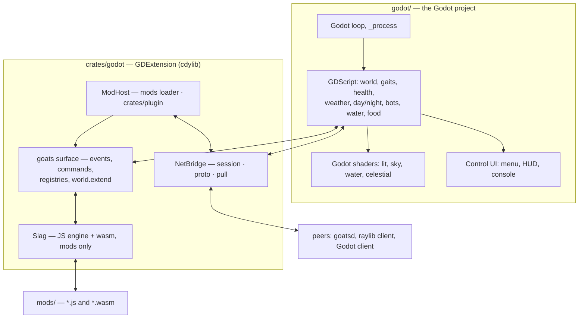

# Porting Slag Goat to Godot — plan

**Status:** architecture decided, scaffold landed. The Godot project is `godot/`;
the GDExtension is `crates/godot`. What runs today is the two verification gates
described in section 3 — nothing is a game yet.

**The decided architecture**

- **Godot owns the game.** The main loop, rendering, UI, input, audio and the
  simulation are Godot's: the 13,538-line JS scene is rewritten in GDScript.
  JavaScript does not run the frame.
- **Slag is embedded as a mod-only runtime.** The JS engine is present for mods
  (`APIv1.md`), not for the game, so a mod's cost is a mod's problem and never
  the frame's.
- **The Rust crates are reused behind a GDExtension.** `session`, `proto`,
  `mods`, `pull` and `plugin` are linked unchanged by `crates/godot`, which is
  what makes the wire compatible with the existing client rather than merely
  similar to it (section 7).

This is a *rewrite* of the game with a *kept* backend. Sections 4 and 10 say
what that costs and where to start.

---

## 1. The shape



The seam is deliberately narrow and in one direction at a time: GDScript calls
into `crates/godot` for networking and for mods, and `crates/godot` calls back
into GDScript only through the `goats` surface a mod asked for.

## 2. What has to move

| Layer | Size | Where it goes |
| --- | --- | --- |
| Scene JS (`game/*.js`, 18 files) | 13,538 lines | **Rewritten** as GDScript |
| Shader programs (GLSL 330) | 7 (+ skinned variants) | **Re-authored** in Godot's shading language |
| Mod API surface (`APIv1.md` §4) | ~17 member groups | Re-exposed to JS mods, backed by GDScript |
| `proto` (protocol + packed wire) | 1,970 lines incl. tests | **Reused** unchanged |
| `session` (iroh transport) | 2,595 lines incl. tests | **Reused** unchanged |
| `mods` (loader) | 2,088 lines | **Reused** unchanged — pure Rust |
| `plugin` (wasm ABI v1) | 819 lines | **Reused** unchanged |
| `pull` (mod sync) | 598 lines | **Reused** unchanged |
| `goats` host (bridge, audio, android) | ~4.2k lines | Rewritten: bridge in Rust, audio in Godot |
| `harness` (scene tests) | ~11.7k lines, 205 cases | **At risk** — see section 9 |

The asymmetry from the original assessment survives the decision, and is now the
whole point of the shape: **the Rust that is pure logic is reused, the JS is
not.** `proto`, `session`, `mods`, `pull` and `plugin` have no renderer, no
window and no engine in them, so a GDExtension links them as-is.

## 3. What already works (verified)

Three headless gates in `godot/tools/`, all green against Godot 4.7.2.

**The model** (`verify_model.gd`): all 14 clips with their exact durations, all
15 bones (`Root`, `Spine`, `Neck`, `Head`, `Tail`, `LidL`, `LidR` among them),
all 5 surfaces named as the scene expects, and the fleece's diffuse and normal
maps intact (1024×1040, non-power-of-two). Godot honours
`KHR_texture_transform`, which raylib ignores — so the fur is *correct* here
where the shipped client's is stretched. `project.godot` pins
`gltf/embedded_image_handling = 3` so the textures stay inside the imported
scene.

**The extension** (`verify_extension.gd`):

```
Initialize godot-rust (API v4.7.stable.official, runtime v4.7.2.stable.official, safeguards strict)
class registered: ModHost    extends Node: true
class registered: NetBridge  extends Node: true
ModHost.eval_js("1 + 1") -> ok
NetBridge.poll_events() -> 0 event(s)
OK: the GDExtension loads and answers from Rust
```

So the toolchain question is answered: **godot-rust 0.5.5 supports 4.7** (via its
`api-4-7` feature, so no Godot binary is needed at build time), the crate links
as a workspace member, and Godot loads and calls into it. `crates/godot/build.sh`
builds and stages the library; `godot/goat.gdextension` points at it.

**The mod runtime** (`verify_mods.gd`): the repository's own `mods/`
directory — the same one the raylib client loads — is discovered by
`crates/mods`, and the checked-in example mod is then run end to end:

```
load_mods -> 5 mod(s) in .../mods
load order: ["com.example.jitprobe", "com.github.sdgoij.goats.birds",
             "com.github.sdgoij.goats.fatguy", "com.github.sdgoij.goats.hello",
             "com.github.sdgoij.goats.wasm"]
load_mod -> loaded com.github.sdgoij.goats.hello (2 asset(s))
hello -> ok hello world
the HUD hook produced 1 line(s):
  drawText "example mod  14:30" at (900, 16) size 20 rgba(255, 235, 160, 220)
assets: ["mod:com.github.sdgoij.goats.hello:sfx.bleat:0.wav",
         "mod:com.github.sdgoij.goats.hello:sfx.bleat:1.mp3"]
OK: the loader loads the repository's mods and the example runs end to end
```

Three things are happening, and two of them are `crates/mods` rather than this
crate: **discovery, validation, ordering and the asset reads are the loader
crate's** (the `loadAfter` order above is its `order()`, the digests are its
FNV hashes, and nothing reaches a mod by path); the entry runs **wrapped in its
own `goats.begin(id)` scope**, which is what `Manifest::entry_js` produces; and
only then does the seam do its work — the mod registers a command with
`goats.command`, the host invokes it and gets the reply, its `"hud"` hook reads
`goats.world.time()` (a native read of a value the core pushed) and calls
`rl.drawText`, which lands in the extension's queue for Godot to draw. The
`goats`/`rl` facade is `crates/godot/src/prelude.js`; the native capabilities it
leans on are registered in `crates/godot/src/lib.rs`.

**The networking bridge** (`verify_net.gd`): two `NetBridge` nodes — a host and
a joiner — meet over iroh on loopback, with a real ticket and no window:

```
host -> ok
ticket: endpointab7reluryzrukeqdcfpxeqsf...
join -> ok
welcome:        {"name":"alice","type":"welcome"}
host joined:    {"name":"alice","type":"joined"}
host roster:    {"names":["bob","alice"],"type":"roster"}
client roster:  {"names":["bob","alice"],"type":"roster"}
host heard:     {"direct":false,"from":"alice","text":"hello","type":"chat"}
client heard:   {"direct":true,"from":"bob","text":"psst","type":"chat"}
host saw:       {"name":"alice","state":{"gait":"trot",...},"type":"peer"}
OK: two Godot peers meet over the session crate's own wire
```

This is the automation of the two-window check, and it mirrors the client's own
`two_bridges_meet_over_loopback` case. Because both ends *are* `session` and
`proto`, it exercises the real ALPN, the framed control channel, the join
handshake, the world-mod digest comparison and the packed peer datagram — the
wire the raylib client and `goatsd` speak, not a resemblance of it.

The lines are the client's vocabulary field for field, because
`crates/goats/src/net.rs` serialises its own `Event` with `#[serde(tag =
"type", rename_all = "snake_case")]`: the tag is `type`, `BlastReport` is
`blast_report`, a peer's pose is nested under `state` rather than flattened, and
the world's fields sit directly on the event. Matching that exactly is what makes
"a scene written against `net.js` reads these unchanged" true rather than
aspirational — and the first draft of this bridge did *not* match it (it tagged
events `kind`, flattened the pose and dropped the world's fields), which is worth
knowing about a claim like that.

**The interop check** (`interop.sh`): the *shipping* host, and a Godot client
joining it. Both modes run against the built `target/release/goatsd.exe`:

```
$ godot/tools/interop.sh                 # goatsd --no-mods: the client joins
welcome:         {"name":"godot","type":"welcome"}
roster:          {"names":["godot-host","godot"],"type":"roster"}
chat echo:       {"direct":false,"from":"godot","text":"hello from godot","type":"chat"}
world datagrams: 6
world bot 0:     {"gait":"idle","index":0,"phase":0.486,"py":0,"variant":-1,"x":14.56,"yaw":3.2767,"z":4.5}
world weather:   clear at hour 8.0
OK: a Godot client joined goatsd, chatted and mirrored its world

$ godot/tools/interop.sh refuse          # goatsd with the repository's mods/
refusal: {"text":"could not join: refused: world mods do not match
          (missing com.github.sdgoij.goats.birds)","type":"error"}
OK: the host refused the join by mod digest
```

The first proves the transport, the join handshake, the chat routing and the
world's *fields* — bots, weather, streams, meadow, craters, spent — against the
shipping binary rather than between two Godot peers. The second is the one that
matters most: `goatsd` demanded `com.github.sdgoij.goats.birds@1.0.0#4f3291755f0c1837`,
and the Godot client — which hashes nothing itself, it hands the set to
`crates/mods` — was refused by digest with the missing id named. Two
independently built implementations agreeing on a digest handshake is
`APIv1.md` section 6.3 working end to end.

Two caveats the check uncovered and now encodes. `goatsd` loads the shared JS
scene one step per frame, so its *first* snapshots are of a half-built world
with no herd in it: an earlier version waited for any world and got
`"bots":[]`, so this one waits for one that carries bots. And the first version
sampled for three seconds and found no world at all. Both are hints about the
port's own startup — the GDScript core will have the same shape of problem.

**The first scene** (`interop.sh herd`): `scenes/herd.tscn`, the port's first
piece of world. A session is *optional* — with no `GOATSD_TICKET` it boots into
an empty field and says so, which is what a player sees before they host or join
(`interop.sh offline` is the gate for that). Given a ticket, it joins, drains the
bridge once a frame, and hands each world snapshot to `Herd`, which places one
*real* goat per bot the host is simulating:

```
world snapshots: 43, mirroring 7 bot(s)
herd: 7 goat(s), worst gap 0.0781 m, largest bot step 0.4319 m
  bot 0  at (8.770006, 0.0, 2.850001)  ->  (8.77, 0.0, 2.85)  GoatIdle
  bot 1  at (-9.468863, 0.0, 5.801913)  ->  (-9.46, 0.0, 5.82)  GoatWalk
  bot 4  at (-9.299994, 0.0, -4.779997)  ->  (-9.3, 0.0, -4.78)  GoatEat
  bot 5  at (11.81722, 0.0, 3.302228)  ->  (11.81, 0.0, 3.38)  GoatJump
OK: the herd mirrors goatsd's bots
```

It is the client's own mirror rule, ported (`net.js` `updatePeers`): a snapshot
is a *target*, not a teleport; the position eases at a fixed rate per second, so
10 Hz arrivals read as movement; and yaw takes the short way round so a goat
crossing the ±π seam does not spin the long way. The gait picks the clip and the
snapshot's phase poses it, which is the only thing that can pose a one-shot — a
jump in the middle, a death part-way through.

The probe is deliberately not satisfied by agreement alone. It insists the herd
*moved* while it watched (`largest bot step`), because a mirror that agrees with
a herd standing still would pass a weaker test than it looks; it settles for
eight seconds first, so a herd that has not started moving yet is not mistaken
for one that cannot be tracked; and it reports the worst remaining gap —
0.078 m here, against bots covering up to 0.43 m between snapshots.

What it could not do was put the goats *on the ground*: the world snapshot
carries no terrain, so a joiner has to compute it. That is the next gate.

**The ground** (`verify_terrain.gd`): `terrain.gd` is `world.js`'s heightfield,
transcribed — and the oracle is the JavaScript itself, run by the embedded
engine, which is the engine the client runs it on:

```
oracle answered 17 line(s)
compared 17 of 17 sample point(s)
largest disagreement: 0.000000000050 m (tolerance 0.000000001000 m)
  worst at (22.000, 0.000): js 0.87172325296239017, gd 0.87172325301269160
OK: the GDScript heightfield is the scene's heightfield
```

This is the port's first *measured* answer to the determinism risk rather than
an intention, and section 9 has what it means. In short: the transcription is
right — every octave, the bowl, the interpolation and the order — and
bit-exactness is **not reachable**, because the hash takes `sin` at arguments in
the millions where the answer depends on the argument-reduction algorithm. 5e-11
metres is where the two engines stop agreeing.

And with the field in place the herd stands on it, and the ground is *drawn*
from it:

```
grounded gap: 0.0715 m, largest bot step 0.2159 m
ground under the herd: -0.407 .. 0.204 m
terrain mesh: 1 rebuild(s), anchored (0, 0)
OK: the herd mirrors goatsd's bots, on Godot-drawn ground
```

**The ground itself** (`verify_terrain_mesh.gd`): the 48x48 grid the client builds
through `makeModel`, as an `ArrayMesh` -- 2401 vertices and 4608 triangles, a
normal from central differences, a per-vertex material colour from the scene's
palette, a world-space texcoord, and a rebuild only when the snapped anchor moves
(`terrainEnsure`'s 24-unit rule, so a step costs a rebuild and a frame does not):

```
vertices: 2401  triangles: 4608
aabb: [P: (-48.0, -1.45, -48.0), S: (96.0, 2.94, 96.0)]
worst height error: 0.000000 m (float32 grid against the double field)
worst normal error: 0.000000  (normals not facing up: 0)
first triangle normal: (0.003738, 0.997595, 0.069206)
vertices off the palette: 0
follow(30, 7) -> anchor (24, 0), 1 rebuild(s)
OK: the ground is the scene's grid, built from the scene's field
```

Two of those checks exist because the data can look perfect and the picture be
wrong. The **winding** of the first triangle decides whether the ground faces up
at all -- a mesh wound the other way is invisible while every number in it is
right -- and the **normals** have to point at the sky, not downhill. Neither is
visible in a headless run's pixels, which is exactly why they are read from the
buffer.

What is *not* transcribed is the lighting: the scene routes the terrain through
its own lit program and hand-rolled shadow map, and this uses a Godot material,
Godot's light and Godot's shadows. That is the decision from section 5 -- the
look is a Godot look, the ground is the scene's ground.

**The sky** (`verify_sky.gd`): `sky.gd` is `world.js`'s day/night curve and
`lighting.js`'s light, transcribed, and `sky.gdshader` is `sky.js`'s `SKY_FS`.
Godot draws it -- a `shader_type sky` material on the `WorldEnvironment`, with
`EYEDIR` standing in for the view ray the GLSL rebuilds from the camera basis, and
`REALTIME` so the sun moves and the clouds drift -- but what decides the colour of
everything is the curve, so the curve is what the gate measures:

```
compared 345 field(s) over 15 hour(s)
largest disagreement: 0.000000029087 (tolerance 0.000001000000)
  worst at h=17.000 field 17: js 0.86799999999999999, gd 0.86799997091293335
byte mismatches: 0
OK: the GDScript sky is the scene's sky
```

Fifteen hours through the curve, plus the sun's and moon's directions, the light
colour, the ambient and the cloud tints. The 3e-8 above is `Color`'s own float32
storage rather than the arithmetic. Two things this gate *decided* rather than
confirmed. First, `updateLight`'s warmth is derived from the **raw** `sin(a)`, not
from the normalised `SUN_DIR[1]` -- `updateLight` computes it from the local `sunY`
before dividing by the arc's length, and the first version of the port reused the
normalised vector, which moved the horizon's warm band by 0.006. A tidier
transcription would have been quietly wrong about dawn forever. Second, the fields
that must agree *exactly* -- the curve's bytes -- do, because both sides
interpolate in the same order (`a + (b - a) * t`, and not Godot's `lerpf`, which
associates the other way) and then round.

**The grass** (`verify_grass.gd`): `grass.gd` is `weather.js`'s `tuftField`, drawn
as a `MultiMesh`. The hard part is not the drawing: the scene's cell hash is 32-bit
**wrap-around integer mixing** (`Math.imul`, `>>>`, `| 0`) and GDScript's `int` is
64 bits, so the port re-implements the wrap -- and a subtly wrong `imul` is not a
slightly wrong field, it is a different one that still looks like grass.

```
case 0 at (0.0, 0.0): gd 236 tuft(s), js 236
case 1 at (14.5, -3.2): gd 245 tuft(s), js 245
case 2 at (-40.0, 25.0): gd 242 tuft(s), js 242
case 3 at (2.0, 2.0): gd 232 tuft(s), js 232
compared 6685 value(s)
largest disagreement: 0.000000000068 m (tolerance 0.000000001000 m)
count/flag mismatches: 0
OK: the GDScript meadow is the scene's meadow
```

The counts, the near/far flag and the ``eaten`` skip are integers and are compared
exactly; 6.8e-11 m is the same `value_hash` floor the heightfield has, which is
where the two engines' `sin` stops agreeing. The meadow is also *fed*: the world
snapshot's `eaten` keys thin it where the host's herd has grazed.

**The picture** (`interop.sh shot`): every gate above reads buffers, and a buffer
cannot say whether any of it looks like a world -- two of this port's worst bugs
(a ground wound invisible, a sun pointing at the sky) passed every number. So
`shot` runs the real scene against a live `goatsd` in a window and saves it after
ten seconds:

```
screenshot: 600 frames, (1280, 720), save error 0
```

Seven goats -- the real skinned model, at the per-spec scales the scene gives them
-- standing in the swaying grass on the heightfield, lit by the scene's own sun,
under the scene's own dawn sky. The camera moved to do it: three metres up and
fifteen back, which is where the scene's own camera rides, and `TUNING.sky`
`cloudBase` is 5 -- so the camera is *under* the cloud deck, two metres of air
below it. That matters: the march is a function of where the eye is inside the
slab, and from higher up the same deck is a band across the horizon instead of a
canopy overhead. `GOATS_CLOUD` (section 6's staging knobs) is what makes the
cumulus visible at all, because the scene boots `clear`.

Two things the picture is honest about, and neither is a gate. The sun and moon
*discs* are not drawn: `skyBackground` deliberately does not draw one (the note in
`SKY_FS`), and `drawCelestial` -- the spheres and the glare, `world.js` section M2
-- is not ported. And the port's colours run through Godot's linear pipeline: the
sky's are converted to it, so the sky is the scene's sky, while the ground's and
the grass's per-vertex albedos are handed over as the scene authored them, so the
meadow is a shade paler than the client's. Section 9.

**The local goat** (`verify_goat.gd`): `player_goat.gd` is `goat.js`'s gait state
machine, movement and stats — the first thing in the port that is a *game* rather
than a mirror, because the goat is the part that decides. Two things are checked,
and they are the two things a state machine can get wrong. The **speeds**, from the
model's own clip durations (`stride / (duty * clipDuration)`, so a goat moves at
whatever speed keeps its feet from sliding):

```
walk speed: scene 0.872727254 m/s, port 0.872727254 m/s
trot speed: scene 1.577142911 m/s, port 1.577142911 m/s
run speed: scene 2.941176471 m/s, port 2.941176471 m/s
```

And the **frame**, as a scripted input tape run through both sides one frame at a
time — idle, walk, run, a turn, a jump taken at a trot, back to a trot, a sleep and
a wake, a walk *backwards*, then a long run and a long idle:

```
the tape ran 2203 frame(s); compared 17624 value(s)
largest disagreement: 0.000000000000 (tolerance 0.000000001000)
mode mismatches: 0
the port's goat ended as: sleep at (75.116, -21.987), energy 24.00, health 97.00
OK: the local goat is the scene's goat, frame for frame
```

Two thousand frames of walking, turning, jumping, tiring and falling asleep on its
own, and the two agree on the position, the yaw, the phase, the mode, the energy,
the health and the speed at every one of them. The tape is expanded *once* and
handed to both sides as one literal, so they are reacting to one script rather than
to two generators that happen to agree.

The gate also caught the port being *more* right than its own oracle: the first
version injected one duration per role, and the port diverged by 12 frames on the
jump. The port was correct. `cyclePlayerVariant` moves the jump from `GoatJump`
(1.167 s) to `GoatJump2` (1.333 s) and `jumpDuration` reads whichever is current, so
a *cycled variant is a different length* -- which is also why `clip_durations`
returns the whole table.

And then it caught the opposite, which is the more embarrassing half: a goat that is
`standing` was *posing the walk clip*, and neither this gate nor a screenshot had seen
it. `clipRole` is a chain whose last two lines are

```js
if (mode === "idle" && CLIP.idle) return "idle";
return "walk";
```

and the port had inverted the test and swapped the fallback, so every idle goat
walked in place. The gate missed it because **its oracle had been transcribed from
the port rather than from `goat.js`** -- `if (hasRole("walk")) return "walk";` -- and
two copies of one mistake agree perfectly. Writing the oracle from the source is
what found it: the same tape then reported 268 clip-role mismatches, the first at
frame 0, and a phase that advanced at the walk clip's rate instead of the idle's.
The frame line now carries the *clip role* as well as the mode, so the next one of
these cannot hide, and `verify_input.gd` checks the case a person meets first --
stop pressing W, and the goat poses its idle clip (`GoatIdle2`, the second variant,
because settling into idle cycles it).

**The meadow** (`verify_meadow.gd`): grass is a thing a goat can eat, which makes
the cell hash a *gameplay* question and not only a drawing one — where the grass is
is where the food is. `meadow.gd` is `food.js`'s `nearestTuft`, `assignRegrow` and
`updateFood`, and `verify_grass.gd` checks the same hash through the drawing path
while this checks it through the eating one:

```
cell hashes disagreed by at most 0 bit(s)
cell hash mismatches: 0
3 search(es) hit, 0 missed (the oracle's own misses included)
nearest-tuft disagreement: 0.000000000000 m (tolerance 0.000000001000 m)
bite: ok (one tuft, hidden for 79.2 s, then back)
key <-> cell round trip: ok
OK: the GDScript meadow is the scene's meadow, and it can be eaten
```

**Zero bit mismatches** over 49 cells and three hashes each, which is a stronger
claim than a tolerance: the hash is the one part of this port that can be compared
exactly, because it is integer arithmetic in both engines and has no `sin` in it.
The first version of this gate compared the `[0, 1)` the bits divide into, and lost
3.7e-9 — which turned out to be the *gate* dividing after a round trip through a
JavaScript array, not the port. Comparing bits removed the question, and the port's
`Meadow.cell_hash` returns the bit patterns for exactly that reason (section 9).

What is *not* yet proven: the water; the weather state machine (so the scene stays
`clear` without a session, and `GOATS_CLOUD` is a staging knob); the sun and moon
discs; the *devices* — mines, craters and the blast that flings a goat
(`explosions.js`), so a bite cannot yet be a bang and the goat cannot be thrown;
the HUD as a `Control` tree, the menu and the console (stage 6 — there is a
one-`Label` read-out and no way to paste a ticket *in game*); the bots' own AI in
GDScript (the herd is still a mirror); audio; the mods state, bites, bangs and voice
reaching GDScript (they are carried on the wire but the core does not consume them
yet, and the Godot client publishes its own goat but does not yet report a bite —
`NetBridge` has no `consume`); the asset bytes reaching an engine shim
(`rl.loadSound` and friends) rather than a map; the tuning merge, reload and the
file watcher; the wasm path through `crates/plugin`; and the other 16 `goats` member
groups. Those are sections 6 and 7.

## 4. Why this shape, and what it costs

The original assessment weighed three strategies and recommended keeping the JS
scene and emulating raylib on Godot. The decision inverts that, and the reason is
the mod split: **once JavaScript is kept for mods, there is no reason for it to
run the game.**

Emulating raylib on Godot (the rejected strategy A) would have meant a ~143-member
`rl` shim sitting between 13.5k lines of JS and Godot's scene tree — Godot's
weight paid for, Godot's model barely used, and a shim to maintain forever. The
chosen shape spends the same GDScript effort on the game itself and uses Godot
directly.

What it costs, stated plainly:

- **The simulation is re-derived, not ported.** Gaits, energy/health, weather
  easing, the seeded noise, the mine field, the terrain function — all of it must
  come out the same as the JS, or records drift and peers desync. This is the
  largest and subtlest cost (section 9).
- **The harness is the casualty.** 205 scene cases run the JS scene on Slag with
  a recording `rl`. Rewrite the scene and they no longer apply (section 9).
- **Every shader is re-authored.** Not translated: the maths carries over, the
  entry points and built-ins do not (section 5).

What it buys: the editor, the renderer (shadows, sky, AA, mobile/console export),
Godot's UI and audio, and a mod runtime that cannot affect the frame except by
the work it is asked to do.

## 5. What the GDScript core has to reproduce

The reference for each system is the JS file, and the JS file is the
specification: the rewrite is judged against `shots_*`, `shot_*.png` and
`goats.mp4`.

| System | Reference | Godot home |
| --- | --- | --- |
| Terrain heightfield (3-octave noise, materials, drifting) | `game/world.js` | **Done**: `terrain.gd` (the field) + `terrain_mesh.gd` (the grid) |
| Grass field (per-cell hash, follows the goat, sways) | `game/weather.js` | **Done**: `grass.gd`, a `MultiMesh` |
| Gaits, speed from stride/duty, health/energy | `game/goat.js` | **Done**: `player_goat.gd`, gated frame for frame |
| Day/night clock, sky, sun/moon, stars | `game/world.js`, `game/lighting.js` | **Done** apart from the sun and moon discs: `sky.gd` + `sky.gdshader` |
| Lighting + shadows | `game/lighting.js` | `DirectionalLight3D` + Godot's shadow atlas |
| Water pools (level, chop, fresnel) | `game/water.js` | mesh + `ShaderMaterial` |
| Weather state machine, wind | `game/weather.js` | GDScript; must stay deterministic |
| Bots (collision, temperaments, fleece) | `game/bots.js` | GDScript + `MultiMesh` |
| Mines, craters, flipbook FX | `game/explosions.js` | GDScript + generator atlases |
| Menu, HUD, console | `game/menu.js`, `console.js` | `Control` trees |
| Touch surface | `game/touch.js` | `InputEventScreenTouch` |

Two decisions were settled with the plan and are recorded where they belong:

- **Shadows: use Godot's.** `lighting.js` renders its own depth pass into a
  render texture, packs depth across RGB and samples it with a 3×3 PCF kernel,
  with `K` cycling map / planar / off. That pipeline is not reproduced. Godot's
  shadow atlas is the shadow system, and `K` keeps only the planar fallback as a
  debug view.
- **The sky still ports, and it landed that way.** The best fit in the whole
  port — `sky.js` is already a full-screen fragment shader that rebuilds the
  camera ray and raymarches a cloud slab, which is what `shader_type sky` is for.
  It went in without a rewrite: `EYEDIR` replaced the rebuilt ray, the raylib
  uniforms became shader parameters, and the march count is still the Clouds
  setting (`TUNING.sky.steps`). Two things are *not* the scene's: the slab needs
  the eye's world position (Godot's sky is at infinity, and the density is a
  function of where the eye sits inside the slab), and Godot's linear pipeline
  means display-space colours have to be converted — which `sky.gd` does on the
  CPU and the ground does not, section 9.

`GPU_SKINNING` disappears: Godot always skins on the GPU, so the plain/skinned
shader duality in `lighting.js` — which exists only because raylib can be built
either way — collapses to one family.

## 6. Modding: Slag as a mod-only runtime

A mod is JavaScript (`entry` in `mod.json`) against the `goats` handle, or a wasm
module (`ABIv1.md`), or both. Both are kept.

The options, unchanged from the original assessment, are why:

| Option | Existing mods work? | Sandbox (`APIv1.md` §0) | Verdict |
| --- | --- | --- | --- |
| **Embed Slag** in the GDExtension | **Yes** | Yes — host-provided surface only | **Chosen** |
| Embed QuickJS | Mostly (no JIT) | Yes | Rejected: Slag is already here and has wasm too |
| wasm mods only (`ABIv1`) | No — a narrower ABI | Yes, structurally | Kept as the second path |
| GDScript / C# mods | No | **No** — real file access | Rejected: it deletes the guarantee |
| Native/GDExtension mods | No | **No** | Rejected by `ABIv1.md` §6 |

**What "embed Slag" means here.** `crates/godot` owns a `Context`, the mod loader
loads and validates manifests, and each JS mod's entry is evaluated inside a
per-mod `goats` handle — the same split as today, with the engine's embedding API
(`create_object`, `create_function`, `register_fn`, the re-entrant
`FunctionCall::call`/`eval`) building the surface. The wasm path is
`crates/plugin` driving `slag::wasm`, unchanged.

**The one hard problem: the `goats` surface is now a cross-language bridge.**
Today the surface is JS-to-JS: a mod calls `goats.world.terrainHeight(x, z)` and
the scene's own JavaScript answers. With the world in GDScript, every such call
crosses JS → Rust → GDScript and back. The surface is ~17 member groups
(`APIv1.md` §4), including `world.extend` (a mod's own simulated entities,
synced to peers) and `entities` (one mod seeing another's). Design options:

- **Register callbacks from GDScript.** The core registers handlers for each
  surface member at startup; the Rust side is a shim that calls them. Simple, and
  the surface stays exactly as documented; the cost is a crossing per call.
- **Cache into the extension.** The core pushes the values a mod is allowed to
  read (player state, belly, terrain height, weather) into the extension each
  frame; most reads then never cross. The writable half (`commands`, `events`,
  `world.extend`) still crosses.
- **Move the surface's state into the extension.** The most invasive, and it
  duplicates the world.

Recommendation, now followed: a per-frame push of the readable values plus
callbacks for the rest — it keeps the hot reads off the boundary without
inventing a second copy of the world. `ModHost::set_world_time` is the first
instance of the push half; `goats.command` and `goats.on` are the first of the
callbacks. This is a design task in its own right, not a port, and it should be
scoped as one.

**Decided: a JS mod keeps an engine drawing surface.** Today a mod gets both
`goats` *and* the engine's `rl`, so it can build geometry and textures in JS.
Godot has no raylib, so the extension hosts a Godot-backed drawing shim and
`rl` survives as a facade over it — which is what keeps `birds` and `fatguy`
working unchanged. `crates/godot/src/prelude.js` is where that facade begins,
with `rl.drawText` forwarding to the extension and Godot drawing the result; the
remaining members arrive with the shim proper.

## 7. Multiplayer: wire-compatible by construction

The target is checkable — the existing `crates/session` tests are the spec — and
it is met by linking the crates rather than reimplementing them.

| Requirement | Detail | Source |
| --- | --- | --- |
| Transport | iroh QUIC endpoint, `presets::N0` (n0 relays + DNS discovery) | `session::bind_endpoint` |
| ALPN | `goats/{PROTOCOL_VERSION}`, plus mod fetch `goats-mods/…` | `session::alpn`, `proto::mod_fetch_alpn` |
| Addressing | an iroh `EndpointTicket` string (the "ticket") | `iroh-tickets` |
| Control channel | one-shot length-framed JSON messages, one per uni stream | `proto::encode_frame` |
| High-rate channel | unreliable **postcard** datagrams: `Peer`/`World`/`Mods`/`Voice`, quantized per `wire.rs` | `crates/proto/src/wire.rs` |
| Join handshake | `Hello {version, name, mods}` → `Welcome {…}`; world-mod digest ⇒ accept/refuse | `APIv1.md` §6.3 |
| Voice | Opus frames as `Voice` datagrams | `proto::VoiceFrame` |
| Mod sync | fetch-ALPN request/reply, verified against the announced identity | `crates/pull` |

The bridge is `net::NetBridge` in `crates/godot`, and it is built: `host`,
`join`, `say`, `pose`, `leave` and `poll_events`, tokio on its own thread exactly
as `crates/goats/src/net.rs` does, and a queue of JSON event lines in place of
the signal stream. `event_json` carries the client's vocabulary field for field,
including the world snapshot — bots, weather, streams, meadow, craters and spent
— which is the one a joiner has to mirror. What GDScript does **not** yet consume
is the mods state, bites, bangs and voice; those are carried on the wire but have
no reader in the core yet, which is stage 3's business rather than this crate's.

Verified so far by `verify_net.gd` (two Godot peers) and by `interop.sh`
(a Godot client against the shipping `goatsd`, in both the join and the refusal
mode) — section 3. What the interop run adds over the peer check is that the far
end is a *separately built* binary: the digest handshake, the ticket, the framed
handshake and the world datagrams all have to agree with code that shares no
crate version with this one at link time.

Two things this does *not* solve, both worth knowing now:

- **Determinism across engines.** A world mod's PRNG draws and the sim's seeded
  maths must produce the same numbers in GDScript as in JS on Slag. GDScript
  floats are `double`, Godot's `sin`/`cos` are its own. If they differ, a Godot
  peer can desync from a raylib peer *with a byte-identical protocol*. This is
  the port's sharpest risk and the reason the deterministic systems should be
  validated against golden values captured from the JS before the rewrite of
  each one.
- **Voice** needs a microphone path and an Opus stream in Godot (the shipped
  client uses cpal + a raylib stream). Godot's `AudioStreamGenerator` plus a
  capture effect is the shape; the existing speech gate and Opus coding port.

## 8. Work breakdown

Sizes are judgement, not measurement.

| # | Stage | Done when | Size |
| --- | --- | --- | --- |
| 0 | Scaffold | model + extension gates green — **done** | — |
| 1 | Mod host in the extension | the repository's mods are discovered by `crates/mods` and the example loads, registers, runs and draws back — **discovery, manifests, ordering, assets and one entry done**; the tuning merge, reload/watch, the asset-to-engine path, the wasm path and the other 16 member groups remain | 2–3 |
| 2 | NetBridge | a Godot client joins `goatsd`; roster, chat, goat snapshots, world — **all four verified against the shipping `goatsd`, peer-to-peer and cross-engine, with the world's fields carried**; the core's consumption of them, and the mods, bite, bang and voice paths, remain | 3–4 |
| 3 | Core world in GDScript | terrain, grass, gaits, health/energy, clock; a goat moves — **done: the field, the grid, the meadow, the sky with its light and the local goat with its gaits, health and energy are all in and gated against the scene's own, and `interop.sh shot` is a live host's herd with your goat in it**; the HUD as a `Control` tree and the bots' own AI remain | 2–3 |
| 4 | Weather, bots, food, mines | the README's world features, rules matching the JS | 3–5 |
| 5 | Shaders | lit, sky, water, celestial; `K`/`L`/`B` decided — **the sky is in (`sky.gdshader`) and the lit and shadow work is Godot's own materials and lights; water and the celestial discs remain** | 3–5 |
| 6 | UI | menu, HUD, console, Mods screen as `Control` trees | 2–3 |
| 7 | Audio | music/SFX; voice through Godot's audio + the existing Opus path | 2–3 |
| 8 | Mod surface | the `goats` bridge; JS mods load; the two examples work (or are reworked) | 4–6 |
| 9 | Platforms | desktop, Android, web export presets + CI | 2–4 |
| 10 | Tests | golden-value checks per deterministic system; GUT/GdUnit for the core | 3–6 |

Roughly **a quarter or two**, with stages 4, 8 and 10 carrying the uncertainty.
Stage 2 is independent of everything else and can start immediately.

## 9. Risks

- **Determinism (highest — now measured).** The wire is only half the contract;
  the maths must match, because the device field is *derived* from the seed rather
  than sent. The terrain port is the first system to answer this with numbers
  rather than intentions (`verify_terrain.gd`), and the answer is: the
  transcription is right, and **bit-exactness is not reachable**.

  `value_hash` is `sin(n * 127.1) * 43758.5453` with `n` running to tens of
  thousands, so the sine is taken at arguments in the millions — where the result
  depends on the argument-reduction algorithm and how many bits of pi the
  implementation carries. Godot's `sin` is not Rust's, which is what the scene's
  `Math.sin` bottoms out in, and across 17 sample points the two agree to
  **5.0e-11 m** and no closer. Everything else in the field (the octaves, the
  bowl, the interpolation, the order) is identical, which the same check shows.

  What that costs: sub-nanometre ground, and — for the one thing derived rather
  than sent — a chance of two peers disagreeing about a device that is the odds
  of a hash landing within 5e-11 of a threshold. It cannot accumulate, because
  spent devices and craters travel on the wire. This is the shape any later
  deterministic system should be checked in: transcribe it, then measure the
  residual against the JavaScript and say what it costs.

  The port also found a Godot 4.7 trap worth knowing about a language with no
  compiler: `var x := <call to a static function of the same class>` makes
  GDScript's analyser **loop forever** — the class never compiles and any call
  into it hangs the process, with no error and nothing on stderr. `terrain.gd`
  annotates every local for that reason, and the gates are run under `timeout`
  because a hang is otherwise indistinguishable from a slow start.

- **An extension class as a node type in a `.tscn`.** Found the hard way, and the
  sibling of the trap above: a `class_name` script and a GDExtension class cannot
  be used as a *node type* in a scene dependably, because the import pass is what
  registers the name and a scene parsed before that pass cannot resolve it. The
  failure is silent — the node is simply absent, and `$NetBridge` comes back
  null. It then fails *once per frame*, not once: this produced 4310 identical
  `Cannot call method 'call' on a null value` errors at 60 fps, with no line
  pointing at the scene. `herd.tscn` therefore references scripts by path, and
  the bridge is built with `ClassDB.instantiate` in code.

- **The front-face convention — found by looking, not by reading.** raylib and
  Godot wind a front face in *opposite* directions. The scene's `terrainIndices`
  (`a, c, b` / `b, c, d`) is Godot's *back* face, so the ground was culled: not
  dim, not dark, simply not there — while every number in the mesh was correct and
  every gate that reads buffers passed. `terrain_mesh.gd` therefore mirrors the
  winding, and `verify_terrain_mesh.gd` checks it against Godot's own `Plane` so
  the assertion is Godot's rule rather than the author's. This and a sun
  transform pointing at the sky were both invisible in data and obvious in one
  image, which is the whole argument for `tools/screenshot.gd`.
- **The harness (highest, and it is a real loss).** 205 cases encode the current
  behaviour precisely; they cannot run against GDScript. They should be mined for
  golden values and re-expressed, not discarded — and that is stage 10, not an
  afterthought.
- **The `goats` bridge.** The mod API is the most JS-shaped part of the codebase,
  and it is being pulled across two language boundaries. Budget it as design work.
- **A runaway mod still hangs a frame.** True today (`ABIv1.md` §3.6 has no fuel
  budget); Godot changes nothing.
- **Web export.** Godot's web build has threading constraints and iroh in a
  browser is unproven; treat web multiplayer as a spike, not a stage.
- **The display-space/linear split between the two pipelines.** The scene writes a
  plain framebuffer, so its colours are display-space; Godot renders in linear and
  encodes to sRGB at the end. The port converts where it is cheap and it shows --
  the sky's curve colours and cloud tints, once on the CPU in `sky.gd` -- and
  leaves the ground's and the grass's per-vertex albedos as the scene authored
  them. So the sky is the scene's sky and the meadow is a shade paler than the
  client's. Doing it properly is `srgb_to_linear()` on `terrain_mesh.gd`'s colours
  and `Image.FORMAT_SRGB8` for its detail texture, and then the *light* needs
  re-tuning, because the scene multiplies in display space and Godot multiplies in
  linear. Worth knowing before the pallor is mistaken for a bug in the
  heightfield.
- **Godot's vector types are float32, and a value type that silently rounds is a
trap for a deterministic port.** Found by a gate, and it is the kind of thing that
reads as a *deterministic* divergence until you look. `Meadow.cell_hash` began by
returning the cell's three hashes as a `Vector3` — natural, and allocation-free,
which is why it was chosen — and a `Vector3` stores float32, so the `[0, 1)` a cell
divides into came back good to only ~4e-9. That is nothing for the jitter of a tuft
(±0.9 m) and fatal for anything that *compares* one, which is exactly what a cull
radius and a reach test do: the meadow's own gate then disagreed with the scene
about whether three tufts were in reach. The fix is the shape a GDScript port has to
keep reaching for: `cell_hash` returns the raw **uint32 bit patterns** in a
`Vector3i`, and `Meadow.unit` does the division in double precision at the call
site. Every float in a `Vector2`/`Vector3`/`Color` in this project is float32 —
including, as sections 3 and 9 note, the sky's — so a value that has to survive a
comparison should be carried as an integer or a double and narrowed as late as
possible.
- **An oracle written from the port proves nothing, and it is the easiest mistake
  here to make.** Every gate in this project checks a transcription against the
  JavaScript the scene runs, and every one of them had to be *written from
  `crates/goats/src/game/`*, not from the file it was checking. That is one edit away
  from going wrong, and it went wrong: `player_goat.gd`'s `clip_role` had an
  inverted `idle` test and a swapped fallback, so a standing goat posed the walk
  clip, and `verify_goat.gd` agreed with it because the oracle had the same two
  mistakes. A gate whose oracle is copied from the code under test is a tautology
  with extra steps, and it looks exactly like a passing gate. What closes it: a
  second, independent assertion (the clip role *on the wire line*, and
  `verify_input.gd` asserting the pose a person sees), and reading the source when
  the transcription is written rather than when it fails.
- **A second engine to maintain.** The raylib client and the Godot port share a
  protocol and a mod format but not a line of code. Every balance or protocol
  change now has two homes.
- **GDExtension weight.** `iroh` + tokio + Slag in one `cdylib` is a lot of
  runtime behind an engine plugin; build time and binary size both grow, and the
  Android/web targets are harder again. Stage 2 measures this.

## 10. Next steps

Both spikes have landed, and the interop check passes in both modes: a Godot
client joins the shipping `goatsd`, chats, receives its world, and is refused by
digest when it presents the wrong mods (section 3). And the scene is a *game*: a goat
you drive, on a heightfield, in a meadow it can eat, under the scene's own sky, with
a host's herd mirrored alongside it and your goat published back. The next steps, in
order:

1. **The devices (stage 4's sharp end).** Mines, craters and the blast that flings a
goat: `explosions.js`. It is the largest single feature left, it is what the
meadow's *trapped* tufts and the goat's `flung` mode are waiting for, and it is the
one system that changes the ground under the goat (a crater is a term in
`terrainHeight`, so it reaches the mesh, the grass and both shadows for free).
2. **The HUD, the menu and the console (stage 6).** There is a one-`Label` read-out
and no way to paste a ticket, choose a setting or ask the world a question; every
staging knob is an environment variable because of it. The console is the port's own
debug surface and the mods' (`goats.command`), so it pays twice.
3. **The weather state machine and the celestial bodies.** The machine is what takes
the sky from `clear` to `rain` on its own and makes `GOATS_CLOUD` unnecessary; the
sun and moon *discs* (`drawCelestial`) are the last piece of the sky.
4. **Water, then the bots' own AI in GDScript.** The herd is a mirror; a scene that
simulates its own bots is what makes `goatsd` optional rather than required.
5. **Finish stage 1's edges.** The `tuning.json` merge, reload and `--watch`,
asset bytes handed to an engine shim rather than a map, the wasm path through
`crates/plugin`, and the remaining `goats` member groups.

Order 1–4 is the scene's own roadmap read in the port's direction; 5 is independent
and is the cheaper win whenever the context is fresh.

---

*Verified while writing this: Godot 4.7.2 imports `goat_animated.glb` with all
14 clips, 15 bones, 5 materials and the fleece textures
(`godot/tools/verify_model.gd`); loads `crates/godot`'s library, registering
`ModHost` and `NetBridge` (`godot/tools/verify_extension.gd`); discovers the
repository's five mods through `crates/mods` and runs the checked-in example
through the embedded engine, invoking its command and receiving its `rl.drawText`
(`godot/tools/verify_mods.gd`); carries a session, roster, chat and goat
snapshots between two Godot peers over iroh (`godot/tools/verify_net.gd`); joins the shipping `goatsd`, accepted and
mirroring its world in one mode and refused by digest in another
(`interop.sh join`, `interop.sh refuse`); runs the mirror scene against it,
standing seven real goats on Godot-drawn ground at a 0.07 m worst gap
(`interop.sh herd`); measures the ported heightfield against the JavaScript one
at 5.0e-11 m (`godot/tools/verify_terrain.gd`); and builds the scene's own 48x48
grid from it, wound and normalised the way the client winds it
(`godot/tools/verify_terrain_mesh.gd`). Every one of them exits zero.
The rest is read from the tree.*
