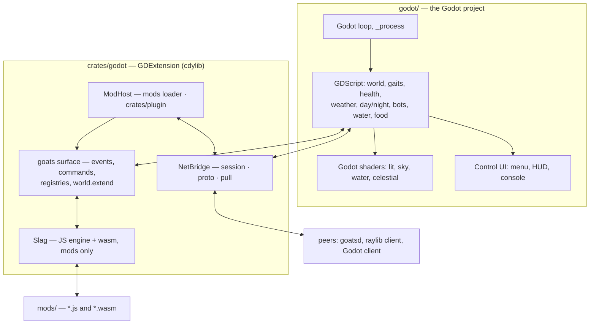

# Porting Slag Goat to Godot — plan

**Status:** architecture decided, scaffold landed. The Godot project is `godot/`;
the GDExtension is `crates/godot`. What runs today is the two verification gates
described in section 3 — nothing is a game yet.

**The decided architecture**

- **Godot owns the game.** The main loop, rendering, UI, input, audio and the
  simulation are Godot's: the 13,538-line JS scene is rewritten in GDScript.
  JavaScript does not run the frame.
- **Slag is embedded as a mod-only runtime.** The JS engine is present for mods
  (`APIv1.md`), not for the game, so a mod's cost is a mod's problem and never
  the frame's.
- **The Rust crates are reused behind a GDExtension.** `session`, `proto`,
  `mods`, `pull` and `plugin` are linked unchanged by `crates/godot`, which is
  what makes the wire compatible with the existing client rather than merely
  similar to it (section 7).

This is a *rewrite* of the game with a *kept* backend. Sections 4 and 10 say
what that costs and where to start.

---

## 1. The shape



The seam is deliberately narrow and in one direction at a time: GDScript calls
into `crates/godot` for networking and for mods, and `crates/godot` calls back
into GDScript only through the `goats` surface a mod asked for.

## 2. What has to move

| Layer | Size | Where it goes |
| --- | --- | --- |
| Scene JS (`game/*.js`, 18 files) | 13,538 lines | **Rewritten** as GDScript |
| Shader programs (GLSL 330) | 7 (+ skinned variants) | **Re-authored** in Godot's shading language |
| Mod API surface (`APIv1.md` §4) | ~17 member groups | Re-exposed to JS mods, backed by GDScript |
| `proto` (protocol + packed wire) | 1,970 lines incl. tests | **Reused** unchanged |
| `session` (iroh transport) | 2,595 lines incl. tests | **Reused** unchanged |
| `mods` (loader) | 2,088 lines | **Reused** unchanged — pure Rust |
| `plugin` (wasm ABI v1) | 819 lines | **Reused** unchanged — and now *linked* by `crates/godot`, so a `.wasm` mod is decoded, instantiated and stepped from Rust on the Godot client too (`ABIv1.md`, section 6) |
| `pull` (mod sync) | 598 lines | **Reused** unchanged |
| `goats` host (bridge, audio, android) | ~4.2k lines | Rewritten: bridge in Rust, audio in Godot |
| `harness` (scene tests) | ~11.7k lines, 205 cases | **At risk** — see section 9 |

The asymmetry from the original assessment survives the decision, and is now the
whole point of the shape: **the Rust that is pure logic is reused, the JS is
not.** `proto`, `session`, `mods`, `pull` and `plugin` have no renderer, no
window and no engine in them, so a GDExtension links them as-is.

## 3. What already works (verified)

Three headless gates in `godot/tools/`, all green against Godot 4.7.2.

**The model** (`verify_model.gd`): all 14 clips with their exact durations, all
15 bones (`Root`, `Spine`, `Neck`, `Head`, `Tail`, `LidL`, `LidR` among them),
all 5 surfaces named as the scene expects, and the fleece's diffuse and normal
maps intact (1024×1040, non-power-of-two). Godot honours
`KHR_texture_transform`, which raylib ignores — so the fur is *correct* here
where the shipped client's is stretched. `project.godot` pins
`gltf/embedded_image_handling = 3` so the textures stay inside the imported
scene.

**The extension** (`verify_extension.gd`):

```
Initialize godot-rust (API v4.7.stable.official, runtime v4.7.2.stable.official, safeguards strict)
class registered: ModHost    extends Node: true
class registered: NetBridge  extends Node: true
ModHost.eval_js("1 + 1") -> ok
NetBridge.poll_events() -> 0 event(s)
OK: the GDExtension loads and answers from Rust
```

So the toolchain question is answered: **godot-rust 0.5.5 supports 4.7** (via its
`api-4-7` feature, so no Godot binary is needed at build time), the crate links
as a workspace member, and Godot loads and calls into it. `crates/godot/build.sh`
builds and stages the library; `godot/goat.gdextension` points at it.

**The mod runtime** (`verify_mods.gd`): the repository's own `mods/`
directory — the same one the raylib client loads — is discovered by
`crates/mods`, and the checked-in example mod is then run end to end:

```
load_mods -> 5 mod(s) in .../mods
load order: ["com.example.jitprobe", "com.github.sdgoij.goats.birds",
             "com.github.sdgoij.goats.fatguy", "com.github.sdgoij.goats.hello",
             "com.github.sdgoij.goats.wasm"]
load_mod -> loaded com.github.sdgoij.goats.hello (2 asset(s))
hello -> ok hello world
the HUD hook produced 1 line(s):
  drawText "example mod  14:30" at (900, 16) size 20 rgba(255, 235, 160, 220)
assets: ["mod:com.github.sdgoij.goats.hello:sfx.bleat:0.wav",
         "mod:com.github.sdgoij.goats.hello:sfx.bleat:1.mp3"]
OK: the loader loads the repository's mods and the example runs end to end
```

Three things are happening, and two of them are `crates/mods` rather than this
crate: **discovery, validation, ordering and the asset reads are the loader
crate's** (the `loadAfter` order above is its `order()`, the digests are its
FNV hashes, and nothing reaches a mod by path); the entry runs **wrapped in its
own `goats.begin(id)` scope**, which is what `Manifest::entry_js` produces; and
only then does the seam do its work — the mod registers a command with
`goats.command`, the host invokes it and gets the reply, its `"hud"` hook reads
`goats.world.time()` (a native read of a value the core pushed) and calls
`rl.drawText`, which lands in the extension's queue for Godot to draw. The
`goats`/`rl` facade is `crates/godot/src/prelude.js`; the native capabilities it
leans on are registered in `crates/godot/src/lib.rs`.

**The networking bridge** (`verify_net.gd`): two `NetBridge` nodes — a host and
a joiner — meet over iroh on loopback, with a real ticket and no window:

```
host -> ok
ticket: endpointab7reluryzrukeqdcfpxeqsf...
join -> ok
welcome:        {"name":"alice","type":"welcome"}
host joined:    {"name":"alice","type":"joined"}
host roster:    {"names":["bob","alice"],"type":"roster"}
client roster:  {"names":["bob","alice"],"type":"roster"}
host heard:     {"direct":false,"from":"alice","text":"hello","type":"chat"}
client heard:   {"direct":true,"from":"bob","text":"psst","type":"chat"}
host saw:       {"name":"alice","state":{"gait":"trot",...},"type":"peer"}
OK: two Godot peers meet over the session crate's own wire
```

This is the automation of the two-window check, and it mirrors the client's own
`two_bridges_meet_over_loopback` case. Because both ends *are* `session` and
`proto`, it exercises the real ALPN, the framed control channel, the join
handshake, the world-mod digest comparison and the packed peer datagram — the
wire the raylib client and `goatsd` speak, not a resemblance of it.

The lines are the client's vocabulary field for field, because
`crates/goats/src/net.rs` serialises its own `Event` with `#[serde(tag =
"type", rename_all = "snake_case")]`: the tag is `type`, `BlastReport` is
`blast_report`, a peer's pose is nested under `state` rather than flattened, and
the world's fields sit directly on the event. Matching that exactly is what makes
"a scene written against `net.js` reads these unchanged" true rather than
aspirational — and the first draft of this bridge did *not* match it (it tagged
events `kind`, flattened the pose and dropped the world's fields), which is worth
knowing about a claim like that.

**The interop check** (`interop.sh`): the *shipping* host, and a Godot client
joining it. Both modes run against the built `target/release/goatsd.exe`:

```
$ godot/tools/interop.sh                 # goatsd --no-mods: the client joins
welcome:         {"name":"godot","type":"welcome"}
roster:          {"names":["godot-host","godot"],"type":"roster"}
chat echo:       {"direct":false,"from":"godot","text":"hello from godot","type":"chat"}
world datagrams: 6
world bot 0:     {"gait":"idle","index":0,"phase":0.486,"py":0,"variant":-1,"x":14.56,"yaw":3.2767,"z":4.5}
world weather:   clear at hour 8.0
OK: a Godot client joined goatsd, chatted and mirrored its world

$ godot/tools/interop.sh refuse          # goatsd with the repository's mods/
refusal: {"text":"could not join: refused: world mods do not match
          (missing com.github.sdgoij.goats.birds)","type":"error"}
OK: the host refused the join by mod digest
```

The first proves the transport, the join handshake, the chat routing and the
world's *fields* — bots, weather, streams, meadow, craters, spent — against the
shipping binary rather than between two Godot peers. The second is the one that
matters most: `goatsd` demanded `com.github.sdgoij.goats.birds@1.0.0#77675b54122841b5`,
and the Godot client — which hashes nothing itself, it hands the set to
`crates/mods` — was refused by digest with the missing id named. Two
independently built implementations agreeing on a digest handshake is
`APIv1.md` section 6.3 working end to end.

Two caveats the check uncovered and now encodes. `goatsd` loads the shared JS
scene one step per frame, so its *first* snapshots are of a half-built world
with no herd in it: an earlier version waited for any world and got
`"bots":[]`, so this one waits for one that carries bots. And the first version
sampled for three seconds and found no world at all. Both are hints about the
port's own startup — the GDScript core will have the same shape of problem.

**The first scene** (`interop.sh herd`): `scenes/herd.tscn`, the port's first
piece of world. A session is *optional* — with no `GOATSD_TICKET` it boots into
an empty field and says so, which is what a player sees before they host or join
(`interop.sh offline` is the gate for that). Given a ticket, it joins, drains the
bridge once a frame, and hands each world snapshot to `Herd`, which places one
*real* goat per bot the host is simulating:

```
world snapshots: 43, mirroring 7 bot(s)
herd: 7 goat(s), worst gap 0.0781 m, largest bot step 0.4319 m
  bot 0  at (8.770006, 0.0, 2.850001)  ->  (8.77, 0.0, 2.85)  GoatIdle
  bot 1  at (-9.468863, 0.0, 5.801913)  ->  (-9.46, 0.0, 5.82)  GoatWalk
  bot 4  at (-9.299994, 0.0, -4.779997)  ->  (-9.3, 0.0, -4.78)  GoatEat
  bot 5  at (11.81722, 0.0, 3.302228)  ->  (11.81, 0.0, 3.38)  GoatJump
OK: the herd mirrors goatsd's bots
```

It is the client's own mirror rule, ported (`net.js` `updatePeers`): a snapshot
is a *target*, not a teleport; the position eases at a fixed rate per second, so
10 Hz arrivals read as movement; and yaw takes the short way round so a goat
crossing the ±π seam does not spin the long way. The gait picks the clip and the
snapshot's phase poses it, which is the only thing that can pose a one-shot — a
jump in the middle, a death part-way through.

The probe is deliberately not satisfied by agreement alone. It insists the herd
*moved* while it watched (`largest bot step`), because a mirror that agrees with
a herd standing still would pass a weaker test than it looks; it settles for
eight seconds first, so a herd that has not started moving yet is not mistaken
for one that cannot be tracked; and it reports the worst remaining gap —
0.078 m here, against bots covering up to 0.43 m between snapshots.

What it could not do was put the goats *on the ground*: the world snapshot
carries no terrain, so a joiner has to compute it. That is the next gate.

**The ground** (`verify_terrain.gd`): `terrain.gd` is `world.js`'s heightfield,
transcribed — and the oracle is the JavaScript itself, run by the embedded
engine, which is the engine the client runs it on:

```
oracle answered 17 line(s)
compared 17 of 17 sample point(s)
largest disagreement: 0.000000000050 m (tolerance 0.000000001000 m)
  worst at (22.000, 0.000): js 0.87172325296239017, gd 0.87172325301269160
OK: the GDScript heightfield is the scene's heightfield
```

This is the port's first *measured* answer to the determinism risk rather than
an intention, and section 9 has what it means. In short: the transcription is
right — every octave, the bowl, the interpolation and the order — and
bit-exactness is **not reachable**, because the hash takes `sin` at arguments in
the millions where the answer depends on the argument-reduction algorithm. 5e-11
metres is where the two engines stop agreeing.

And with the field in place the herd stands on it, and the ground is *drawn*
from it:

```
grounded gap: 0.0715 m, largest bot step 0.2159 m
ground under the herd: -0.407 .. 0.204 m
terrain mesh: 1 rebuild(s), anchored (0, 0)
OK: the herd mirrors goatsd's bots, on Godot-drawn ground
```

**The other players** (`verify_peers.gd`, `interop.sh pair`): M21. The port mirrored the host's
*bots* from the beginning and never the host's *people* -- a `peer` event fell through
`main.gd`'s dispatch unused -- so two clients in one session could not see each other and a
Godot client could not see a raylib one. `peers.gd` is `net.js`'s peer half, and it is a
*buffering* rule rather than a drawing one: a snapshot is a target, a one-shot gait is posed
straight from the phase the wire carried (`netPeerShot`) with no easing and no wrap, a looped
phase wraps so `0.9 -> 0.1` is a tenth of a lap *forward*, a yaw takes the short way round, and
the flung height is applied outright -- a parabola whose apex is smoothed is a lower arc, and a
mirrored goat would fly through a trajectory its owner never did. The gate asks `peerRole`'s
`flung -> jump -> walk` chain of every model that could be a clip short rather than only of this
one, and the three easing lines over 384 rows:

```
oracle answered 9 gait(s), 207 role(s), 384 of 384 step(s)
shots: 9 gait(s), 0 mismatch(es)
roles: 207 value(s) over 9 gait(s) x 23 model(s), 0 mismatch(es)
steps: 384 row(s) x 4 axis/axes, 0 mismatch(es)
wraps: 0.9 -> 0.1 moves +0.1000 of a lap, 0.1 -> 0.9 moves -0.1000, yaw 3.0 -> -3.0 is 3.2832
placed: (5.0, 0.0, -2.0) yaw 3.0000, clip GoatWalk
one-shot: phase 0.8000, gap 8.9443 m to the next snapshot
held: y 1.4713 (py 1.5 applied), clip GoatJump, phase 0.8000, gap 8.9443 -> 0.0000 m
removal: left and rejoined -> 1 goat(s) at x 1.0, an unknown name is quiet
OK: the port's peers are the scene's, on the port's own mirror
```

Placing a peer is the one thing a gate cannot prove alone, because a `peer` frame is *somebody
else's* goat: one client can never produce one. `interop.sh pair` starts `goatsd` and two
clients, and both ends hold the session for the whole window -- a client that leaves the moment
it sees a peer takes its own poses with it, which tests one direction and hides the other:

```
OK: a Godot client mirrors the other player's goat, gap 0.0000 m
OK: a Godot client mirrors the other player's goat, gap 0.0000 m
```

And a bite, which the port had never sent either: `food.js` queues a `consume` when the meadow
is not local, the goat now reports its own bite through a callback (`PlayerGoat.bite`, the shape
`trap` already had), the bridge grew a `consume` intent, and the host's `consume` event lands in
`Meadow.consume_key` -- which had no caller from the wire at all.

**The sound** (`verify_audio.gd`): M22, and the last of the scene's senses to arrive. The port had
no audio at all -- no `AudioStreamPlayer`, no assets -- so this is a new module rather than a gap
being closed, and `audio.js` is 307 lines of which four rules carry everything: the **variety
PRNG** (`arnd` is xorshift32 written with `>>> 0`, and GDScript's integers are 64-bit and signed,
so every shift needs a mask -- a mask in the wrong place is a stream that looks random and is
never the scene's), the **variant and the copy** (a variant at random, then the first copy that is
not already in the air, because a `Sound` played twice restarts and a restarted bang is worse than
a dropped one), the **bang's reach** (full volume inside its own radius, half at twenty-odd
metres, and quieter with every link of a chain) and the **two gains** the menu will drive. Ten
slots, three of which shipped empty (M19g's `sfx.blast.close`/`sfx.fuse`/`sfx.trap` -- an empty
slot is *silence*, not an error):

```
oracle answered 24 draw(s), 280 pick(s), 54 attenuation(s), 9 chain(s), 96 gain(s)
stream: 24 draw(s), 0 mismatch(es)
picks: 280 row(s), 0 mismatch(es)
schedule: 5 thunder(s) and 5 debris delay(s), ok
attenuation: 54 offset(s), 0 mismatch(es)
chain: 9 depth/depths, 0 mismatch(es)
gains: 96 setting(s), 0 mismatch(es)
loaded: bleats 6, thunders 3, blasts 5, debris 4, fuses 0, traps 0, close 0, beds 3
beds: music -14.89 dB, rain -15.81 dB, wind -16.83 dB
bang: 1 queued and dropped, pending back to 0
mute: 'muted' while muted, 'on' while not, and a muted roll still reschedules to 18.12 s
OK: the port's sound is the scene's, slot for slot and draw for draw
```

What no case can hold is what any of it *sounds* like, and `--headless` could not play it in any
case -- the engine's audio driver is a dummy there. So the proof that something came out is a
*window*, twenty frames in, asked what it left playing:

```
bleat -> true
bang -> true
players: 57, playing 5
  playing: res://assets/sfx/jkstudios-rage-2-187959.mp3 at -14.89 dB, pitch 1.0
  playing: res://assets/sfx/WE Heavy Outside Rain 1.ogg at -80.0 dB, pitch 1.0
  playing: res://assets/sfx/WE Light Wind Whistle 1.ogg at -23.56 dB, pitch 1.0
  playing: res://assets/sfx/dragon-studio-goat-baa-390303.mp3 at -5.57 dB, pitch 1.08
  playing: res://assets/sfx/universfield-epic-cinematic-explosion-454857.mp3 at -5.29 dB, pitch 0.97
```

57 players is the arithmetic of the table (3 beds + 6x3 bleats + 3x3 thunders + 5x3 blasts + 4x3
grit), the five playing are the three beds plus the two things just fired, the rain bed is silent
because it is not raining and the wind bed is not because it is windy, and the bleat and the bang
carry the two random pitches that keep a flock from sounding like one goat and a minefield from
sounding like a button.

**The HUD** (`verify_hud.gd`): M23, and the first half of stage 6. The port had drawn its HUD as a
single `Label` whose *words* were the scene's and whose layout was not -- and three of the words
themselves had drifted, which is the part worth the space: there was no `paused` case at all,
`"walking"` stood where the scene says `"walking forward"` or `"walking backward"`, and an
`"exhausted"` word existed that `drawHud` has never had (an exhausted goat is capped at a walk by
a rule, so it reads as walking). The scene's HUD is *immediate mode* -- `rl.drawRectangle` and
`rl.drawText` at pixel coordinates -- so the port's is a `Control` that draws rather than a tree of
nested nodes: the geometry is part of the specification, and a rectangle at twelve from the right
edge is easier to check against than a pile of anchors. Everything in it that is a *rule* is a
static function, and this holds every one against `goat.js`:

```
oracle answered 54 word(s), 29 status line(s), 272 weather line(s), 9 fill(s), 8 pulse(s)
state words: 54 case(s), 0 mismatch(es)
status lines: 29 row(s), 0 mismatch(es)
weather lines: 272 row(s), 0 mismatch(es)
fills: 9 fraction(s), 0 mismatch(es)
pulses: 8 value(s), 0 mismatch(es)
OK: the port's HUD says what the scene says, word for word and pixel for pixel
```

The state word is asked over every combination of the frame's move axis, the goat's mode and the
pause -- which is the only place "forward" and "backward" are told apart -- the status line over
the four read-outs the settings screen will drive at both ends of their ranges, and the weather
line over both sides of its two thresholds (`rain > 0.02` and `speed < 0.98`), which is where the
`slowed N%` term the port was missing comes from. What is left is the *layout*, and that is
`shot.png`'s job: a bar at twelve from the right edge with a one-pixel inset, a 132x34 prompt box
in the corner, two lines at the bottom, and the damage pulse as four bands rather than a screenful
of tint. The pulse came with it (`explosions.gd`'s `hurt_pulse`, which `hurtBy` sets and
`drawDamagePulse` reads, and which had no port at all), and so did `P`: the world freezes, the view
does not, which is `sceneFrame`'s own gate.

**The console** (`verify_console.gd`): M24, and the second half of stage 6 -- the overlay that is
not a menu. `console.js` is emphatic about the distinction: a menu is a `uiScreen` value, which
freezes the world by forcing the frame's `dt` to 0; the console must not, because it has to stay
usable while the game keeps running, and once multiplayer lands one player opening their console
must not pause everyone else. So `console.gd` is a `Control` that draws a panel over the top half
and touches nothing, and `main.gd` is what keeps the keyboard out of the goat while it is up --
`press`'s and `ctlKeyDown`'s own gates, in the one place Godot delivers an event to.

The shell is four counters and one protocol, and the *vocabulary* is `ctl.js`'s `sceneCommand`:
about sixty verbs on one `match`, each answering `ok …` or `error …`. This holds both halves. The
pure rules are held against a JavaScript oracle transcribed from `console.js` and `ctl.js` -- the
`help` page, `Number.isFinite(Number(token))`, `Math.round(v * 100) / 100`, the `consoleWrap`
algorithm, and `drawConsole`'s panel arithmetic -- and then the same vocabulary is run against the
*live* scene, which is the half the pure table cannot hold: whether the verbs are *wired*.

```
oracle answered 9 help row(s), 14 arg(s), 16 round(s), 12 wrap(s), 10 box(es)
help rows: 9 row(s), 0 mismatch(es)
arguments: 14 case(s), 0 mismatch(es)
rounds: 16 case(s), 0 mismatch(es)
wraps: 12 case(s), 0 mismatch(es)
panels: 10 case(s), 0 mismatch(es)
dispatch: 50 line(s), 0 mismatch(es)
live: the scene is up, running 72 line(s)
live dispatch: 72 line(s), 0 mismatch(es)
OK: the port's console is the scene's -- the ring, the line, the wrap and the vocabulary, pure and wired
```

The 50 pure lines are the ones that answer before they reach a module -- the arity errors, the
unknown command, the `/verb` stripping, the `error <system> unavailable` verbs whose system is a
later stage -- and the 72 live ones are the same vocabulary against the real goat, meadow, water,
devices, weather, herd and audio: `weather rain`, `camera 90 20 6`, `flood -0.9`, `energy 0`,
`setting herd 3`, `jump`, `kill`, `step 5`. What a *headless* gate still cannot hold is the panel
itself, and that is `shot.png`'s job -- `GOATS_CONSOLE=help` is a page of the console across the
top of the frame, in `console.js`'s own five colours, with the input line and its caret below it.

**The menu** (`verify_menu.gd`): M25, and the rest of stage 6. It is the console's opposite in the
one way that matters -- a menu *is* a `uiScreen` value, so `sceneFrame` freezes the world by
forcing `dt` to 0, and it takes the keyboard and the mouse while it is up. The scene builds its
menus out of raygui at explicit pixel coordinates, so the **layout is the specification**, and
this holds it as data: `Menu.layout(size)` answers a list of widgets for a screen at a viewport
size, `_draw` paints that list and `_gui_input` hits it, and a JavaScript oracle transcribed from
`menu.js` computes the same four screens at four sizes -- 288 widget lines of kind, word and
rectangle. The keymap table, the `Play`/`Continue` word and Escape's walk (`hud -> main -> hud`, a
sub-screen -> `main`) are held beside it.

```
oracle answered 288 widget line(s)
layout: 288 line(s), 0 mismatch(es)
keymap: 22 row(s), 0 mismatch(es)
first button: 3 case(s), 0 mismatch(es)
escape: 5 case(s), 0 mismatch(es)
hit tests: 18 control(s), 0 mismatch(es)
clicks: 12 check(s), 0 mismatch(es)
settings effects: 14 check(s), 0 mismatch(es)
shared settings: the console and the menu hold one object
routed click: the viewport delivered it to 'settings', pointer (640.0, 292.0)
OK: the port's menu is the scene's -- four screens at four sizes, and every control reaches what it names
```

The **hit tests** and the **clicks** are the lines that were missing when this first shipped, and
their absence is what shipped a menu nothing could click: `_press` returned on the first widget
whose rectangle held the point, which is the *panel*, and the panel covers every control on every
screen -- so no button was ever reached. A layout case and a settings case both passed. The `hit
tests` line asks every interactive control at its own centre and gets its own id back; `clicks`
drives `_press` and checks that a button changes the screen, a toggle flips, a combo advances and a
slider takes the position it was clicked at, and that a click on the dim does *nothing*; and the
last line pushes a real `InputEventMouseButton` through the *viewport* to the scene's own menu, so
Godot's GUI picking -- which has to find a `Control` under a `CanvasLayer` -- is covered too, and
not only the logic.

The last three lines are the part a layout cannot answer: **every control does something.** The
settings became real in the same slice, because a settings screen with a control that writes a
value nothing reads is worse than no screen: `core.js`'s `SETTINGS` is one `Settings` object the
console's `setting` verb and the screen both hold, and its `apply` is the frame's -- the lit
materials and the unshaded ones (`TerrainMesh.shading` on the ground, the tufts, the goat's rig
and the herd's coats), Godot's `sun.shadow_enabled`, the environment's sky program against a flat
horizon colour, the cloud march's step count, the reflection tier, fullscreen and the herd's size.
So the fourteen live checks assert against the **world** -- the terrain's material really is
unshaded -- rather than against the settings object, which a broken `apply` would satisfy anyway.

Two vocabularies are narrower than `ctl.js`'s on purpose, and both are the rule this port has kept
since stage 5 (**a JavaScript fallback for a build without something Godot always has is not
ported**): there is no `planar` shadow, because that mode is the scene's fallback for a build with
no shadow map and Godot always has one, so the shadow words are `off|map` where the scene's are
three; and the port boots windowed where the client boots full-screen, because its screenshot and
interop harnesses are sized windows. The look of the chrome is a *lookalike* of raygui's default
theme -- the port has no raygui -- and the keymap panel reproduces the scene's own geometry,
overflow and all: 22 rows at 21 px from `y + 44` is 462 px in a 500-tall panel, so the last row
sits six pixels past the panel's edge and `Back` is drawn over the two before it.

**The ground itself** (`verify_terrain_mesh.gd`): the 48x48 grid the client builds
through `makeModel`, as an `ArrayMesh` -- 2401 vertices and 4608 triangles, a
normal from central differences, a per-vertex material colour from the scene's
palette, a world-space texcoord, and a rebuild only when the snapped anchor moves
(`terrainEnsure`'s 24-unit rule, so a step costs a rebuild and a frame does not):

```
vertices: 2401  triangles: 4608
aabb: [P: (-48.0, -1.45, -48.0), S: (96.0, 2.94, 96.0)]
worst height error: 0.000000 m (float32 grid against the double field)
worst normal error: 0.000000  (normals not facing up: 0)
first triangle normal: (0.003738, 0.997595, 0.069206)
vertices off the palette: 0
follow(30, 7) -> anchor (24, 0), 1 rebuild(s)
OK: the ground is the scene's grid, built from the scene's field
```

Two of those checks exist because the data can look perfect and the picture be
wrong. The **winding** of the first triangle decides whether the ground faces up
at all -- a mesh wound the other way is invisible while every number in it is
right -- and the **normals** have to point at the sky, not downhill. Neither is
visible in a headless run's pixels, which is exactly why they are read from the
buffer.

What is *not* transcribed is the lighting: the scene routes the terrain through
its own lit program and hand-rolled shadow map, and this uses a Godot material,
Godot's light and Godot's shadows. That is the decision from section 5 -- the
look is a Godot look, the ground is the scene's ground.

**The sky** (`verify_sky.gd`): `sky.gd` is `world.js`'s day/night curve and
`lighting.js`'s light, transcribed, and `sky.gdshader` is `sky.js`'s `SKY_FS`.
Godot draws it -- a `shader_type sky` material on the `WorldEnvironment`, with
`EYEDIR` standing in for the view ray the GLSL rebuilds from the camera basis, and
`REALTIME` so the sun moves and the clouds drift -- but what decides the colour of
everything is the curve, so the curve is what the gate measures:

```
compared 345 field(s) over 15 hour(s)
largest disagreement: 0.000000029087 (tolerance 0.000001000000)
  worst at h=17.000 field 17: js 0.86799999999999999, gd 0.86799997091293335
byte mismatches: 0
OK: the GDScript sky is the scene's sky
```

Fifteen hours through the curve, plus the sun's and moon's directions, the light
colour, the ambient and the cloud tints. The 3e-8 above is `Color`'s own float32
storage rather than the arithmetic. Two things this gate *decided* rather than
confirmed. First, `updateLight`'s warmth is derived from the **raw** `sin(a)`, not
from the normalised `SUN_DIR[1]` -- `updateLight` computes it from the local `sunY`
before dividing by the arc's length, and the first version of the port reused the
normalised vector, which moved the horizon's warm band by 0.006. A tidier
transcription would have been quietly wrong about dawn forever. Second, the fields
that must agree *exactly* -- the curve's bytes -- do, because both sides
interpolate in the same order (`a + (b - a) * t`, and not Godot's `lerpf`, which
associates the other way) and then round.

**The grass** (`verify_grass.gd`): `grass.gd` is `weather.js`'s `tuftField`, drawn
as a `MultiMesh`. The hard part is not the drawing: the scene's cell hash is 32-bit
**wrap-around integer mixing** (`Math.imul`, `>>>`, `| 0`) and GDScript's `int` is
64 bits, so the port re-implements the wrap -- and a subtly wrong `imul` is not a
slightly wrong field, it is a different one that still looks like grass.

```
case 0 at (0.0, 0.0): gd 236 tuft(s), js 236
case 1 at (14.5, -3.2): gd 245 tuft(s), js 245
case 2 at (-40.0, 25.0): gd 242 tuft(s), js 242
case 3 at (2.0, 2.0): gd 232 tuft(s), js 232
compared 6685 value(s)
largest disagreement: 0.000000000068 m (tolerance 0.000000001000 m)
count/flag mismatches: 0
OK: the GDScript meadow is the scene's meadow
```

The counts, the near/far flag and the ``eaten`` skip are integers and are compared
exactly; 6.8e-11 m is the same `value_hash` floor the heightfield has, which is
where the two engines' `sin` stops agreeing. The meadow is also *fed*: the world
snapshot's `eaten` keys thin it where the host's herd has grazed.

**The picture** (`interop.sh shot`): every gate above reads buffers, and a buffer
cannot say whether any of it looks like a world -- two of this port's worst bugs
(a ground wound invisible, a sun pointing at the sky) passed every number. So
`shot` runs the real scene against a live `goatsd` in a window and saves it after
ten seconds:

```
screenshot: 600 frames, (1280, 720), save error 0
```

Seven goats -- the real skinned model, at the per-spec scales the scene gives them
-- standing in the swaying grass on the heightfield, lit by the scene's own sun,
under the scene's own dawn sky. The camera moved to do it: three metres up and
fifteen back, which is where the scene's own camera rides, and `TUNING.sky`
`cloudBase` is 5 -- so the camera is *under* the cloud deck, two metres of air
below it. That matters: the march is a function of where the eye is inside the
slab, and from higher up the same deck is a band across the horizon instead of a
canopy overhead. `GOATS_CLOUD` (section 6's staging knobs) is what makes the
cumulus visible at all, because the scene boots `clear`.

One thing the picture is honest about, and it is not a gate: the port's colours run
through Godot's linear pipeline. The sky's are converted to it, so the sky is the
scene's sky, while the ground's and the grass's per-vertex albedos are handed over as
the scene authored them, so the meadow is a shade paler than the client's. Section 9.
(The sun and moon *discs* are not in *this* frame for a different reason: they sit on
the light's line *behind* the scene's own boot camera (`TUNING.camera.yaw` 0.7), so a
player orbits to see one. The weather section below has the pictures.)

**The local goat** (`verify_goat.gd`): `player_goat.gd` is `goat.js`'s gait state
machine, movement and stats — the first thing in the port that is a *game* rather
than a mirror, because the goat is the part that decides. Two things are checked,
and they are the two things a state machine can get wrong. The **speeds**, from the
model's own clip durations (`stride / (duty * clipDuration)`, so a goat moves at
whatever speed keeps its feet from sliding):

```
walk speed: scene 0.872727254 m/s, port 0.872727254 m/s
trot speed: scene 1.577142911 m/s, port 1.577142911 m/s
run speed: scene 2.941176471 m/s, port 2.941176471 m/s
```

And the **frame**, as a scripted input tape run through both sides one frame at a
time — idle, walk, run, a turn, a jump taken at a trot, back to a trot, a sleep and
a wake, a walk *backwards*, then a long run and a long idle:

```
the tape ran 2203 frame(s); compared 17624 value(s)
largest disagreement: 0.000000000000 (tolerance 0.000000001000)
mode mismatches: 0
the port's goat ended as: sleep at (75.116, -21.987), energy 24.00, health 97.00
OK: the local goat is the scene's goat, frame for frame
```

Two thousand frames of walking, turning, jumping, tiring and falling asleep on its
own, and the two agree on the position, the yaw, the phase, the mode, the energy,
the health and the speed at every one of them. The tape is expanded *once* and
handed to both sides as one literal, so they are reacting to one script rather than
to two generators that happen to agree.

The gate also caught the port being *more* right than its own oracle: the first
version injected one duration per role, and the port diverged by 12 frames on the
jump. The port was correct. `cyclePlayerVariant` moves the jump from `GoatJump`
(1.167 s) to `GoatJump2` (1.333 s) and `jumpDuration` reads whichever is current, so
a *cycled variant is a different length* -- which is also why `clip_durations`
returns the whole table.

And then it caught the opposite, which is the more embarrassing half: a goat that is
`standing` was *posing the walk clip*, and neither this gate nor a screenshot had seen
it. `clipRole` is a chain whose last two lines are

```js
if (mode === "idle" && CLIP.idle) return "idle";
return "walk";
```

and the port had inverted the test and swapped the fallback, so every idle goat
walked in place. The gate missed it because **its oracle had been transcribed from
the port rather than from `goat.js`** -- `if (hasRole("walk")) return "walk";` -- and
two copies of one mistake agree perfectly. Writing the oracle from the source is
what found it: the same tape then reported 268 clip-role mismatches, the first at
frame 0, and a phase that advanced at the walk clip's rate instead of the idle's.
The frame line now carries the *clip role* as well as the mode, so the next one of
these cannot hide, and `verify_input.gd` checks the case a person meets first --
stop pressing W, and the goat poses its idle clip (`GoatIdle2`, the second variant,
because settling into idle cycles it).

**The meadow** (`verify_meadow.gd`): grass is a thing a goat can eat, which makes
the cell hash a *gameplay* question and not only a drawing one — where the grass is
is where the food is. `meadow.gd` is `food.js`'s `nearestTuft`, `assignRegrow` and
`updateFood`, and `verify_grass.gd` checks the same hash through the drawing path
while this checks it through the eating one:

```
cell hashes disagreed by at most 0 bit(s)
cell hash mismatches: 0
3 search(es) hit, 0 missed (the oracle's own misses included)
nearest-tuft disagreement: 0.000000000000 m (tolerance 0.000000001000 m)
bite: ok (one tuft, hidden for 79.2 s, then back)
key <-> cell round trip: ok
OK: the GDScript meadow is the scene's meadow, and it can be eaten
```

**Zero bit mismatches** over 49 cells and three hashes each, which is a stronger
claim than a tolerance: the hash is the one part of this port that can be compared
exactly, because it is integer arithmetic in both engines and has no `sin` in it.
The first version of this gate compared the `[0, 1)` the bits divide into, and lost
3.7e-9 — which turned out to be the *gate* dividing after a round trip through a
JavaScript array, not the port. Comparing bits removed the question, and the port's
`Meadow.cell_hash` returns the bit patterns for exactly that reason (section 9).

**The devices** (`verify_devices.gd`): the minefield, the traps, the bangs and the holes — `explosions.js`, the last big system. It is the port's *sharpest* determinism question, sharper than the heightfield: the devices are **derived** from the session seed and nothing about where they are travels at boot, so a peer that computes a different field has mines where this one has grass, and the first anyone finds out is a bang the other cannot explain.

```
oracle answered 162 hash(es), 5202 cell(s), 10 move(s), 5043 dip(s)
hash mismatches: 0
the field: port 59 mine(s), 211 trap(s); scene 59 mine(s), 211 trap(s)
field mismatches: 0 mine, 0 trap
relocation mismatches: 0
crater dip disagreement: 0.000000000000 (tolerance 0.000000000001)
book-keeping: ok (a mine at (-28, -29) went, and a replacement is at (-27, -25))
the bang: ok
  crater under it: -0.450 m, 2 live
  health after: 55.0 of 100
  mode flung, 7.05 m above the ground, 11.586 m from the blast
the bite: ok
  after the bite: mode eat, energy 49.99, satiety 0.00
```

The hashes are compared as **bits**, the minefield over 5202 cells at two salts, and `relocateDevice`'s *destination* for a cell that fired — which is the other half of "the wire carries the key and nothing about where the device went". Two of the blocks say the pieces are wired to each other, and they are the *two* ways a device can reach a goat: a goat stands on a mine, the fuse runs out, and the tuning's own numbers come out the far end — 45 damage at the centre clamped by the floor, a 0.45 m dish, `flung`, seven metres up and eleven out (two craters, because the bang chained to a neighbour: `chainDepth` is 1, so a minefield is a bang and not a wall of them); and a goat *bites* a trapped tuft from 1.0 m away, which the walk-in trigger's own 0.6 m query cannot reach, and the bite is what sets it off — the tuft eaten, the fuse lit, the trap spent, the mode `eat`, and no meal banked, because the goat ate a mine.

The bite case is the one this gate was extended for, and it is the sharper of the two because the two reaches differ: the eat range is 1.1 m and the trigger is 0.6 m, so before the devices' own `tripTrapAt` hook reached `PlayerGoat.startEat`, pressing E the moment a tuft came into reach was a free meal off a device the scene makes a goat pay for. It is also the reason the hook is a `Callable` and not a node reference: `explosions.js`'s `startEat` reaches for `trapAt` out of the module scope it shares with the devices, and GDScript's way to say that without `player_goat.gd` linking against `explosions.gd` is the same way `Meadow.nearest` takes its filter.

And this gate earned its keep twice over, in opposite directions. **The port was too accurate.** `trapAt` calls the cell hash with `cx ^ 0x5bf03635`, so `cx * 374761393` is about 5.6e17 — past 2**53, where a JavaScript number stops being able to hold an integer exactly. The scene's own sum is therefore *rounded* before `| 0` takes its low 32 bits, and an exact 64-bit multiply in GDScript takes different bits: 8% of the traps were in the wrong cells. The gates that only pass small cells (the meadow's, whose products stay under 2**53) see no difference at all, which is why this took a device gate to find. It joins the `value_hash` `sin` floor in section 9 as the same lesson from the other side.

The *look* is the port's, and the rules are the scene's: the fireball and the smoke column are Godot sprites driven by the tuning's times and scales, not `fxAtlasPixels`'s generated flipbook, and the scorch tint on the ground is not drawn. The debris ballistics, the light and the camera knock are the scene's numbers. `GOATS_BOOM` sets off a bang beside the goat so a bang and its hole can be looked at.

**The weather and the two bodies** (`verify_weather.gd`): `weather.gd` is
`weather.js`'s state machine plus `rainFall`, `celestial.gd` draws the sun and the moon
on the light's own line (`world.js` section M2) and `rain.gd` draws the streaks. The
machine is a **seeded stochastic process**, which is the sharpest kind of thing to port
after the device field — one draw of the xorshift taken in the wrong order, or the hold
read before the state changes, and two peers disagree about when it starts to rain — so
it is stepped frame for frame against `weather.js`'s own `updateWeather`, with
`forceWeather` (the `C` key) spliced in at four points:

```
oracle answered 5400 weather frame(s), 120 celestial line(s), 200 rain frame(s)
weather machine: 5400 frame(s), 0 kind mismatch(es)
  worst at frame 1367 field 0 (rain): scene 37.39747303587696300, port 37.39747303587695600
bodies: compared 960 field(s), 0 alpha mismatch(es)
  worst at h=21.000 cloud=0.00 side=1 field 0: scene -405.05362138751019000, port -405.05360364913940000
rain: 200 frame(s), 0 active mismatch(es)
  worst at frame 40 drop 37 x: scene 0.79745979658696342, port 0.79745979947233536
api: mirror and pin ok
largest weather disagreement: 0.000000000000007 (tolerance 0.000000000001000)
largest body disagreement:    0.000000029563951 (tolerance 0.000001000000000, relative to scale)
largest rain disagreement:    0.000000002885372 (tolerance 0.000100000000000)
OK: the GDScript weather is the scene's weather, and so are the two bodies
```

Ninety seconds of weather with four `C` presses, **zero disagreements about which state
the world is in**, and the hold and the two eased amounts agreeing to seven parts in a
thousand million. Three floors, and each is a different lesson. The machine's 7e-15 is
double rounding alone. The bodies' 3e-8 *relative* is **float32**: `sun_dir` returns a
`Vector3` and a node position *is* one, so a direction narrowed to float32 and then
multiplied by `CELESTIAL_R` 600 lands 1.8e-5 m out however right the rule is — 3e-8 of a
radian, and the same order as the position's own storage, which is why the gate compares
the coordinates relative to that scale. And the rain's 2.9e-6 is the `value_hash` floor
again, four orders worse than the heightfield's: a wrapped column is
`hash(i * 13.1 + rainSeed * 0.0001)`, so `sin` is taken near 5.5e7 rather than in the
millions. Section 9.

The *looks* are the port's, and they are the one part a gate cannot carry, so both are
pictures:

```
GOATS_WEATHER=rain GOATS_HOUR=10        ascreen full of slanted streaks; the HUD reads
                                        "10:00   rain   wind 1.3 m/s   rain 100%"
GOATS_HOUR=6.4 GOATS_WEATHER=clear \
    GOATS_CAM=-1.75,0.08,5.2            the sun: a warm disc with its tight glare and
                                        wide halo, every shadow reaching the camera
GOATS_HOUR=19 GOATS_CAM=-1.39,0.08,5.2  the moon: a cratered grey disc lit by a light
                                        only it sees (its own `MOON_LAYER`)
```

The rain is the one thing here that only a picture can judge, because it is drawn and
not measured; `GOATS_WEATHER` is the knob that pins a steady downpour without waiting
out the machine's 20-45 s holds, and `GOATS_CAM` is what lets a script aim at a body at
all — the boot camera looks away from the light's line, the way the scene's own does.

**What the two bodies are not**: they are drawn in **one** sky pass, so a body is dimmed
by the weather's cover (`celestialCover`) but not *per-pixel occluded* by a cloud
crossing it — the scene draws them between its two sky layers to get that, and the port's
sky is one pass. The cloud *billboards* (`drawClouds`) are skipped outright: they are
`goat.js`'s `if (!skyShaderOn)` fallback, and the port always has a sky shader, so its
clouds are the raymarched ones and `GOATS_CLOUD`/cloudiness is what moves them.

**The water** (`verify_water.gd`): `water.js`'s table is one expression — `depth(x, z) = max(0, W - ground(x, z))` — so it is a *level* over a *ground* rather than a simulation, and the level is the rain's own: `W` is `low + wetting * fill * (high - low)`, the wetting a concave curve of the rain with `seep` for a floor, and the only thing that ages is its drain. That is what lets two peers agree with nothing on the wire, and what makes a client that joins mid-shower right on its first frame.

```
grid: 2401 vertices at anchor (0, 0), lowest ground -1.451661
oracle answered 22 state(s), 110 probe(s)
wiring: dry 0.872727 m/s, at half the water's speed 0.436364 m/s, ratio 0.500000
wiring: 60 idle frames cost 0.400000 energy, and 0.800000 at double the water's drain
chop wind: 5 case(s) over 5 oracle line(s), 0 mismatch(es), worst 0.000000028950828
wave clock: 0.000000 s through a dry spell, 1.000000 s with water
compared 785 value(s) over 22 state(s)
largest disagreement: 0.000000000000000 (tolerance 0.000000001000000)
  worst at tag 900 point 2 field 0: scene 0.97612043610582100, port 0.97612043610582055
mismatches: 0
OK: the GDScript water is the scene's water
```

A scripted rain history — a dry spell, a shower rising through `seep` exactly at 0.05, a downpour, then the drain in 60-second bites and one `wetDown`-long step that snaps the wetting to a hard zero — and the level, the wetting, the wet-cell count, the volume, the deepest point, the `flood <h>` override and the `enabled` leaf all agree. The 4.4e-16 above is the last bit of a double, and the HUD's *strings* match character for character.

The ground it reads is the one shared input, and it is named rather than duplicated: `water.js` is the table over the *terrain grid's vertex heights* and not over the continuous field, because the drawn surface is that grid and the depth a goat wades in has to be the depth of the thing it is standing in. The gate injects the grid into the oracle so both sides read identical ground, and the grid's own correctness is `verify_terrain_mesh.gd`'s.

The three lines above the *comparison* are the rest of the wiring, and each of them is a rule rather than shading: the goat's two factors, the chop's wind (a unit direction whatever the wind is doing, because a dead calm still chops, and the gust's share driving the amplitude), and the wave clock — which `waterDraw` advances **only while there is water to draw**, so a fresh pool is not already mid-cycle. The field's numbers agreeing would say nothing about any of them, which is why they are checked at all; the 2.9e-8 on the wind is a Godot `Vector3`'s float32 against the JavaScript's double, not a transcription error.

**The water's surface** (`verify_water_mesh.gd`): the mesh is the terrain's own grid -- the positions carry the *ground*, not the water, so the level is one shader uniform and a rising pool costs a uniform rather than a rebuild. `water.gdshader` is `WATER_VS`/`WATER_FS` re-authored on the bargain the ground already strikes: the *rules* are the scene's and the *lighting* is Godot's. The scene's three are the **vertex lift** (a vertex rises to the table by its own depth, which is what makes a pool a level sheet over a basin), the **absorption** (the tint and the alpha both run shallow -> deep with the water's own depth, so the edge is a fade and a puddle reads thin) and the **chop** (M20c -- `waterNormal`, two crossed wave trains differentiated per fragment, faded out where one pixel spans a crest). Everything `WATER_FS` spent its last third on -- the sun, the ambient, the shadow map and the reflection -- is the engine's, with `SPECULAR` set so that F0 is the scene's own `waterFresnel` of 0.02.

```
oracle answered 1078 quad(s) kept of 2304, 2304 index/indices
surface: 2401 vertices, 6726 indices, 1121 quad(s), 1 rebuild(s)
aabb: [P: (-48.0, -1.451661, -48.0), S: (96.0, 2.939152, 96.0)]
cut: 1121 kept, 0 of the scene's dropped, 43 beyond it, none more than 0.000000000000 m from the ceiling
winding: 0 triangle(s) facing down, first normal (0.223448, 0.971896, 0.074083)
grid: worst height error 0.000000059 m (float32 mesh against the double field), 0 off the window
level: pushed -0.5, read back -0.5
OK: the surface is the scene's grid, cut and wound the scene's way
```

Two things there are worth the space. The **winding** is the same one `terrain_mesh.gd` records: the scene winds a quad `a, c, b`, which is raylib's front face and Godot's back one, so the port mirrors it -- and the gate asserts it with Godot's own `Plane(p0, p1, p2)` rather than with the author's idea of which way is up. The first attempt used a bare cross product and reported all 2156 triangles facing down; the port was right and the *test* was wrong, which is the second time this port has been bitten by that exact convention.

And the **cut** turned out to be knife-edge, which is a new shape of the determinism risk rather than another instance of it. `waterCut` keeps a quad when some corner stands under the table's ceiling, and the ceiling is the field's own *midline* -- so about half the grid sits within the heightfield's 5e-11 `sin` floor of it, and a quad that straddles the boundary flips between the two engines: **65 of 2304 quads**, 22 of them holes the scene fills and the port would not. The two directions are not symmetric. A quad drawn and dry is invisible, because nothing above the ceiling can ever be wet; a quad *culled* and wet is a hole in a pool. So `water_mesh.gd` widens the cut by a micrometre, which closes all 22 and adds nothing: the 43 quads it keeps beyond the scene sit within a picometre of the ceiling, measured.

What is left of the water is the reflection tiers (M20e, which Godot answers with the port's own mirrored pass rather than with the scene's bake and a probe); the wake, the splashes and the grass a pool hides are M20D and are just below. The picture is `GOATS_FLOOD=0.5`, which is `water.js`'s own `flood <h>` verb: a level sheet following the terrain's contours, transparent over the grass it has submerged, the chop's crossed ripples carrying the sun along a glitter path — `WATER_FS`'s "a point the chop spreads into a path" — and the HUD reading `water 0.50 m   slowed 29%`.

**The wake and the splashes** (`verify_water_wake.gd`): M20D -- `waterActorStep`'s rings and drops, and the grass a pool hides. The wake is **three named `vec4` uniforms** (`water_ripple0..2`), not an array, because the scene's own shader could not carry one either; each is a centre, a front radius in metres and a strength the *emitter has already decayed*, which is what keeps the shader stateless about time. `ripple_grad` is summed into the same gradient the chop uses, so a ring is one more term in an existing function rather than a second system. A splash is not a particle system: `waterSplash` draws its drops off the same `value_hash`, in fixed slots of a `SPLASH_MAX` ring buffer, and `water_splash.gd` is one `MultiMeshInstance3D` over those slots -- no allocation, no lifetime to manage, the pool *is* the fix. And the grass a pool hides is the same kind of question asked of a different value: `drawTufts` skips a tuft whose own *swayed* place stands under the water, and `submerged_at` counts what it skipped.

Three of the scene's rules are named here because two of them are easy to get subtly wrong. **The herd gets the edge and the footfall but no ring** -- `RIPPLE_MAX` is three slots and a bot is not allowed to spend one -- so the herd throws drops and lays nothing. **A stride in water throws a splash, not only a step in**, and the ring's distance gate had to move off the *last frame* and onto the *last ring*: a goat at a walk moves two centimetres a frame and never reaches `RIPPLE_STEP`, so a gate measured against the previous frame's position laid no rings at all -- the scene's own bug, and the port inherited it until the gate showed the tape's goat walking through the bowl without rippling. And the two water tests are **not the same question**: `in_water` is the HUD's own line (the bilinear depth at a point at or above `HUD_MIN`, the rule that decides when a *sleeper* wakes) while `submerged_at` is the **grid vertex** nearest a point (the rule that decides whether `drawTufts` draws a tuft at all).

```
grid: 2401 vertices at anchor (0, 0), lowest ground -1.451661, dry level -1.551661
oracle answered 120 frame(s), 120 drop table(s), 5 level(s), 3 grass case(s)
wake: 120 frame(s), 21960 value(s), 80 splash(es) thrown, up to 3 ring(s) at once, 18 dry
largest wake disagreement: 0.00000058607232289 (ring 0.00001000000000000, drop 0.00010000000000000, life 0.00000000100000000)
  worst at frame 98 drop 10 field 5: scene -0.52107595941057039, port -0.52107654548289328
water tests: 5 level(s) x 104 point(s), 0 mismatch(es), 7 disagreement(s) between the two
  case 0: scene [236, 0], port 236 tuft(s) / 0 culled, 236 oracle line(s)
  case 1: scene [57, 179], port 57 tuft(s) / 179 culled, 57 oracle line(s)
  case 2: scene [0, 236], port 0 tuft(s) / 236 culled, 0 oracle line(s)
submerged grass: 3 case(s), 293 tuft(s) kept, 415 culled, 0 mismatch(es)
ripples pushed: ok
splash node drew 24 of 24 live drop(s)
edges: unbuilt quiet ok, entry 1 ring(s), re-entry 2 (want 1 then 2)
OK: the GDScript wake is the scene's wake, and it throws what the scene throws
```

The tape walks out of the bowl, stands, hops, then spends **eighteen dry frames** with the pool gone and re-enters -- so the no-water branch is exercised rather than assumed. The 5.86e-7 is the `value_hash`'s own floor seen through an angle (a drop's direction is a second `sin` of the hash, `sin` at arguments in the thousands), which is why the drops carry a tolerance four orders looser than the life's: the drop's *life* is pure arithmetic and is checked at 1e-9 with the counts. And `entry 1, re-entry 2` is the one claim in the gate that is the *port's* rather than a transcription: a pool that drains and comes back must lay a **second** entering ring, because `update()` clears the mark while the water is gone, so a goat standing exactly where it stood has, in effect, arrived again.

**The reflection** (`verify_water_reflect.gd`): M20e, and the one part of the water that is mostly a *look*. The scene answers "what does the surface reflect" three ways -- the sky alone, the ground baked into a texture the fragment shader marches, and the world rendered mirrored about the table -- behind one clamped leaf, `TUNING.water.reflection`, with the **wish** the leaf holds and the **promise** the frame can keep told apart (`waterReflectTier`): no texture, no bake; no render texture, no mirror; else the sky.

The port answers the *mirror* with **`renderWaterMirror` transcribed** -- `water_mirror.gd`, a second `Camera3D` in a `SubViewport` that shares the scene's own `World3D` -- and that is a measurement rather than a preference. Two earlier attempts are in this tree's history and both were rejected: a `ReflectionProbe` (which collided with the moon's light layer and washed the meadow pale) and the port's **own screen-space march** in `water.gdshader`, which found only what sits near the reflector's own screen footprint and painted a hard splat of the goat into a pool the goat was nowhere near. The measurements that decided it are still worth keeping: **Godot's `ssr_enabled` is computed from the opaque pass and does not reach an alpha-blended surface at all** -- toggling it moves a frame by 0.000064 with this water transparent and by 0.003081 with it made opaque, a 48x difference -- and the water has to be transparent, because the shore fade and the submerged ground are M20b's.

`water_mirror.gd` is `renderWaterMirror`'s own geometry: a horizontal plane mirrors `y` and leaves `xz` alone, so the eye and what it looks at both flip through `2 * level - y`, at half the viewport, with the camera's own `fov`/`near`/`far`/`keep_aspect` copied so the sample lands on the right pixel. The surface reads it at the fragment's **own screen position** (`SCREEN_UV`), which is the whole reason the camera is mirrored rather than a ray projected: a reflected ray leaves the same pixel it entered. `WATER_FS` is transcribed where it can be -- the fresnel, the reflected direction, and `color = mix(color, sky, fres)` -- and Godot's specular reflection of the sky is what `sky` starts as, so the mirror **replaces** it wherever the pass drew something. The pass's clear is transparent, and that alpha *is* the mask: a fragment the pass never touched keeps the sky.

The one thing the port had to invent is what a tier *draws*. The scene's three answers are three mechanisms (a bake, a render texture, or nothing); the port's are three answers to one pass, said with a `cull_mask` over layers `main.gd` sets:

```
tier     mask              draws                                   runs
sky      0                 nothing -- the engine's own sky          no
ground   layer 7           the ground the mirror can see, no goat  yes
mirror   all but 5 and 6   everything but the two grounds, the
                           surface and the meadow                  yes
```

The layers are the ground as the *main* pass draws it (5), the surface, the drops and the meadow, which must never be in a reflection (6), and the ground as the *mirror* draws it (7). Everything else -- the goat, the herd, the devices and the bodies -- keeps layer 1, which is what makes "the ground and not the goat" expressible at all. **The ground needs two of them because it needs two draws:** its quads face away from a camera under it, so each camera has to be kept to its own mesh, and a single layer would cost a draw of terrain nobody can see at best. **And the layers start at 5 for a reason that is not arbitrary:** layer 2 is already the moon's (`celestial.gd`'s `MOON_LAYER`, the layer its own light is masked to), and the collision is silent and expensive -- the ground moved onto it went pale, because the moon's light was suddenly lighting the terrain as well as the moon. A layer is a global number and nothing checks it is free.

Three things in the gate are worth the space. The **rule is transcribed exactly**: the leaf's clamp over twelve leaves (a number in 0..2 and *not* rounded -- `tuningCoerce` clamps and `waterReflectTier` rounds), the promise over all 48 combinations of leaf x ground x mirror, and the three words `setting reflect` spells. The **masks are pins** rather than transcriptions -- the two engines answer the tier differently -- so they are asserted as the properties the mapping exists for (the sky runs no pass; the ground draws the mirror's ground and *not* layer 1, and not the main pass's ground either, since that one faces away from it; the mirror draws the goat and not what must not be in a reflection; the mirror draws everything the ground tier does; no two tiers draw the same layers). And the **plumbing** is checked the only way a name can be: both shaders must *declare* the names the tier is pushed under -- `water_reflect` and `water_mirror`, and `water_level` and `detail_texture` in the ground's own -- and `apply` must land the tier on **both** the material and the pass, which is what `mirror.mask()` and `mirror.running()` read back off the camera and the target rather than off a second copy of the tier, with `use_ground`/`has_ground` checked the same way round.

```
oracle answered 12 leaf/leaves, 48 tier(s), 5 word(s)
clamp: 12 leaf/leaves, 0 mismatch(es)
promise: 48 value(s) over 12 leaf/leaves x ground x mirror, 0 mismatch(es)
words: 5, 0 mismatch(es)
drawing: sky 0, ground 64, mirror 1048527 (nothing 0, ground-mirror 64, noreflect 32), 0 problem(s)
declared: water_level, ..., water_reflect, water_mirror
declared (ground): water_level, detail_texture
landing: 3 wish(es) and the ground, 0 mismatch(es)
display server: headless, can pass: false
degrade: 3 wish(es), 0 mismatch(es)
edges: ok
OK: the port's reflection tiers are the scene's, on the port's own mirror
```

The **promise degrades a tier rather than drawing nothing**, and the port's half of it is the engine's: a mirrored pass needs a *frame*, so `--headless` has none and answers `sky` however the leaf is set. That is the port's `can_mirror` -- "a render texture beside a window to size it to", with Godot's texture always present and only the window left to ask about.

What a picture adds is the only thing a case cannot. `GOATS_FLOOD=0.7 GOATS_REFLECT=mirror` aimed with `GOATS_CAM=0.7,0.10,6.0` shows the goat **mirrored in the water** -- inverted, grazing-angle-strong, and nothing like a shadow, which is the thing this slice was rejected twice for -- with the ground's own reflection as a band along the far shore and around the goats' feet; the same frame at `sky` has no reflection at all and at `ground` has no goat in it. Measured with `GOATS_HOUR=8` pinned so that the clock cannot drift between runs, `mirror` differs from the sky alone by **0.001534** of a frame (21,508 of 921,600 pixels) and `ground` from `sky` by **0.000236** (8,762), against a **run-to-run floor of 0.000433** (2,189) -- the herd is a little elsewhere between two runs, and the floor is measured rather than assumed so the numbers above can be read against it. At the boot camera the reflection falls to about a third of that, and that is physics rather than a bug: a sheet of water seen steeply reflects almost nothing, and the scene's own fresnel says so, so the reflection lives at grazing angles and nowhere else.

**The ground has a draw of its own.** A heightfield seen from a camera below it is a back face, and the mirrored eye sits under the terrain by construction, so the mesh the main pass draws is invisible to the mirror. The scene can put terrain in its mirror because `LIT_FS` keeps the *authored* normal -- an underside is shaded as ground rather than flipped dark, which is what Godot's `StandardMaterial3D` does -- and because `mirrorClip` discards everything below the waterline, which is exactly the near slab that would otherwise hide the goat. It is one global shader there and a per-pass uniform; here the material is shared with the main pass and must *not* clip, because the submerged ground is M20b's. So `terrain_mirror.gdshader` is a second **instance** of the same `ArrayMesh`, on a layer of its own, and it changes only what a camera under the terrain needs: `cull_front`, so the faces the mirrored eye sees are the ones the main pass throws away; the authored normal carried across as a varying rather than read back, so no back-face flip can reach it; and the waterline cut, pushed as `water_level`. `main.gd` keeps each camera to its own layer, so the twin costs one draw at half the viewport and no geometry at all.

Two things about that are worth the space. The twin is the **ground tier's** subject as well as the mirror's, which is what makes that tier more than a cheaper mirror, and its own target proves it: with `GOATS_REFLECT=ground` the pass's image holds two slivers of mound and **no goat**, which is "the ground, and not the goat" said literally. And the ground's reflection is a *band* rather than a surface: at the shipped `GOATS_FLOOD=0.7` the whole hollow is a lake and only the mounds the goats stand on and the far shore are above the waterline, so that is all there is to reflect.

**The herd** (`verify_bots.gd`): `bots.gd` is the scene hosting itself. Seven goats with
a temperament each -- `TUNING.herd.spec`'s coat colour, body scale, `bold` and `lazy` --
roaming a small state machine: eat, stand, doze, or walk, trot or run to a target, with
the odd hop while a run lasts ("zoomies"), a gaze-at-nothing idle when a tuft is out of
reach, and a hard backstop that pulls a bot back in once it drifts 80 m. This is what
makes `goatsd` **optional rather than required**: with no session the scene owns the
bots' AI, their grazing and the blast that throws and kills them; with one it mirrors the
host's herd instead (`herd.gd`), which is `sceneFrame`'s `netWorldLocal()` and the same
switch the meadow's countdown already reads.

The rules are `bots.js`'s, and almost none of them is a formula -- they are a private
PRNG, a float comparison deciding whether a bot has arrived, and one frame's decision
changing every frame after it. So the gate is a tape:

```
oracle answered 3780 frame(s), 7 bot(s), 9 role(s)
botSpec: 18 spec(s), 0 mismatch(es)
botRnd: 40 draw(s), 0 mismatch(es)
use_seed: 4 seed(s), 0 mismatch(es)
clips by role: 9 role(s), 0 mismatch(es)
clip durations: worst 0.00000000000000355
tape: 3780 frame(s), 223020 value(s) compared
largest disagreement: 0.00000000000060990 (tolerance 0.00000000100000000)
  worst at frame 1088 bot 1 field 7: scene 0.00735390495772002, port 0.00735390495832992
field mismatches: 0
mode mismatches: 0
clip mismatches: 0
herd values: 0 mismatch(es), worst 0.00000000000007638
push-apart: 36 frame(s) with something to separate, 0 frame(s) overlapping after
modes: eat 1843, sleep 262, jump 781, flung 9, dead 480 frame(s)
coverage: { "eat": 1843, "sleep": 262, "jump": 781, "flung": 9, "dead": 480, "trapped": 3, "wakes": 1 }, and the gate counted 1 wake(s)
OK: the GDScript herd is the scene's herd, and it feeds itself
```

Sixty-three seconds of herd, 223020 values compared, and the worst of them out by
six-tenths of a picometre. Four things there are worth the space. The **mode and clip
counts are asserted separately** from the bodies, because a herd that agrees about where
it is and not about what it is doing is a herd that agrees by coincidence. The
**coverage line is a claim the gate makes about its own tape** -- every mode the machine
has, a trapped tuft bitten into, and one sleeping bot reached by water -- because a tape
that never dozed would pass while checking less than it says it does; the `sleep` and
`jump` counts are what forced the tape to be 63 s long rather than 20, a doze being one
draw in ten inside a branch that is itself one draw in two. The **push-apart is checked
both ways**: nothing overlapping after a pass, *and* at least one frame that had
something to separate. And the **primitives are checked before the tape** -- `botRnd`'s
xorshift as raw uint32 states rather than the divided draws, `botSpec` past the sixth
cycle, `sceneUseSeed`'s *second* draw (the weather's is the first, the salt is the
fifth), and the model's clips by role against the table `player_goat.gd` reads off the
same model, which is a second reader of one source and not a second copy of a rule.

Three things in it are **seams rather than transcriptions**, and they are named here
rather than buried: the traps, the armed mines and the water are pure stubs handed to
both sides, because the devices are `verify_devices.gd`'s subject and the water is
`verify_water.gd`'s, and what the herd does *with* them is this gate's. The water stub is
the one with a rule in it: it is the goat's own latitude less sixteen metres, so parking
the goat far north walks the water line south over the herd -- which is the only way a bot
can be *woken* by water, since a bot never dozes in one and a fixed lake can never catch
one already asleep. The line's *latitude* is therefore part of the tape and not a free
number: at the first version's `z = 22` the single sleeping bot stood at `z = 16.58`, on
the dry side of the line, and the gate said so by failing.

What the herd *looks* like is the port's where the engine is better at it. Each bot is a
real rig (`goat_animated.glb` instantiated per goat, as `herd.gd` does) rather than the
`MultiMesh` section 5 sketched, because a bot's pose lives *in the model* and one
transform per goat cannot hold seven `AnimationPlayer`s' worth of it. It wears the
scene's own fleece: `makeBotTextures`' three octaves of `vnoise2` built as a 64x64
diffuse per coat colour, one material per coat shared by every bot wearing it. The three
things not reproduced are all *looks*: the contact blobs under bots outside the scene's
shadow box (Godot's shadow atlas makes them unnecessary), the tumble of a flung bot
(the player's goat has no tumble either, and both are posed from the clip), and the
`spawn`/`despawn`/`blast` mod events (the `goats` surface is stage 8). And the
**mirrored** herd does not wear the coats the local one does -- `herd.gd` places the
host's goats on the model's own material, so a client's herd is seven goats of one size;
a coat there needs the host's spec table on the wire, which is a protocol change and not
a drawing one.

**The session's other half** (`verify_net.gd`, `verify_hosting.gd`, `interop.sh herd|pair`): M26,
and the client that can *host*. The port could join and only join: `NetBridge::host` existed and
no GDScript called it. A session now carries two flags rather than one -- `_joined` for the client
and `_hosting` for the host -- because the host keeps simulating the world a client must not, and
it is the one side that *publishes* it (`net.js` `netWorldLocal` / `netMaybePublishWorld`). The
console's `host` verb is the way in, and the world goes out every `NET_WORLD_EVERY` frames.

The world is **one object in both directions**: `_world_payload` builds the same JSON the `world`
*event* carries, and `NetBridge::world` parses it as `WorldIntent`, which is `proto::WorldState`.
That is deliberate -- a renamed or dropped field is an `error: ...` the scene can act on rather
than a snapshot that silently goes missing, which is what a world nobody receives actually is.
`verify_hosting.gd` is the gate for the *builder*, the one thing `verify_net.gd` (which hand-writes
its snapshot) cannot reach: it runs the real scene, takes `_world_payload`, holds every key against
the lists transcribed from `proto` and from `net.js`'s six `scene*`/`netWorld*` functions, and then
hands the same JSON to `NetBridge.world` and requires `ok` -- with no socket at all.

```
bots: 7 row(s), the scene simulates 7
world intent -> ok
OK: the scene's world payload is the wire's, and the wire's own parse takes it
```

The **bang** (M19e) is the other half, and it is an *event* rather than state: the process that
simulates the goat that tripped a device fires it locally and reports it; the host spends the
device and relays it to everyone *but* the reporter, who has already felt it; and every other
client draws it and applies it to the goats *it* simulates -- so a peer's mine flings your goat
here, not on the host. `explosions.gd`'s `blast` grew the device key and a `net_fired` seam,
`apply_remote_blast` and `scene_blast_report` joined it, and `NetBridge` gained a `blast` intent
whose meaning is the session's to decide: a client's own bang becomes a `report_blast` -- its
coordinates are dropped, because the host owns the layout and says where the key is -- and a host's
becomes the broadcast. `verify_net.gd` now runs **three** peers, so the relay has somebody to reach
who is not the reporter:

```
client world:   {"bots":[{"gait":"trot","index":0,"phase":0.250980406999588,"py":0,"variant":3,"x":1.5,"yaw":0.75,"z":-2.5},...
client bang:    {"by":"bob","key":33566722,"kind":"mine","type":"blast","x":6.0,"z":7.0}
host report:    {"by":"alice","key":33566722,"kind":"trap","type":"blast_report"}
carol heard:    {"by":"alice","key":33566722,"kind":"trap","type":"blast","x":8.0,"z":9.0}
OK: three Godot peers meet over the session crate's own wire, world and bangs included
```

One thing M26 found by reading `net.js` rather than the port: **a host publishes its own goat.**
`_publish_pose` had been gated on `_joined` -- "only a *client* does this: a host's own goat is
already local to its own scene" -- which is true of the host's scene and false of the clients',
and `netMaybePublish` gates on `netInSession`, not on the mode. Nothing in the port could reach
that line while it could not host, so the comment had been a lie the missing feature hid -- the
same shape as `verify_console.gd`'s blank panel. The seed's four streams are wired the same way:
`sceneUseSeed`'s weather, bots, food and audio draws, plus the trap salt as the fifth; and a joiner
adopts the host's four off each snapshot (`use_stream`), so a stream a client still draws from
continues where the host is rather than replaying from zero.

**The mods the scene runs** (`verify_scene_mods.gd`): stage 1, and the one thing the port could not do
about mods at all. `crates/mods` and the embedded engine were in from the start (`verify_mods.gd`
proves discovery, manifests, ordering, assets, the example's entry, its command and its HUD hook),
but nothing in the *scene* called them: a player's game loaded no mods, so the Mods screen drew
`menu.js`'s "no mods found" and no mod's console verb existed. `mods.gd` is the scene's half -- the
`ModHost` node, the directory, the per-frame push (`set_world_time`, `emit_hud`) and the two seams
`main.gd` wires (`commands.mods`, `menu.mods_list`) -- and it is built after the console and before
the offline return, so a player with no ticket still has their mods.

The load is **isolated** and the table is **truthful**. `crates/mods` validates a manifest before
anything runs, so only the host that *ran* an entry can say it threw; `ModHost::mods_json` therefore
merges `failed`/`error` into the loader's table, which is `mods.js`'s `sceneModResult` folded into
`sceneMods`. Of the repository's five mods, all five load: the examples no longer read `rl` at all,
which is the thing that made them two clients' mods, and the flock's last missing member
(`goats.world.extend`) is in. What is left between them and this client is a handful of *writes*,
not a rewrite, and the Mods screen draws five healthy rows.

```
table: 5 row(s)
  com.example.jitprobe v0.1.0 [client]
  com.github.sdgoij.goats.birds v1.0.0 [world]
  com.github.sdgoij.goats.fatguy v1.0.0 [client]
  com.github.sdgoij.goats.hello v1.0.0 [client]
  com.github.sdgoij.goats.wasm v1.0.0 [client]
failed: 0 of 5
mods screen: 6 label(s), 6 button(s)
OK: the scene runs the mods, names the one that threw, and draws them
```

The gate holds four things, each one the direct host check cannot see: that the *scene* owns a
runtime (read from the live scene, because "loaded by nothing" is exactly what the port had); that
the table is **truthful** -- `failed: 0 of 5` is the expected line now that not one repository mod
reads the engine, so a failed row is a regression here, and the failure *path* stays held on a mod
the gate writes at run time instead; that the **Mods screen draws the list** (a label and a button
per mod, and `menu.js`'s "no mods found" gone); and that the vocabulary reaches the mods both ways
-- the example's own `hello` verb answers through the console's dispatch, and `mod list` / `mod key`
answer from the host's table.

**The compiled path is a gate of its own**, because a module reaches none of the above: Slag never
evaluates it (`ABIv1.md`, section 6). `verify_wasm_mod.gd`:

```
module: abi 1  imports ["goats.log","goats.rng","goats.belly","goats.publish"]  frames 44  log wasm mod: ready
compiled frames: 44  of 45 scene frame(s)
wasm hud fill: 0.0026
staged refusal: com.example.wasmabi2: compiled for ABI 2, this build is ABI 1
published keys: ["com.example.worldwasm"]
mirroring: frames 30 -> 30
OK: a compiled mod loads, is driven by the scene, reports a HUD bar and is refused by ABI
```

`compiled frames: 44` is the line that matters: it can only come from the *scene's* own frame
calling `drive_wasm` (`mods.gd`), so a host that instantiated a module and never stepped it fails
here rather than looking healthy. `mirroring: frames 30 -> 30` is `ABIv1.md`'s rule that a client
which joined a host does not simulate the world's modules either -- the compiled half of
`netWorldLocal()` -- and the refusal is the ABI's own: the module's *number*, not the manifest's.

And the drawing is **the API's own surface, not the engine's** — which is a correction to this
slice's first cut, and worth naming. That cut queued a mod's `rl.drawText` as a line and rendered
none of it, which was wrong twice: `rl` *is* raylib, so a mod reading it is bound to one client, and
a draw that is only *counted* is not a draw. `goats.draw` (`APIv1.md` section 4.18) is the surface
now — the raylib client implements it over `rl`, the port implements it over Godot — and the port
has **no `rl` at all**: a mod that reads it fails, clearly and in isolation. A `goats.draw` call
becomes a JSON *record* the extension queues, and `mod_hud.gd` — a `Control` over the game's HUD and
under the console — paints a frame's records in `_draw`, so a mod's HUD is on the screen rather than
in the console. The gate holds both halves:

```
hud hook draws: 6
surface: 1 command(s), 5 paint(s)
```

`hud` fires only while the HUD is up, which is `sceneFrame`'s own gate — `modEmit("hud", ...)` is
inside the `uiScreen === "hud"` branch — so a menu silences a mod's HUD hook exactly as it silences
the game's, and `ModHud`'s list *is* the frame, so a hook that stops drawing is cleared rather than
left standing.

**And the world has its own half.** `goats.gfx` (`APIv1.md` section 4.19) is the API's world-space
surface — `model()`, `draw.model` and `draw.cube` — and it is called from the `"draw3d"` hook, the
frame's 3D pass, which is handed the camera. The crossing is the 2D one on a seam of its own
(`__goatsDraw3d`, drained by `poll_draw3d`), and its painter is `godot/src/mod_world.gd`, which is
the interesting part: Godot has no immediate-mode 3D, so a record becomes a **node** — a
`MeshInstance3D` with a box for a cube, or an instance of the asset's own scene for a model. The
asset is real: `goats.gfx.model(name)` hands over an opaque name and the port imports the glTF at
runtime with Godot's `GLTFDocument`, straight from the bytes the extension kept. `verify_mod_gfx.gd`
draws one cube and the repository's own `fatguy` model through a `draw3d` hook and reads the tree:

```
model asset: mod:com.github.sdgoij.goats.fatguy:model.fatguy.glb
records: 2, placed: 2
after a second frame: 2 child(ren), 2 placed
after an empty frame: 0 placed
OK: a mod's goats.gfx draws stand in the world, one node per call
```

Two things there are the ones worth holding. The instances are **reused by index**, so a mod that
draws the same thing every frame does not churn the scene tree (the second frame is still two
children), and a frame that draws less **hides the rest** rather than leaving it standing — the tree
*is* the frame, exactly as `ModHud`'s list is. And what neither surface has yet is a mod's own
geometry: `mesh()`/`texture()`, which is how `birds` builds its flock, plus the shadow-map slot,
`unload()` and a rotation other than yaw.

**And the mods read the world back.** The `goats` handle's readable members (`APIv1.md` sections
4.1 and 4.5-4.12) were the ones a mod hit second: the runtime loaded a mod, ran its entry and
handed it a `goats` with a dozen members, so a mod that asked the goat's health -- or its own
`goats.mod` -- threw on its first hook. Filling them in is where section 6's decision 3 stopped
being a recommendation. The scene builds **one JSON
snapshot of the world each frame** -- the goat, the camera, the weather and the wind, the herd, the
settings, the session's state and the tuning tree -- and pushes it (`ModHost::push_world`). The
facade parses it once per push and answers every group out of that parse, so a group costs no
crossing, no signature and no second copy of the world; the `__goatsPush` counter is what lets a
frame's reads share one `JSON.parse` between them. The one read a *value* cannot answer is
`goats.world.terrainHeight(x, z)`, which is a function of the world rather than a statement about
it -- and it, with every write, goes the other way through a `Callable` the scene
registers (`set_scene_call`, `__goatsCall`), answering a JSON `{"ok": ...}` or `{"err": ...}`.
`verify_mod_surface.gd` reads every group from inside a `hud` hook, which is where a mod actually
reads it, and holds each against the module that owns it:

```
hud hook: hp 100.0 at x 0.058
player: run  hp 100.0  at (0.058, 0.000)
weather: clear  rain 0.000  terrainHeight 1.373
settings: bgm 90.0  shadow map  herd 7.0
herd: 7.0 bot(s), first at (17.495, 5.412)
tuning: stats.max 100.0  blast.lift 34.0  herd.count 7.0  sky.steps 3.0
net: off  localWorld true
writes: player/camera/settings/world/net/bots/tuning took, the two local-only ones
answer false for a client, and the asset writes are refused outside an entry
tuning event: 8 change(s), herd.count 4.0
staged assets: override true  add true  bleats 6.0->7.0  outside Error: goats.assets.override: registration is closed
identity: api 1.0  game 0.1.0  mods 5.0  mod com.example.jitprobe/client  frozen true
assets: 12.0 slot(s)  model.goat -> goat_animated.glb  bleat 8  squawk 2.0
entities: 2.0 in range from com.example.owner:blob  at a point 1.0  past a throw 3.0  named true
OK: the mods read the live world through every readable goats group
```

Two of those lines are groups the *world* does not supply, and they are the interesting pair.
**`assets`** is the one group with two owners -- the built-in half is the scene's own table
(`audio.gd` derives it, so the game's files are named once) and the declared half is the host's, in
the mod table -- so the facade does the merge itself, fills replacing and joins appending exactly as
`modApplyAssets` does, and a name either half hands back resolves through `gfx.model`/`sfx.load`. Its
one subtlety is that an *empty* slot is not a slot: the game's table holds only what has files, so
the three reserved M19g cues appear when a manifest declares them and not before. **`entities`** is
the only group whose subject is another *mod* -- the asker in that line is one handle and the offer
it found belongs to another -- and it is the query, not the registry, that matters: a callback that
throws costs its own mod's rows, is named on the console, and leaves everybody else's intact.

Three things in that transcript are the ones the gate is built around. The goat is **moving and
running** (the gate holds the console's `run` gait for three frames first), because a snapshot that
agreed with a *standing* goat would be a snapshot that agreed with a row of defaults; the terrain
point is found by **scanning for the largest relief**, because value noise has flat spots and a
hard-coded point can be one; and the run is guarded by a **sentinel** -- `_finished`, set at the very
end of the check -- because GDScript has no `try`, so a runtime error inside one check aborts it and
leaves the failure it was about to record unrecorded. The first version of this gate compared two
strings with `String(x)`, which Godot 4.7 rejects for a same-type argument, and the abort printed
`OK` having checked half of what it claims. It is the heightfield's lesson in another place: the
oracle's *coverage* is a property to assert, not to assume.

The writes are deliberately not in. `goats.world.setTime`/`setWeather` return `false` -- the answer
`APIv1.md` section 4.7 documents for a client that does not own the world, so a mod that guards on
the return value behaves the same either way -- and every other write **throws an error naming the
member**, which the hook isolation logs with the mod's id. A refusal that is loud is worth more than
a write that is quietly not done. The tuning tree is a subset for the same reason:
`godot/src/tuning.gd` gathers each leaf from the module that owns it (`PlayerGoat.STATS_MAX`,
`Explosions.BLAST_LIFT`), so there is still one place each number lives -- and a path it has not got
throws, which is `tuningGet`'s own contract, so a leaf this client never ported is never answered
with a wrong number. Those leaves are `static var`s rather than `const`s now that the write path is
in: `tuning.set`/`merge` validate a value against the one it replaces (`tuningCoerce`: finite
numbers, the leaf's clamps and integer-ness, an array stays an array) and write it back to the
module through `Object.set`, so the tree is a *view* of the constants and not a second copy of them.
The three leaves that are the *scene's* rather than a module's (`herd.count`, `water.enabled`,
`water.reflection`) are registered with a getter and a setter the scene supplies, so the same
address space reaches them too, and every accepted write is drained once a frame and said as the
`"tuning"` event.

**And a mod's own geometry.** The last thing that kept a mod bound to one client was that it
built its own shapes: `birds` makes a body and two wings out of vertices in JavaScript and bakes
a feather pattern from its own noise, through raylib's `makeModel`/`makeTexture`/`drawModelEx`.
`goats.gfx` now carries the same ideas as API members -- `mesh()`, `texture()`, `bind()` and a
`draw.mesh` whose placement is an axis and an angle rather than a yaw -- so a mod reads the API
and each client renders it its own way. `verify_mod_mesh.gd` builds one of each and reads what the
port made of them:

```
calls: mesh handle  texture handle  malformed -> null
records: 1, placed: 1
  mesh  h=mesh:0
mesh: 3 vertex/vertices, indices [0, 2, 1]
texture: 2x2  texel 0 (1.0, 0.0, 0.0, 1.0)  texel 3 (1.0, 1.0, 1.0, 1.0)
OK: a mod builds its own mesh and image, and the port draws them
```

Three things in that transcript are the point. **The winding is reversed** -- `[0, 1, 2]` in,
`[0, 2, 1]` out. The arrays are authored for the reference client's culling and raylib and Godot
wind a front face in opposite directions (the finding that once cost this port an invisible
ground), so which way a triangle faces is the *client's* business, and the adaptation lives in
`mod_world.gd` rather than in every mod that builds a mesh. **The placement is a basis and not a
`rotation.y`**: a tumbling thing is not a turning one, and a port that mapped `draw.mesh` onto the
yaw would look right for a bird that is standing still. And **a normal does not survive the round
trip exactly** -- positions and colours read back byte for byte, but Godot re-encodes the vertex
buffer, so the mod's `(0, 0, 1)` comes back as `(-0.000015, -0.000015, 1.0)` and the gate compares
to 1e-3 rather than for equality. A gate that demanded exactness would fail on a mesh that is
right.

**And a mod's own voice.** The last engine capability either example read was its *sound*:
`loadSound`, `playSound`, `setSoundVolume`, `setSoundPitch`. `goats.sfx` carries the same two ideas
-- `load(name)` resolves an opaque asset name to a handle or `null`, `play(handle, volume, pitch)`
sounds it -- and the port pays for it in one node: `godot/src/mod_audio.gd` decodes every sound the
loaded mods *declared* and plays through a pool of eight. `verify_mod_audio.gd` loads one of the
repository's own macaw calls and reads back what happened:

```
sound asset: mod:com.github.sdgoij.goats.birds:sfx.squawk:0.mp3
load: declared handle  missing/junk/null -> null
plays: 1  sounded: 1
stream: 0.5746938586235 s
players: 8  holding the stream: 1
OK: a mod loads and plays its own sound through the API
```

**The one thing here that is not lazy, and the bug that made it so.** The decode happens at boot
rather than on first use, which looks like an optimisation left on the table and is not: a member
reached through the scene's own `Callable` seam runs *inside* a mod's JavaScript, and the extension
is borrowed while it does -- so a callback that calls back into `ModHost` for bytes dies with
`Bug: Invalid call error code 1337`, a re-entrant borrow, which is how this failed first. `prepare()`
is called from `main.gd`'s `_ready`, where nothing is running, and `stream()` is a cache read and
nothing else. The same constraint applies to every future member on that seam, which is why it is
written down here and in section 9 rather than left in a comment.

The hook is also *isolated* now, in `prelude.js`: one that throws is caught and named on the mod's
own line rather than taking the frame with it, which is the guarantee `PORT.md` section 4 states
("a mod cannot affect the frame except by the work it is asked to do") and `APIv1.md` section 7's
isolation. What stage 1 and stage 8's readable half leave is the rest of stage 8: the rest of the
events (`hud` and `draw3d` are the two that fire today), reload/watch, the sound path and a mod's
own meshes and textures. Three things have come off that list. **The writes the scene owns** did
first: `player`'s position, heading, mode and restart, `camera.set` with the API's own clamps,
`settings.set` through the scene's `applySettings`, the local-only clock and weather, a chat line,
`bots.setCount` and the four bot handles -- each through the same `Callable` seam `terrainHeight`
uses, and each held against the scene's own field (`verify_mod_surface.gd`). The **tuning tree** is
in too (`tuning.set`/`merge` and the `tuning.json` merge before an entry runs): a write lands on the
module that owns the leaf, including the three the *scene* owns (`herd.count`, `water.enabled`,
`water.reflection`), and each change is said as the `"tuning"` event by the frame that follows it.
What is left of that family is nothing: the two slot writes (`assets.override`/`add`) have landed
too, gated to a mod's own entry the way the reference client gates them (`verify_mod_surface.gd`).
`explosions.armed` is in too
-- the request is the *mod's*, so it dies with the mod. The world-mod **datagram** is
the second: a world mod's streams, its published rows and a compiled module's bytes all ride
`ModHost::world_mods_json` on a `mods` datagram of their own, and a joiner adopts them rather than
simulating (`verify_hosting.gd`; `verify_net.gd`'s 7b). `modSetEnabled` is the third: a mod toggles
off and on for the session -- the Mods screen's button and the console's two verbs, the teardown
`goatsEnd` does (which is where `entities`' unload path lands) and the re-read-and-rerun on the way
back -- with a world mod refused mid-session because the host fixed that set at join
(`verify_mod_toggle.gd`). The module itself loads, runs and reports as of stage 8's last slice
(`verify_wasm_mod.gd`).

**Voice** (`verify_voice.gd`): M13b, and the last path with no Godot consumer at all. Voice is the
one feature whose *device* is what the plan's "(a)" was about: Godot owns both sound cards, so
`voice.gd` is the two ends the codec is missing -- a microphone (`AudioStreamPlayer` over an
`AudioStreamMicrophone` on a capture bus, muted at its output so the player never hears themselves)
and an ear (`AudioStreamGenerator` at the wire's 48 kHz) -- while the *codec* is Rust, in
`crates/godot/src/voice.rs` over a new `crates/voice` crate. That crate is the engine-free half of
the shipped client's `audio.rs` -- the Opus coder, the adaptive speech gate and the resampler --
lifted out and shared, so a frame on the wire is the *same bytes* whichever client sent it:
`libopus_sys` with `bundled` compiles libopus from source on both hosts, and `crates/goats`'s
`audio.rs` now keeps only what names a device (cpal's capture, raylib's stream, the mix). The codec's
four `#[func]`s hang on the bridge (`push_voice`/`pull_voice`/`set_voice_gain`/`voice_state`) rather
than a second node, because voice's bytes go out and come back through the session the bridge
already owns: a captured frame is queued through the bridge's own intent channel (`Command::Voice`)
and a delivered one is drained out of a queue the runtime thread fills, so **no Opus byte crosses
GDScript**. The device block is handed over at the project's mix rate and the shared resampler takes
it to 48 kHz -- the port resamples rather than retuning the audio server. A microphone cannot be
gated, so `verify_voice.gd` is the codec and the wire instead: a 440 Hz tone in one host, Opus frames
down a real iroh session, and 11 520 samples decoded at a peak of 0.316 out the other -- followed by
the mute, where the *same* tone still decodes (so the check cannot pass on a client that heard
nothing) and every sample handed back is zero.

What is *not* yet proven: whether the ground's reflection is *enough* -- the pass shows the mounds a shore is made of and not the submerged bed it cuts away, which is the scene's own rule and still a look no case can hold; the cloud *billboards* (`drawClouds` — the fallback
for a build with no sky shader, which the port never is, so this is a deliberate skip
rather than a gap); and the asset bytes reaching an engine shim (`rl.loadSound`
and friends) rather than a map. A *bite* and *voice* were in this list too: M21 closed the bite both
ways and M13b closed voice, which gave the bridge its four `voice` members and the scene its two
devices. The mods state, the world-mod datagram and the three groups
(`goats.world.extend`, `goats.entities` and `goats.water`) have all come off this list. Those are
sections 6 and 7.

## 4. Why this shape, and what it costs

The original assessment weighed three strategies and recommended keeping the JS
scene and emulating raylib on Godot. The decision inverts that, and the reason is
the mod split: **once JavaScript is kept for mods, there is no reason for it to
run the game.**

Emulating raylib on Godot (the rejected strategy A) would have meant a ~143-member
`rl` shim sitting between 13.5k lines of JS and Godot's scene tree — Godot's
weight paid for, Godot's model barely used, and a shim to maintain forever. The
chosen shape spends the same GDScript effort on the game itself and uses Godot
directly.

What it costs, stated plainly:

- **The simulation is re-derived, not ported.** Gaits, energy/health, weather
  easing, the seeded noise, the mine field, the terrain function — all of it must
  come out the same as the JS, or records drift and peers desync. This is the
  largest and subtlest cost (section 9).
- **The harness is the casualty.** 205 scene cases run the JS scene on Slag with
  a recording `rl`. Rewrite the scene and they no longer apply (section 9).
- **Every shader is re-authored.** Not translated: the maths carries over, the
  entry points and built-ins do not (section 5).

What it buys: the editor, the renderer (shadows, sky, AA, mobile/console export),
Godot's UI and audio, and a mod runtime that cannot affect the frame except by
the work it is asked to do.

## 5. What the GDScript core has to reproduce

The reference for each system is the JS file, and the JS file is the
specification: the rewrite is judged against `shots_*`, `shot_*.png` and
`goats.mp4`.

| System | Reference | Godot home |
| --- | --- | --- |
| Terrain heightfield (3-octave noise, materials, drifting) | `game/world.js` | **Done**: `terrain.gd` (the field) + `terrain_mesh.gd` (the grid) |
| Grass field (per-cell hash, follows the goat, sways) | `game/weather.js` | **Done**: `grass.gd`, a `MultiMesh`, culled where a pool hides it |
| Gaits, speed from stride/duty, health/energy | `game/goat.js` | **Done**: `player_goat.gd`, gated frame for frame |
| Day/night clock, sky, sun/moon, stars | `game/world.js`, `game/lighting.js` | **Done**: `sky.gd` + `sky.gdshader`, and the two discs in `celestial.gd` |
| Lighting + shadows | `game/lighting.js` | `DirectionalLight3D` + Godot's shadow atlas |
| Water pools (level, chop, fresnel, wake, splashes, reflection) | `game/water.js` | **Done**: `water.gd` (the table, the wading and the wake) + `water_mesh.gd` + `water.gdshader` (the surface, the chop, the rings and what reads the mirror) + `water_splash.gd` (the drops) + `water_reflect.gd` (the three tiers) + `water_mirror.gd` (the mirrored pass) + `terrain_mirror.gdshader` (the ground's own draw, seen from under it) |
| Weather state machine, wind, rain | `game/weather.js` | **Done**: `weather.gd` (the machine and the drop pool) + `rain.gd` (the overlay) |
| Bots (collision, temperaments, fleece) | `game/bots.js` | **Done**: `bots.gd`, the herd's own state machine, collision and coats -- real rigs, not the `MultiMesh` sketched here |
| Mines, craters, flipbook FX | `game/explosions.js` | **Done** apart from the flipbook art and the scorch: `explosions.gd` + `craters.gd` |
| Menu, HUD, console | `game/menu.js`, `console.js` | **done**: the HUD (M23), the console (M24) and the menu's four screens with their settings (M25) are all `Control`s that draw the scene's own geometry |
| Touch surface | `game/touch.js` | `InputEventScreenTouch` |

Two decisions were settled with the plan and are recorded where they belong:

- **Shadows: use Godot's.** `lighting.js` renders its own depth pass into a
  render texture, packs depth across RGB and samples it with a 3×3 PCF kernel,
  with `K` cycling map / planar / off. That pipeline is not reproduced. Godot's
  shadow atlas is the shadow system, and `K` keeps only the planar fallback as a
  debug view.
- **The sky still ports, and it landed that way.** The best fit in the whole
  port — `sky.js` is already a full-screen fragment shader that rebuilds the
  camera ray and raymarches a cloud slab, which is what `shader_type sky` is for.
  It went in without a rewrite: `EYEDIR` replaced the rebuilt ray, the raylib
  uniforms became shader parameters, and the march count is still the Clouds
  setting (`TUNING.sky.steps`). Two things are *not* the scene's: the slab needs
  the eye's world position (Godot's sky is at infinity, and the density is a
  function of where the eye sits inside the slab), and Godot's linear pipeline
  means display-space colours have to be converted — which `sky.gd` does on the
  CPU and the ground does not, section 9.

`GPU_SKINNING` disappears: Godot always skins on the GPU, so the plain/skinned
shader duality in `lighting.js` — which exists only because raylib can be built
either way — collapses to one family.

## 6. Modding: Slag as a mod-only runtime

A mod is JavaScript (`entry` in `mod.json`) against the `goats` handle, or a wasm
module (`ABIv1.md`), or both. Both are kept.

The options, unchanged from the original assessment, are why:

| Option | Existing mods work? | Sandbox (`APIv1.md` §0) | Verdict |
| --- | --- | --- | --- |
| **Embed Slag** in the GDExtension | **Yes** | Yes — host-provided surface only | **Chosen** |
| Embed QuickJS | Mostly (no JIT) | Yes | Rejected: Slag is already here and has wasm too |
| wasm mods only (`ABIv1`) | No — a narrower ABI | Yes, structurally | Kept as the second path |
| GDScript / C# mods | No | **No** — real file access | Rejected: it deletes the guarantee |
| Native/GDExtension mods | No | **No** | Rejected by `ABIv1.md` §6 |

**What "embed Slag" means here.** `crates/godot` owns a `Context`, the mod loader
loads and validates manifests, and each JS mod's entry is evaluated inside a
per-mod `goats` handle -- the same split as today, with the engine's embedding API
(`create_object`, `create_function`, `register_fn`, the re-entrant
`FunctionCall::call`/`eval`) building the surface. The wasm path is
`crates/plugin` driving `slag::wasm`, unchanged. **This half is in as of stage 1, and its readable
half as of stage 8**: the loader, the ordering, the assets and the `goats` facade all run, the scene
drives them (`mods.gd`), and the members built are `goats.world.time`, the seven readable groups
the frame pushes (`player`, `camera`, `world`, `bots`, `settings`, `tuning`, `net`), the **asset
slots** (`goats.assets`, the one group with two owners: this build supplies the built-in half out of
its own table and the mod table supplies the declared half, which is why the merge is done in the
facade rather than either side) and the **entities** one mod offers another (`goats.entities`, whose
registry is the only one here that is *mods'* own state rather than the host's), plus the two
drawing surfaces. The **writable** surface is in too
(see section 3): the scene's own writes, the tuning tree's `set`/`merge`, and a `tuning.json` merged
before an entry runs. **Registration closes** when the load is over -- the scene calls
`goats.freeze()` once every entry has run, so `goats.frozen()` answers `true` -- and what is still
thin is a mod that reaches for `assets.override`/`add` or any other registration *outside* its own
entry: refused with the reference's own `registration is closed` and isolated rather than silently
ignored.

**The compiled path is in as of the last slice of stage 8, and it is the half that never touches
JavaScript.** A mod may ship a `.wasm` module instead of an entry (`ABIv1.md`), and `crates/godot`
now links `crates/plugin` -- the same host the raylib client and `goatsd` drive -- so a module is
decoded, instantiated against the capabilities its *own* import list asks for, and stepped from
Rust. That is what the `wasm` feature on Slag is for, and it is why the plugin set can be a plain
field: nothing in the facade reaches it, because a plugin's imports are served inside
`crates/plugin`. The **scene's** frame drives it (`mods.gd`'s `_drive_wasm`), because the two things
a module produces are scene values -- the HUD bar a `side: "client"` module reports and the opaque
bytes a `side: "world"` one published, which the host reads where it builds the **mods datagram**
(`ModHost::world_mods_json`) rather than on the frame -- and because the mirroring rule is the
scene's: a client that joined a host does not step the world's modules. `verify_wasm_mod.gd` holds
the whole ABI: the load, the scene's drive, the module's own report, the HUD bar, a wrong-ABI
refusal by name, that a world module publishes on the datagram, and that mirroring rule.

**The one hard problem: the `goats` surface is now a cross-language bridge.**
Today the surface is JS-to-JS: a mod calls `goats.world.terrainHeight(x, z)` and
the scene's own JavaScript answers. With the world in GDScript, every such call
crosses JS → Rust → GDScript and back. The surface is ~17 member groups
(`APIv1.md` §4), including `world.extend` (a mod's own simulated entities,
synced to peers) and `entities` (one mod seeing another's). Design options:

- **Register callbacks from GDScript.** The core registers handlers for each
  surface member at startup; the Rust side is a shim that calls them. Simple, and
  the surface stays exactly as documented; the cost is a crossing per call.
- **Cache into the extension.** The core pushes the values a mod is allowed to
  read (player state, belly, terrain height, weather) into the extension each
  frame; most reads then never cross. The writable half (`commands`, `events`,
  `world.extend`) still crosses.
- **Move the surface's state into the extension.** The most invasive, and it
  duplicates the world.

Recommendation, now followed: a per-frame push of the readable values plus
callbacks for the rest — it keeps the hot reads off the boundary without
inventing a second copy of the world. `ModHost::set_world_time` is the first
instance of the push half; `goats.command` and `goats.on` are the first of the
callbacks. This is a design task in its own right, not a port, and it should be
scoped as one.

**Decided, and then re-decided: the API owns the drawing surface, not the engine.**
The first plan was a Godot-backed `rl` facade — `rl` surviving in the port as a shim
over Godot, which would have kept `birds` and `fatguy` working unchanged. That is the
wrong shape: `rl` *is* raylib, so the shim is an emulation of a C library that grows a
member at a time and never quite is what a mod was written against, and every member of
it is a promise the port has to keep forever. What a mod should read is the *API*.

So the API has two drawing surfaces and each client implements it: the raylib client over
`rl`, the port over Godot. The port has **no `rl` at all** — a mod that reads it fails,
clearly and in isolation, which is the honest answer.

`goats.draw` (`APIv1.md` §4.18) is the screen and `goats.gfx` (§4.19) is the world. The 2D
surface is `screen`, `color`, the named colours and six primitives; the 3D one is `model()`,
`mesh()`, `texture()`, `bind()`, `draw.model`, `draw.mesh` and `draw.cube`. Between them a mod can
place a thing in the world, build one of its own and write on the screen without ever reading an
`goats/src/mod_world.gd` turns a mod's arrays into Godot's own `ArrayMesh` and its
pixels into an `ImageTexture`, and the raylib client implements the same members over
`rl.makeModel`/`makeTexture`/`drawModelEx`. That is the whole of the rule -- **a member of the API
is a thing each client implements its own way, and an engine library is never a thing a mod may
read.**

A mod's own **sound** is in too (`goats.sfx`, `APIv1.md` §4.20): `load(name)` and
`play(handle, volume, pitch)` stand in for `loadSound`/`playSound`/`setSoundVolume`/`setSoundPitch`,
and `goats.gfx.unload` frees a mesh. Between them those are the **last** of the engine surface
either example read, so a reworked `birds` or `fatguy` has no reason left to mention `rl` at all --
which was the point of the exercise. What is left of the groups is the shadow-map `setModelTexture`
slot and `unload` for textures and sounds, which the reference client does not free either.

On the Godot side each surface is one capability, one seam and one painter. `goats.draw.text(…)`
becomes a JSON *record* the extension queues (`ModHost::__goatsDraw`, drained by `poll_draws`),
and `godot/src/mod_hud.gd` — a `Control` on the UI layer, over the game's HUD and under the
console — parses a frame's records and paints them in `_draw`. `goats.gfx.draw.cube(…)` is the
same crossing on a seam of its own (`__goatsDraw3d` / `poll_draw3d`), and its painter is
`godot/src/mod_world.gd`: Godot has no immediate-mode 3D, so a record becomes a *node* in the
tree — a `MeshInstance3D` with a box, or an instance of the asset's scene, which the port
imports at runtime with `GLTFDocument` from the bytes `ModHost::asset_bytes` hands over.
Records rather than an argument list, so a primitive can be added on both ends without changing
a signature; one record per call, so the order is the order; and drained once a frame, so the
drawing belongs to the frame the mod was called for — with the instances reused by index, so a
steady draw does not churn the tree and a frame that draws less hides the rest.

## 7. Multiplayer: wire-compatible by construction

The target is checkable — the existing `crates/session` tests are the spec — and
it is met by linking the crates rather than reimplementing them.

| Requirement | Detail | Source |
| --- | --- | --- |
| Transport | iroh QUIC endpoint, `presets::N0` (n0 relays + DNS discovery) | `session::bind_endpoint` |
| ALPN | `goats/{PROTOCOL_VERSION}`, plus mod fetch `goats-mods/…` | `session::alpn`, `proto::mod_fetch_alpn` |
| Addressing | an iroh `EndpointTicket` string (the "ticket") | `iroh-tickets` |
| Control channel | one-shot length-framed JSON messages, one per uni stream | `proto::encode_frame` |
| High-rate channel | unreliable **postcard** datagrams: `Peer`/`World`/`Mods`/`Voice`, quantized per `wire.rs` | `crates/proto/src/wire.rs` |
| Join handshake | `Hello {version, name, mods}` → `Welcome {…}`; world-mod digest ⇒ accept/refuse | `APIv1.md` §6.3 |
| Voice | Opus frames as `Voice` datagrams | `proto::VoiceFrame` |
| Mod sync | fetch-ALPN request/reply, verified against the announced identity | `crates/pull` |

The bridge is `net::NetBridge` in `crates/godot`, and it is built: `host`,
`join`, `say`, `consume`, `pose`, `world`, `blast`, `leave` and `poll_events`, tokio on its own
thread exactly as `crates/goats/src/net.rs` does, and a queue of JSON event lines in place of
the signal stream. `event_json` carries the client's vocabulary field for field,
including the world snapshot — bots, weather, streams, meadow, craters and spent
— which is the one a joiner has to mirror, and both directions of a bang (M19e).
The two things that once had no reader in the core now have one: the **mods state** (`NetBridge::mods`
and the joiner's adoption, M16) and **voice**, which hangs four `#[func]`s on this same class rather
than a node of its own -- `push_voice`, `pull_voice`, `set_voice_gain` and `voice_state` -- because
voice's bytes go out and come back through the session the bridge owns (M13b;
`crates/godot/src/voice.rs`, section 3).

Verified so far by `verify_net.gd` (two Godot peers) and by `interop.sh`
(a Godot client against the shipping `goatsd`, in both the join and the refusal
mode) — section 3. What the interop run adds over the peer check is that the far
end is a *separately built* binary: the digest handshake, the ticket, the framed
handshake and the world datagrams all have to agree with code that shares no
crate version with this one at link time.

Two things this does *not* solve, both worth knowing now:

- **Determinism across engines.** A world mod's PRNG draws and the sim's seeded
  maths must produce the same numbers in GDScript as in JS on Slag. GDScript
  floats are `double`, Godot's `sin`/`cos` are its own. If they differ, a Godot
  peer can desync from a raylib peer *with a byte-identical protocol*. This is
  the port's sharpest risk and the reason the deterministic systems should be
  validated against golden values captured from the JS before the rewrite of
  each one.
- **Voice** was the other, and it is now *done* (M13b), in the shape this line predicted: an
  `AudioStreamGenerator` plays and an `AudioEffectCapture` over an `AudioStreamMicrophone` records,
  and the *codec* came through a shared `crates/voice` rather than a second cpal/raylib path -- so
  the bytes are the shipped client's own (`crates/godot/src/voice.rs`, `verify_voice.gd`). What it
  cannot prove is the two devices themselves, which need a real sound card.

## 8. Work breakdown

Sizes are judgement, not measurement.

| # | Stage | Done when | Size |
| --- | --- | --- | --- |
| 0 | Scaffold | model + extension gates green — **done** | — |
| 1 | Mod host in the extension | the repository's mods are discovered by `crates/mods` and the example loads, registers, runs and draws back — **done, and the *scene* drives it as of stage 1** (`mods.gd` + `verify_scene_mods.gd`: the `ModHost` node, the directory, the per-frame push, the console's first refusal and the Mods screen's list, with the failures named); the API's own drawing surfaces are in too (`goats.draw`, §4.18, painted by `mod_hud.gd`, and `goats.gfx`, §4.19, placed by `mod_world.gd`, including a mod's **own** geometry and images — `mesh`/`texture`/`bind`/`draw.mesh`, `verify_mod_mesh.gd`), and so are the **readable groups** (`player`, `camera`, `world`, `bots`, `settings`, `tuning`, `net`, §4.5–4.12, one per-frame snapshot + a callback for `terrainHeight`, held by `verify_mod_surface.gd`) with **`assets`** in among them (§4.11: the built-in half is `audio.gd`'s, the declared half is the host's, and the facade merges fills and joins the way the reference client does, so a name either half hands back resolves through `gfx.model`/`sfx.load`), and **`entities`** (§4.16: the registry a mod offers its own things into and any mod queries, which is the one group whose crossing is between two mods and not between a mod and the scene), and the **world mods' streams** (`rng`/`world.registerStream`, §4.13, derived from the session seed the way `sceneUseSeed` derives the scene's own, and carried to a joiner on the `mods` datagram); **reload and the watcher are in** (`mod reload` and `GOATS_WATCH` — `verify_scene_mods.gd`) — **and the writes the scene owns are in**, `explosions.armed` with them (player, camera, settings, the local-only clock and weather, a chat line, `bots.setCount` and its four handles, each through `_mod_call` and held against the scene — `verify_mod_surface.gd`) — **and the toggle is in** (`modSetEnabled`: a mod off and on for the session, the session guard a world mod is refused by, and `goatsEnd`'s teardown of everything it registered — `verify_mod_toggle.gd`) — **and the events are in** (`update`, `shutdown`, `blast`, so the flock flies: `verify_scene_mods.gd` sends it into the air and holds the scene's own frames to it) — and that same gate now checks what the two examples **drew** (`_check_drawn`: the fat guy is in the world with twelve distinct surface shades, and a `mesh` record's angle is radians) — and **the compiled path is in**: `crates/godot` links `crates/plugin`, so a `.wasm` mod loads, is driven by the scene's own frame, reports a HUD bar and is refused by ABI (`verify_wasm_mod.gd`) | 2–3 |
| 2 | NetBridge | a Godot client joins `goatsd`; roster, chat, goat snapshots, world — **all four verified against the shipping `goatsd`, peer-to-peer and cross-engine, with the world's fields carried**; the *peers* and the *bite report* are in too (M21: `interop.sh pair` is two clients facing each other, and `Meadow.consume_key` has a caller from the wire at last), and so are a client that can **host** and both directions of a **bang** (M26: `verify_hosting.gd` holds the world payload the scene builds, and `verify_net.gd` runs three peers through a published world and a relayed bang); the **mods datagram** is in (a world mod's state on a datagram of its own, adopted by a joiner — `verify_hosting.gd`, `verify_net.gd`'s 7b), and the **voice** path is in too (M13b: the codec hangs on the bridge as `push_voice`/`pull_voice`/`set_voice_gain`, over a shared `crates/voice`, with the two devices in `voice.gd` — `verify_voice.gd`) | 3–4 |
| 3 | Core world in GDScript | terrain, grass, gaits, health/energy, clock; a goat moves — **done: the field, the grid, the meadow, the sky with its light and the local goat with its gaits, health and energy are all in and gated against the scene's own, and `interop.sh shot` is a live host's herd with your goat in it**; the HUD is `drawHud` too now (M23) | 2–3 |
| 4 | Weather, bots, food, mines | the README's world features, rules matching the JS — **done: the mines, the trapped tufts, the bangs and the craters are in and gated, the meadow is live, the weather machine runs offline and mirrors a host, and the bots' own AI is in and gated frame for frame, all against the JS**; what stage 4 leaves is the mods reaching GDScript | 3–5 |
| 5 | Shaders | lit, sky, water, celestial; `K`/`L`/`B` decided — **the sky is in (`sky.gdshader`), the two bodies are Godot meshes on their own light (`celestial.gd`), and the lit and shadow work is Godot's own materials and lights, and the water's reflection is the port's own mirrored pass (M20e), the ground's half of it a shader of its own** | 3–5 |
| 6 | UI | menu, HUD, console, Mods screen as `Control` trees | **done**: the HUD is a `Control` drawing `drawHud` (M23), the console is in (M24: `console.gd` + `commands.gd` + `verify_console.gd` -- the shell, the sixty-odd verbs, chat, and six of the seven `GOATS_*` knobs as verbs), and the menu's four screens are in with the settings they drive (M25: `menu.gd` + `settings.gd` + `verify_menu.gd`); what is left is the `Mods` screen's *list*, which waits on the scene loading mods (stage 1) | 2–3 |
| 7 | Audio | music/SFX; voice through Godot's audio + the existing Opus path | **done for the SFX: ten slots, three of them the empty M19g ones, the variety PRNG, the bang reach and chain, the weather beds and the mute (M22: `audio.gd` + `verify_audio.gd`)**; the console's `mute` and `setting bgm|sfx` are in (M24) and the menu's two sliders are in (M25), and *voice* is in as of M13b, so stage 7 is done | 2–3 |
| 8 | Mod surface | the `goats` bridge; JS mods load; the two examples work (or are reworked) | 4–6 — in progress: identity and logging, the readable groups, both drawing surfaces, a mod's own geometry and images, `gfx.unload`, a mod's own **sound**, the **asset slots**, the **entities** two mods see of each other, a world mod's **seeded stream**, the **devices** and **`goats.water`** are done (`verify_mod_surface.gd`, `verify_mod_gfx.gd`, `verify_mod_mesh.gd`, `verify_mod_audio.gd`), **the events are fired** (`update`/`shutdown`/`blast`), and the two examples have been **rewritten onto the API** — no `rl` in either, and every one of them loads, and *draws* right (the handle-kind and radians fixes, `_check_drawn`); the slot writes are in (`assets.override`/`add`, gated to a mod's own entry), and so are **reload and the watcher** (`mod reload` + `GOATS_WATCH` — `verify_scene_mods.gd`); **the writes the scene owns are in**, `explosions.armed` with them, and **the tuning tree is in** (`tuning.set`/`merge`, the `tuning.json` merge before an entry runs, and the `tuning` event — `verify_mod_surface.gd`), **the toggle is in** (`modSetEnabled`, with the session guard and `goatsEnd`'s teardown of a mod's registrations — `verify_mod_toggle.gd`), **the world-mod datagram is in** (`world.extend`'s transport: `ModHost::world_mods_json` on the `mods` datagram, adopted by a joiner — `verify_hosting.gd`, `verify_net.gd`'s 7b) and **the compiled path is done** (`crates/godot` links `crates/plugin`: a `.wasm` module loads, runs and reports, `verify_wasm_mod.gd`) |
| 9 | Platforms | desktop, Android, web export presets + CI | 2–4 |
| 10 | Tests | golden-value checks per deterministic system; GUT/GdUnit for the core | 3–6 |

Roughly **a quarter or two**, with stages 4, 8 and 10 carrying the uncertainty.
Stage 2 is independent of everything else and can start immediately.

## 9. Risks

- **Determinism (highest — now measured).** The wire is only half the contract;
  the maths must match, because the device field is *derived* from the seed rather
  than sent. The terrain port is the first system to answer this with numbers
  rather than intentions (`verify_terrain.gd`), and the answer is: the
  transcription is right, and **bit-exactness is not reachable**.

  `value_hash` is `sin(n * 127.1) * 43758.5453` with `n` running to tens of
  thousands, so the sine is taken at arguments in the millions — where the result
  depends on the argument-reduction algorithm and how many bits of pi the
  implementation carries. Godot's `sin` is not Rust's, which is what the scene's
  `Math.sin` bottoms out in, and across 17 sample points the two agree to
  **5.0e-11 m** and no closer. Everything else in the field (the octaves, the
  bowl, the interpolation, the order) is identical, which the same check shows.

  The devices then found the same lesson **from the other side, and it is the more
  surprising one: being *more* accurate is being wrong.** `trapAt` calls the cell
  hash with `cx ^ 0x5bf03635`, so `cx * 374761393` is about 5.6e17 — past 2**53,
  where a JavaScript number can no longer hold an integer exactly. The scene's sum is
  therefore rounded before `| 0` takes its low 32 bits, and an exact 64-bit multiply
  in GDScript takes *different* bits: 8% of the traps landed in the wrong cells, and
  the mines were fine, because `mineAt` passes small cells. `trap_noise` now does
  that first sum in double precision on purpose, and the comment says why. A port of
  a double-precision language has to be wrong in the same way it is.

  The rain extends the curve further out, and it is the cleanest statement of what the
  floor actually *is*: a wrapped drop's column is `hash(i * 13.1 + rainSeed * 0.0001)`,
  and `rainSeed` is a whole uint32, so the argument reaches 4.3e5 and the `sin` inside
  `hash` is taken near **5.5e7** -- where the two engines part by **2.9e-6**, four
  orders worse than the heightfield's 5e-11. So the floor is not a constant of the
  port; it is a function of how large the argument gets, and everything else about the
  drop (its fall, its wrap, the count) is exact. It costs nothing -- a hundredth of a
  pixel, once per wrap -- but it is worth knowing before a later system hashes
  something with a session seed in it and expects the heightfield's number.

  What that costs: sub-nanometre ground, and — for the one thing derived rather
  than sent — a chance of two peers disagreeing about a device that is the odds
  of a hash landing within 5e-11 of a threshold. It cannot accumulate, because
  spent devices and craters travel on the wire. This is the shape any later
  deterministic system should be checked in: transcribe it, then measure the
  residual against the JavaScript and say what it costs.

  The port also found a Godot 4.7 trap worth knowing about a language with no
  compiler: `var x := <call to a static function of the same class>` makes
  GDScript's analyser **loop forever** — the class never compiles and any call
  into it hangs the process, with no error and nothing on stderr. `terrain.gd`
  annotates every local for that reason, and the gates are run under `timeout`
  because a hang is otherwise indistinguishable from a slow start.

  The wake's gate found a quieter one of the same family: **Godot's `%` has no scientific
  specifier**. `"%.0e" % [x]` does not raise — it leaves the format string in the output
  *and* mangles the line after it, so a diagnostic can be corrupt while the gate still
  exits zero. The fix is `%.17f`, which reads the smallest tolerance here (1e-9) in full;
  the lesson is to distrust a `%` specifier that is not in Godot's short list rather than
  assume a bad one fails loudly.

  A third one is about *when* a `SceneTree` script runs at all, and it cost the reflection
  gate two rewrites: **`SceneTree.root` is not inside the tree while `_initialize` runs.**
  `root.is_inside_tree()` is false there and true a frame later, so a node added in
  `_initialize` is a node that has not had `_ready`, that resolves no `@onready` reference,
  and that reports the wrong answer to every question about where it is. The gates that add
  nodes there and only read *data* off them are fine; the one whose whole subject is a probe
  knowing where it is had to move its body into `_process`. The same trap then bit the
  throwaway photographs, which looked like they were testing the scene and were testing a
  half-initialised one.

  A fourth is about a *check* rather than a language feature, and it is the one that nearly shipped
  a lying gate: **a GDScript runtime error inside a `SceneTree` script's check aborts that function
  and leaves the failure it was about to append unappended**, so the gate prints its own `OK`.
  Godot 4.7 rejects `String(x)` for a `String` argument (`Invalid call 'String' constructor`), so
  the string comparison in `verify_mod_surface.gd` threw out of the middle of the player check and
  the gate reported success having compared nothing. The fix is both small and general: `str(x)`
  rather than a same-type built-in constructor, and a **sentinel** -- a flag set only at the very end
  of the checks -- so a run that did not reach the end is a failure whatever it asserted on the way.
  An oracle has a *coverage* as well as an answer, and coverage is the part a crash can silently
  take.

  A fifth is about *borrowing*, and it is the one that shaped an API member rather than a gate:
  **a callback the scene hands the extension cannot call back into it while a mod's JavaScript is
  running.** The extension is borrowed for the whole of a `goats` call, so a member reached through
  the `_mod_call` seam that asks `ModHost` for anything -- the bytes of a sound, a table, an asset
  -- dies as a re-entrant borrow, which gdext reports as `Bug: Invalid call error code 1337`.
  That is why `ModAudio` decodes every declared sound in `_ready` and `stream()` is a cache read:
  the constraint is not a performance note, it is a rule about which side of the seam the work can
  happen on, and it applies to every member added to that seam from here on.

- **An extension class as a node type in a `.tscn`.** Found the hard way, and the
  sibling of the trap above: a `class_name` script and a GDExtension class cannot
  be used as a *node type* in a scene dependably, because the import pass is what
  registers the name and a scene parsed before that pass cannot resolve it. The
  failure is silent — the node is simply absent, and `$NetBridge` comes back
  null. It then fails *once per frame*, not once: this produced 4310 identical
  `Cannot call method 'call' on a null value` errors at 60 fps, with no line
  pointing at the scene. `herd.tscn` therefore references scripts by path, and
  the bridge is built with `ClassDB.instantiate` in code.

- **The front-face convention — found by looking, not by reading.** raylib and
  Godot wind a front face in *opposite* directions. The scene's `terrainIndices`
  (`a, c, b` / `b, c, d`) is Godot's *back* face, so the ground was culled: not
  dim, not dark, simply not there — while every number in the mesh was correct and
  every gate that reads buffers passed. `terrain_mesh.gd` therefore mirrors the
  winding, and `verify_terrain_mesh.gd` checks it against Godot's own `Plane` so
  the assertion is Godot's rule rather than the author's. This and a sun
  transform pointing at the sky were both invisible in data and obvious in one
  image, which is the whole argument for `tools/screenshot.gd`.
- **The harness (highest, and it is a real loss).** 205 cases encode the current
  behaviour precisely; they cannot run against GDScript. They should be mined for
  golden values and re-expressed, not discarded — and that is stage 10, not an
  afterthought.
- **The `goats` bridge.** The mod API is the most JS-shaped part of the codebase,
  and it is being pulled across two language boundaries. Budget it as design work.
- **A runaway mod still hangs a frame.** True today (`ABIv1.md` §3.6 has no fuel
  budget); Godot changes nothing.
- **Web export.** Godot's web build has threading constraints and iroh in a
  browser is unproven; treat web multiplayer as a spike, not a stage.
- **The display-space/linear split between the two pipelines.** The scene writes a
  plain framebuffer, so its colours are display-space; Godot renders in linear and
  encodes to sRGB at the end. The port converts where it is cheap and it shows --
  the sky's curve colours and cloud tints, once on the CPU in `sky.gd` -- and
  leaves the ground's and the grass's per-vertex albedos as the scene authored
  them. So the sky is the scene's sky and the meadow is a shade paler than the
  client's. Doing it properly is `srgb_to_linear()` on `terrain_mesh.gd`'s colours
  and `Image.FORMAT_SRGB8` for its detail texture, and then the *light* needs
  re-tuning, because the scene multiplies in display space and Godot multiplies in
  linear. Worth knowing before the pallor is mistaken for a bug in the
  heightfield.
- **Godot's vector types are float32, and a value type that silently rounds is a
trap for a deterministic port.** Found by a gate, and it is the kind of thing that
reads as a *deterministic* divergence until you look. `Meadow.cell_hash` began by
returning the cell's three hashes as a `Vector3` — natural, and allocation-free,
which is why it was chosen — and a `Vector3` stores float32, so the `[0, 1)` a cell
divides into came back good to only ~4e-9. That is nothing for the jitter of a tuft
(±0.9 m) and fatal for anything that *compares* one, which is exactly what a cull
radius and a reach test do: the meadow's own gate then disagreed with the scene
about whether three tufts were in reach. The fix is the shape a GDScript port has to
keep reaching for: `cell_hash` returns the raw **uint32 bit patterns** in a
`Vector3i`, and `Meadow.unit` does the division in double precision at the call
site. Every float in a `Vector2`/`Vector3`/`Color` in this project is float32 —
including, as sections 3 and 9 note, the sky's — so a value that has to survive a
comparison should be carried as an integer or a double and narrowed as late as
possible.

The celestial bodies are the same trap from a third side, and the thing worth naming
is the *scale* that makes it bite: `sun_dir` returns a `Vector3` (float32) and a node
position is one, so a direction rounded to float32 and then multiplied by
`CELESTIAL_R` 600 lands 1.8e-5 m from where double arithmetic puts it, however right
the rule is. That is 3e-8 of a radian -- invisible, and the same order as the
position's own float32 storage -- so `verify_weather.gd` compares the coordinates
*relative* to 600 rather than absolutely, and the honest claim is "the bodies are on
the light's line to within float32" rather than "exactly". A port that promised the
second would be promising something `Node3D.position` cannot hold.

The herd is where the same trap finally cost something real, and it is worth the two
lines because the shape recurs. `Meadow.tuft_at` returned a `Vector2` -- the natural
thing, and the position the grass draws -- and `bots.gd` aims a goat at that point and
turns it with `atan2(-dz, dx)`. A `Vector2` is float32, so the point is out by ~2e-6 m at
the field's rim and the *yaw* built from it out by 4e-7 rad: a herd that had been
identical for 57 frames diverged on the frame its first bot decided to walk somewhere,
and every frame after differed. `food.js` never has the problem because it hands its
callers plain numbers, which is why the port's `Meadow.nearest` now returns doubles in a
dictionary and `tuft_at` became two `float` helpers. **A value a rule reads must not pass
through a vector type**, and the place to look for one is wherever a position crosses
from "what is drawn" to "what is decided".

- **A threshold against a derived band's edge is knife-edge, and it is a *third* shape of
the same risk.** The other two are a `sin` taken at a huge argument and a product past
2**53; this one has neither, and it still flips. `waterCut` keeps a quad while some
corner of it stands under the table's ceiling, and the ceiling is the field's own
*midline* -- so roughly half the grid sits within the heightfield's 5e-11 floor of the
value being compared, and 65 of the grid's 2304 quads came out differently in the two
engines: 22 as holes in a pool and 43 as extra quads. Nothing about those 65 is wrong in
either engine, which is what makes it unlike the other two: there is no arithmetic to
fix, only a *boundary* to step back from. The port keeps a quad within a micrometre of
the ceiling, which is the safe direction -- a quad drawn and dry is invisible, a quad
culled and wet is a hole -- and `verify_water_mesh.gd` asserts both halves of that: none
of the scene's quads dropped, and nothing kept that is not within the widening. The
lesson for a later system is to look for a comparison *at* the edge of a declared band,
not only at a floating-point floor.
- **One rule can carry two floors of different sizes, and the check has to keep them
apart.** The wake is the first system whose numbers arrive from two places at once. A
ring is pushed to the shader as a `Vector4`, so it is float32 -- the same rounding the
vector bullet below records -- good to about 1e-6 m at the field's rim. A drop's
*direction* is `value_hash` read through a second `sin`, which is the heightfield's
5e-11 floor seen through an angle, about 1e-6 too; its *life* is `SPLASH_LIFE` less whole
frame steps and is arithmetic and nothing else. A single tolerance would have to be the
loosest (1e-4), and the life -- which could be compared to 1e-9 -- would then be checked
four orders more loosely than it can be, which is how a gate goes *less* precise than the
thing it checks (the mistake recorded two bullets down). So `RING_TOLERANCE` (1e-5),
`DROP_TOLERANCE` (1e-4) and the life's own `TOLERANCE` (1e-9) are separate and the
comparison picks by field; the worst the tape found is 5.9e-7, inside the drop's floor,
and the life never had to inherit it.

The same water keeps **two tests that look redundant and are not**, and the gate asserts
they *disagree*. `in_water` is the HUD's own line -- the bilinear depth at a point at or
above `HUD_MIN`, the rule that decides when a sleeper wakes -- and `submerged_at` is the
*grid vertex* nearest a point, the rule that decides whether a tuft is drawn. They agree
with the scene at 0 mismatch and part from each other in 7 of 520 probes; collapsing them
into one would pass while checking neither, which is why the gate counts the
disagreements and fails if there are none.
- **A look can still be *measured* when it cannot be judged, and the measurement is what chose
  the design.** Godot's `ssr_enabled` is the obvious answer to "a reflection of the scene", and
  it is wrong here for a reason no amount of reading finds: it is computed from the **opaque**
  pass, so a transparent material never sees it. Toggling it and photographing the same frame
  twice is what says so -- a mean absolute difference of 0.000064 with this water transparent
  against 0.003081 with it temporarily opaque, a 48x gap -- and the water *has* to be
  transparent, because the shore fade and the submerged ground are M20b's. Two further attempts
  are in this slice's history: a `ReflectionProbe`, which collided with the moon's light layer,
  and the port's own screen-space march written into the shader, which measured fine and *looked*
  wrong -- a hard splat of the goat in a pool the goat was nowhere near -- because a march with
  no upper bound counts "merely behind the frame's surface" as a hit. The mirror is what
  survived, and it is checkable the same way: with the hour pinned, `mirror` differs from the
  sky alone by 0.001534 and `ground` from `sky` by 0.000236, against a measured run-to-run
  floor of 0.000433. None of those numbers says the reflection *looks* good; they say the
  tiers are three different, ordered things, and after that only a picture answers. The floor
  is worth its own line: **a picture's measurement is only as good as the frame it is taken
  against**, and this scene's herd walks, so two runs of the *same* tier are already 0.000433
  apart. Without that number, 0.000236 reads as signal.
- **A reflection pass cannot be told apart from the main pass from inside a shader, and the
  scene's two tricks for it do not transplant -- so the ground gets a second draw instead.**
  The scene's mirror works because `LIT_FS` keeps the *authored* normal -- so ground seen from
  below is shaded as ground rather than flipped dark -- and because `mirrorClip` throws away
  everything under the waterline, which is exactly the near slab that would otherwise occlude
  the goat. Godot's `StandardMaterial3D` flips the normal on a back face for a double-sided
  material, and disabling culling on the terrain is what proved both halves at once: its
  reflection came back a **black slab** with the goat hidden *behind* it, which is the occlusion
  `mirrorClip` exists to remove. A clip likewise wants a per-pass uniform, and a material shared
  with the main pass cannot have one -- the main pass must *not* clip, because the submerged
  ground is M20b's. What resolved it was not a smarter shader but a second **instance**: the same
  `ArrayMesh` on its own layer, worn by `terrain_mirror.gdshader`, with `cull_front` (the faces
  the mirrored eye sees are exactly the ones the main pass throws away), the authored normal
  carried over as a varying rather than read back (so no flip can reach it), and the waterline
  cut as a uniform. The general shape is worth keeping: when a pass is a *second submission* of
  the same nodes, anything per-pass has to be per-*instance*, not per-material -- and two
  instances of one mesh over two layers is cheaper than any shader that tries to be both.
- **A shader stage's built-ins are scoped to its stage function, and the fragment stage has no
  `PROJECTION_MATRIX` at all.** This one was paid for by the screen-space march that the mirror
  replaced, and it is kept because it is true of any shader here. The march had to project a ray
  point from a fragment, and the
  first version put it in a file-scope helper -- where `VIEW_MATRIX`, `INV_PROJECTION_MATRIX`
  and `PROJECTION_MATRIX` all came back *unknown identifier*, while the very same `VIEW_MATRIX`
  compiled three lines below inside `fragment()`. Godot injects a stage's built-ins into the
  stage *function*, not into the file, so `water_normal` above is free to be a function only
  because it reads uniforms. Fixing the scope then exposed the second half: the fragment stage
  genuinely has no `PROJECTION_MATRIX` (it is a vertex built-in), so the camera's own is pushed
  as a uniform from `Camera3D.get_camera_projection()`. Both failures have the shape the
  name-misspelling note below describes -- the shader language's silences are quiet -- and both
  were found by the compiler rather than by reading, which the docs could not settle.
- **A scaffolding mistake can look exactly like a rendering bug.** The change that put the
  *second* attempt (the screen-space march) in also dropped the `ReflectionProbe` the first had
  been, and one edit in that batch stopped on a failed match: `main.gd` went on calling `water_reflect.refresh`, a method
  the new object does not have. The frame that produced had a **black sky, no HUD and a camera
  in the wrong place** -- every symptom of a broken renderer -- because `_process` aborts at
  the error and the camera, the sky and the HUD are all set *after* it. The tell was that the
  *same* frame came back with the previous shader restored: a bisect that moves the shader and
  changes nothing has not found the shader. `interop.sh offline` greps for `SCRIPT ERROR` for
  precisely this, and the run that confirmed it named the line.
- **A gate that announces itself with an environment variable tests the *harnessed* path, and can
  hide a bug on the other one.** The scene's probe reports and `quit()`s eight seconds after a
  world carrying a herd arrives, which is what makes `interop.sh herd` a bounded run rather than
  a hang. What it did not do was check that it *was* a probe: the settle clock armed for anybody
  who received a herd, so **every Godot client that joined a session with a herd in it quit eight
  seconds in** -- and the only session the suite ran was `interop.sh herd`, which sets
  `GOATS_PROBE`. The variable the probe is defined by was exactly why the probe was the only path
  anyone exercised. `interop.sh pair` found it on its first run, because two clients that are not
  probes have to stay up for fifteen seconds to see each other. The shape is worth keeping: when a
  check makes itself known through the environment, the *unmarked* path is the one with no
  coverage, and it is the one a player takes.
- **A rule and the engine's plumbing are different numbers, and a case written against the wrong
  one fails on the port being *right*.** `audio.js` sets a *linear* volume (`setSoundVolume`);
  Godot takes decibels, so `_set_bed` converts on the way to a player. The first version of the
  gate compared `linear_to_db(gain)` -- the conversion -- and reported 48 of 96 rows wrong, every
  one of them a scale of zero, where the module clamps to a floor because `linear_to_db(0)` is
  minus infinity. The fix was not to make the port match the test. It was to factor the rule out
  as `Audio.bed_gain`, a linear number, which is what the scene has, and compare *that*, leaving
  the decibels in the one line that hands a number to a player. The shape to keep: when the
  engine's units differ from the scene's, the case belongs on the scene's side of the conversion,
  or it is testing the port's plumbing and calling it a rule.
- **A row the oracle did not answer is a failure, not a skip.** The HUD gate's two numeric loops
  parsed the wrong token count, so the oracle answered *nothing* -- and no case failed, because the
  comparison was `absf(mine - NAN) > TOLERANCE` and every comparison against `NaN` is false. Nine
  of nine fills "passed" vacuously, and the thing that caught it was printing the oracle's answer
  count beside the case count: `9 fill(s)` next to `oracle answered 0 fill(s)`. This is the same
  family as the chunking note in `verify_peers.gd` -- a *silent* oracle reads as agreement -- one
  layer further down, where the silence is a parse rather than an evaluation.
- **`set_anchors_preset` is not `set_anchors_and_offsets_preset`, and the difference is a HUD that
  is not there.** A `Control` whose parent is a `CanvasLayer` gets its anchors set by the first and
  keeps a size of nothing, so `width - 160 - 12` is negative and every corner of the HUD draws off
  the left edge. Every *number* in the HUD was right, and no case could have caught it: the tell
  was one fragment of a line -- the tail of `health 100   energy 100   belly 0%` -- sitting at the
  very edge of a picture. The fix is the second call, and the reason to reach for the screen size
  rather than the control's is the scene's own (`rl.getScreenWidth`), which is the viewport.
- **An oracle written from the port proves nothing, and it is the easiest mistake
  here to make.** Every gate in this project checks a transcription against the
  JavaScript the scene runs, and every one of them had to be *written from
  `crates/goats/src/game/`*, not from the file it was checking. That is one edit away
  from going wrong, and it went wrong: `player_goat.gd`'s `clip_role` had an
  inverted `idle` test and a swapped fallback, so a standing goat posed the walk
  clip, and `verify_goat.gd` agreed with it because the oracle had the same two
  mistakes. A gate whose oracle is copied from the code under test is a tautology
  with extra steps, and it looks exactly like a passing gate. What closes it: a
  second, independent assertion (the clip role *on the wire line*, and
  `verify_input.gd` asserting the pose a person sees), and reading the source when
  the transcription is written rather than when it fails.

  There is a second way to write the same tautology without copying a line, and
  `verify_meadow.gd` did it: it stored the *oracle's* tuft positions in a `Vector4`, so
  the JavaScript's doubles were rounded to float32 on the way in -- onto the very grid
  the port was rounding to on the way out. Both sides then agreed perfectly, and the gate
  reported a disagreement of `0.000000000000 m` for as long as the meadow narrowed its
  positions through a `Vector2`. It only appeared when the *port* stopped rounding, and
  then the gate went from "exactly equal" to "out by 4.35e-7" without a line of the
  scene or of the port changing behaviour. So the rule is not only "transcribe the oracle
  from the source" but "carry it at the width the source does": a gate is full of its own
  arithmetic, and a gate *less* precise than the thing it checks agrees with every mistake
  smaller than its own rounding.
- **The scene re-reads a field between two uses of it, and caching the first read is a
  divergence.** `updateBots` computes a bot's clip role and variant once for the gait's
  *speed*, then calls `botNewAction` -- which may cycle the variant -- and then reads the
  role and the variant *again* to advance the loop's phase. A bot that re-chose `idle`
  moves to the next idle clip and advances *that* clip's phase from its first frame; the
  port had cached both reads, which is 4e-4 of phase on the frames where it happens --
  one frame's advance, invisible, and never recovered from. It is a distinct shape from
  the other three: not a floor, not a boundary and not a width, but **ordering inside a
  frame**. The tell is a helper that reads a field, mutates it, and is read from again;
  the port's habit of binding a value to a local at the top of a function is what made
  that easy to write and hard to see.
- **A comment can be a lie that the missing feature hides.** `_publish_pose` carried "only a
  *client* does this: a host's own goat is already local to its own scene" from the day the port
  could join, and it was true -- because the port could not *host*, so nothing in it could reach
  the difference. `net.js`'s `netMaybePublish` gates on `netInSession`, not on the mode, so a host
  publishes its goat too; the sentence asserted the *opposite* of the rule and sat above a working
  line for two milestones (M26). This is the same family as `verify_console.gd`'s blank panel -- a
  claim with no way to be contradicted. The tell is a comment that explains why a *branch is
  absent* rather than what a branch does: a justification of the form "the other case does not
  exist yet" is a note about the port's gaps rather than about the scene, and it wants re-reading
  the day the gap closes.
- **A loader's table cannot describe a run.** `crates/mods` validates a manifest before anything
  executes, so the metadata table it builds is honest about *files* and says nothing about what
  happened when an entry evaluated -- which is why it carried `enabled: true` for a mod whose entry
  threw on its first line. The failure existed the whole time, in the string `load_all` returned;
  nothing read it, and nothing a player could see disagreed with the table. The fix is not a check
  but a *source*: the module that ran the entry is the only one that can report the outcome, so
  `ModHost::mods_json` merges it into the loader's table (stage 1). It is the same shape as the
  `_publish_pose` note above and as `verify_console.gd`'s blank panel -- a value true where it is
  produced and absent where it is read -- and the tell is a return value nothing consumes.
- **A method that shares a name with a *global* function binds to the global, and a fully
  qualified call to it hides that.** The console's `wrap` -- `consoleWrap`'s transcription -- is
  also `@GlobalScope.wrap(value, min, max)`, so the unqualified `wrap(...)` inside `_draw`
  resolved to the global: one `SCRIPT ERROR` a frame ("Cannot convert argument 1 from String to
  float"), nothing drawn, and the console's own method never reached. Every *gate* case passed,
  and this is exactly why: the gate called it as `Console.wrap(...)`, which is the one spelling
  that does reach the class. The rename to `wrap_rows` is the fix, and the shape to keep is that
  a qualified call can mask a shadowing bug for as long as the qualified path is the only tested
  one -- the panel only ever appeared when it was *looked* at.
- **A retained `Control` draws only when it is dirtied, where the scene it stands in for draws
  every frame.** The console's `toggle` asks for one redraw, and it asks for it inside `_ready`,
  before the control can be drawn: Godot clears the request and the panel never paints at all --
  not "paints once", but never. The scene's own console is immediate mode (`drawConsole` runs
  every frame the panel is up), so the port pumps the redraw from `_process` while open, which is
  what makes the retained version behave like the immediate one. A picture found it; no headless
  case could, because `--headless` has no rasteriser and does not call `_draw` at all.
- **A freeze gate that wraps the *drawing* as well as the *stepping* blanks the screen.** The port
  froze the world by skipping `_advance`, which is a *step* -- and the sky's uniforms and the sun's
  colour were being pushed from inside it, because that was where the frame's own values were
  freshest. Nobody saw it for two milestones: `P` freezes a world that has already been drawn, so
  every frame before the pause had set the sky. The first time a menu opened on frame *zero* was
  M25's `GOATS_UI` knob, and the panel hung over a black world. `sceneFrame`'s own `dt` gate wraps
  only the world update -- the sky is drawn from `worldTime` outside it -- so the fix is `_apply_sky`,
  which runs on both paths, and the lesson is that a pause is a claim about *state* and not about
  *drawing*: anything a frozen frame still has to show is not a step. A picture found it; the gate
  could not, because a headless run has nothing to draw.
- **A hit test that returns on the first widget under the point is a menu nothing can click.**
  `menu.js` builds each screen the way raygui does -- a `guiPanel` first, then the controls drawn
  on it -- and the port's `_press` walked the same list and returned on the first widget whose
  rectangle held the click. That widget is always the *panel*, whose `kind` no arm matched, so the
  walk ended in a `return` with nothing done: every button, toggle, combo and slider on all four
  screens was dead, and the panel still drew, the hover still highlighted (`_draw` skipped the
  panel) and the settings cases still passed because they called the setters directly. Two
  independent mistakes made it invisible: the *hit* was tested in a function the gate never called,
  and the *routing* was never tested at all. What closes it is three cases at three levels --
  `widget_at` for every interactive control at its own centre, `_press` for the actions themselves,
  and one real `InputEventMouseButton` pushed through the viewport so Godot's own picking is in the
  loop. The general shape: a control is only clickable if the thing that *finds* it skips what is
  not a control, and a panel is not a control.
- **The scene draws the HUD *or* a menu, never one over the other.** `sceneFrame` calls `drawHud`,
  the touch controls and the damage pulse inside the `uiScreen === "hud"` branch and `drawUi` in the
  `else`, so a menu screen is the dim over a world with no read-out on it -- and the port's first
  attempt drew the HUD under the dim, which was a dimmed read-out the scene does not have. It is a
  *rule* rather than a bug, and the only way to see it is to read the branch: neither a picture nor
  a case would have said which of the two was intended.
- **A hash cannot be made more accurate than the language it copies, and this is the third place
  that floor hides.** `goats.rng`/`world.registerStream` derive a world mod's PRNG from the stream's
  key with `modHashKey`, FNV-1a over the namespaced name. `hash * 16777619` reaches ~7.2e16 for a
  32-bit hash -- **past 2^53, where a JavaScript number can no longer hold every integer** -- so the
  reference's `>>> 0` takes the low 32 bits of a *rounded* product. The gate's GDScript oracle did it
  exactly, in 64 bits, and the two agreed for one and two characters, parted at the **third** (off by
  one), and by the tenth agreed with nothing at all. It is `trap_noise`'s lesson in different clothes
  (`hash` instead of a cell coordinate), and its tell is the shape a tolerance would forgive: the
  divergence starts one character deep and one bit wide, then explodes -- which is how a "close
  enough" comparison would have turned a silent cross-peer desync into a green gate.
- **A gate that counts what a frame *contains* stops being about its own subject the moment
  another mod draws.** `verify_mod_gfx` and `verify_mod_mesh` assert exact record and node counts --
  two draws, two nodes, and a frame that draws nothing leaving nothing standing -- which was true
  only because the repository's mods were inert in them: `fatguy` builds its model in `update`,
  which the port did not fire, and `birds` did not load at all. The rework fired nothing and fixed
  nothing about that, but it made `birds` *load*, and a `side: "world"` mod draws in `draw3d` every
  frame: **24 records a frame** (six birds, each a body, two wings and a shadow), after which
  "what this hook drew" and "what the tree holds" are two
  different questions. Both gates now run with `GOATS_NO_MODS` set, so their counts mean what they
  say. **What that costs is recorded rather than hidden:** `verify_mod_gfx`'s model case used
  `mods/fatguy`'s declared asset and now uses the game's own built-in `model.goat`, and with it goes
  the only gate on the *host-registered bytes* half of the glTF path (`ModWorld._imported_scene`,
  the `mod:...` name). The cheap way to restore it is a one-mod directory staged at run time --
  `mods.gd`'s `load_mods` takes a directory and discovery walks its subdirectories -- which is the
  shape `verify_scene_mods.gd`'s staged-failure case already uses.
- **A host call inside a `catch` trips the embedded VM's environment stack, and mod isolation is
  exactly that shape.** Found while adding `goats.entities`, whose whole design is a query that calls
  *another mod's* callback and has to survive that callback throwing. Slag's `LeaveBlock`
  (`slag/crates/runtime/src/ir.rs`) pops a scope environment the exception never pushed when, inside
  a `catch` that caught a throw out of a **nested call**, the handler calls a **host** function --
  `console.log` re-enters Rust -- and the answer is `SyntaxError: Environment stack underflow`, or a
  bare `TypeError: undefined is not a function`, which is the same fault in different clothes. It is
  *context-dependent*, which is what made it expensive: the identical statement shape passes in a
  small script and fails inside a large one, so bisecting the statement is a dead end and the gate's
  own run is the only reliable probe. What the port can do about it is a rule rather than a fix:
  **a `catch` in this facade records and does not speak**, and the failure is said after the loop --
  `entitiesNear` and both `__fire*` emitters, applied to the second pre-emptively because it is the
  same shape. `APIv1.md` §7's guarantee (the failure is named with its mod's id) is kept; only the
  *moment* moved. The underlying bug is Slag's and wants a minimal case against `ir.rs`.
- **A mod that reads the world in `update` has to *see* a world, so the snapshot has to be pushed
  first -- and the reference's own order is the reason.** The scene's frame is `modFrameTick(dt)`
  and *then* the drawing hooks, and the port had `update` run **before** `push_world`, so the first
  `update` of a session reached every handler with nothing pushed at all. `fatguy` read
  `goats.tuning.get("explosions.mine.trigger")` there, the unknown path threw out of the middle of
  his handler, and the half-run frame it aborted left his `knock` a `NaN` for the rest of the
  session -- which is why a mod whose *simulation* ran perfectly the whole time never drew a thing.
  The fix is to fire the event from inside `mods.gd`'s `frame`, after the push and before `hud` and
  `draw3d`, which is both correct and the reference's order. The shape to keep: a snapshot the frame
  *builds* cannot be read by an event the frame fires *before* it, and the tell is a first frame
  that behaves differently from every later one.
- **`null >= 0` is `true` in JavaScript, and a leftover numeric handle test never loads anything.**
  `fatguy`'s `ensureModel` opened with `if (model >= 0) return;` -- correct when a handle was a
  raylib integer, and now that a handle is opaque (`null` until it is loaded, §3.3) it returns for
  ever, because `null` coerces to `0` and the guard reads as "already loaded" from the very first
  call. His simulation ran, the devices tripped under him, and his body was never built. The API
  work had already turned the last two `>= 0` tests in `birds` into `null` ones; this one survived
  because it is in `fatguy` and no gate asked what a mod *drew* -- which is the next bullet's
  subject, and `APIv1.md` §3.3's own reason for making a handle opaque.
- **A `mesh` record's handle is *any* handle, and the flock and the fat guy are the two halves of
  it.** `goats.gfx.draw.mesh` takes whatever `goats.gfx.mesh` built *or* whatever `goats.gfx.model`
  loaded (`APIv1.md` §4.19), and `mod_world.gd`'s `_node` asked only its mesh store: the flock's
  parts (arrays) resolved, and the fat guy's body (an imported glTF) came back `null`, so his slot
  held an `ArrayMesh` of nothing. He was in the tree, his `draw3d` ran, and he could not be seen.
  The fix is a `model-mesh` kind recorded on the **node** rather than read off the record, so the
  placement orients either and a slot that changes kind is still rebuilt rather than reused. The
  shape is the one the `entities` seam taught: an opaque handle has no type of its own, so "what
  kind of thing is this?" is answered by whichever store is asked, and asking one store answers the
  question for one kind.
- **The axis-angle `goats.gfx.draw.mesh` takes is radians, and a mod written against the replaced
  engine's unit is off by a factor of 57.** The reference client multiplies by `180 / Math.PI` only
  to hand raylib the degrees its `DrawModelEx` wants; the API declares radians, and the rework left
  the flock posing its birds in **degrees** -- so under the Godot host the whole bird was turned by
  ~57x and spun like a rotor instead of beating its wings. `fatguy` had the mirror-image version
  (`yaw` in degrees at the draw). The lesson is not the conversion but *where it belongs*: a mod
  states its angle in the unit the API declares, and the abstraction earns its name only by never
  showing the engine's quirk through it -- a leak here is invisible in every gate and obvious in one
  picture, which is why `_check_drawn` bounds an angle at a full turn. (It is also the seventh
  `birds` digest move, M14d: the entry changed, so a peer on the older flock cannot join.)
- **raylib's tint *scales* a model's own colours; a flat `material_override` erases them, and the
  difference is an entire character.** `mod_world.gd`'s `_apply_tint` replaced each mesh node with one
  `StandardMaterial3D` at the tint and copied only `albedo_texture` across. That is right for the goat
  — one material, a fleece texture, the tint the scene's own day/night asks for — and wrong for the
  fat guy: his glTF carries no texture at all, only twelve `baseColorFactor`s, so at the white tint a
  mod passes he drew a flat white blob, shirt and skin and hair and guitar all gone, while *he was
  plainly coloured in the raylib client*, where `DrawModelEx`'s tint multiplies what the surface
  already had. "The examples draw right" (section 8) was true of the flock and false of him, which is
  exactly what a count of drawn records cannot see. The fix is the engine's own rule: a material per
  *surface*, a duplicate with `albedo_color * tint`, so white is a no-op and a dusk-blue dims without
  repainting. `_check_drawn` now counts the fat guy's distinct surface shades (twelve) rather than only
  his existence. The shape mirrors `_apply_mesh_material`'s: a mod's own mesh really is one material and
  the tint belongs *on* it, while an imported model already has one per surface and the tint belongs
  *in* each.
- **The port found a bug in the reference — and the only reason it could is that it shares no code.**
  `birds` worked under Godot and threw in the raylib client, every session, in its `update` handler:
  `TypeError: rl.makeTexture: argument 1 must be a number`. The fault was the *reference's* own
  implementation of `goats.gfx.texture`: the API's image is **one** size (`APIv1.md` §4.19) and
  raylib's `makeTexture` takes **two** — a width, a height and the pixels — so the member passed
  `rl.makeTexture(size, pixels)` and the hex string landed in the height's slot. `crates/godot`
  implements the same member without the engine (an `Image` from the hex), so it had no arity to get
  wrong, and the port is what exposed it. The harness could not have: its recording stub took the same
  two arguments the bug passed, which is the lesson that matters here — **a stub that agrees with a bug
  is a copy of the mistake, not a reference to the engine**. Fixed in `mods.js`; the stub is
  `(w, h, hex)` with types checked and `crates/harness/tests/mods.rs` calls the member and reads the
  texture back square, so it cannot drift back (ROADMAP's M14f has the reference-side write-up). The
  argument from section 4 stands in both directions: an independent implementation is a second opinion,
  and a second opinion is worth having precisely when it disagrees.
- **A second engine to maintain.** The raylib client and the Godot port share a
  protocol and a mod format but not a line of code. Every balance or protocol
  change now has two homes.
- **GDExtension weight.** `iroh` + tokio + Slag in one `cdylib` is a lot of
  runtime behind an engine plugin; build time and binary size both grow, and the
  Android/web targets are harder again. Stage 2 measures this. The compiled-mod
  host adds least of the three: `crates/plugin` drives `slag::wasm`, which is the
  engine's own pure-Rust interpreter rather than `wasmtime`, so linking it in is
  one crate and no new runtime (`ABIv1.md` section 5).

## 10. Next steps

Both spikes have landed, and the interop check passes in five modes: a Godot
client joins the shipping `goatsd`, chats, receives its world, and is refused by
digest when it presents the wrong mods (section 3); two of them face each other and mirror
each other's goat (`interop.sh pair`); and the scene boots, runs and keeps its
own herd with **no server at all** (`interop.sh offline`). And the scene is a *game*: a goat
you drive, on a heightfield, in a meadow it can eat, among mines it can set off,
under the scene's own sky, with a weather that runs itself, with **a herd of its own
when there is no host and a host's herd mirrored when there is**, with **the other
players' goats mirrored too**, with **a session of its own to host** (M26), and your goat
published back.

**The order below changed when the goal was stated plainly: every feature the JavaScript client
has, before anything it does not.** M20g is *not* in the JavaScript client -- the `ROADMAP` calls
it the next planned step there as well -- so it is no longer first, and what is left is ordered
the other way round: the multiplayer gaps the JS client has closed, then the UI it has, then the
audio and the mod surface, and new work last.

1. **The multiplayer surface: complete.** Hosting, the bang, the world and the world-mod datagram
   were in as of M26, and **voice** -- the last path with no Godot consumer -- landed as M13b: the
   engine-free half of the shipped client's `audio.rs` (the speech gate, the Opus coder, the
   resampler) became a shared `crates/voice`, and the two *devices* stayed where the platform is
   (`cpal` and a raylib stream in the client; `AudioStreamMicrophone` plus an `AudioEffectCapture`
   and an `AudioStreamGenerator` in `godot/src/voice.gd`). The codec hangs four `#[func]`s on the
   bridge and the wire carries the same `proto::VoiceFrame` bytes either client sends, so a raylib
   peer and a Godot peer can hear each other rather than merely another Godot peer
   (`godot/tools/verify_voice.gd`; section 3).
2. **The UI -- the `Mods` screen's list.** The HUD is in as of M23 (a `Control` drawing `drawHud`,
   its words gated and its layout photographed), the console is in as of M24 (the shell, the
   sixty-odd verbs, chat, `connect`/`leave`/`who`/`copy`), and the menu's four screens are in as of
   M25 with a `Settings` object the console, the menu and the HUD all read -- so every control on
   the settings screen really does what it names. Six of the seven `GOATS_*` staging knobs are
   verbs now (`time <h>`, `setting cloud`, `weather <state>`, `camera <yaw> <pitch> <dist>`,
   `flood <h>`, `setting reflect`) and only `GOATS_BOOM` maps to none. What is left of stage 6 is
   the `Mods` screen's *list*: it draws `menu.js`'s "no mods found" because the scene does not load
   mods yet, so it waits on stage 1 rather than on the UI.
3. **The mod surface -- stage 8.** The host is in and the scene drives it (stage 1), and so is the
   half a mod *reads*: **identity and logging** (`api`, `game`, `mod`, `mods()`, `frozen()`,
   `log`/`warn`/`error`, §4.1), the seven world groups (`player`, `camera`, `world`, `bots`,
   `settings`, `tuning`, `net`), the **asset slots** (`assets`, §4.11 -- the game's own files and
   the mods' declared ones resolved together) and the **entities** one mod offers another
   (`entities`, §4.16) and a world mod's own seeded **stream** (`rng`/`world.registerStream`,
   §4.13) -- the groups as one world snapshot pushed each
   frame, `terrainHeight` back through a scene callback, the session seed back through
   `ModHost::use_seed`, and the drawing surfaces (`goats.draw`,
   `goats.gfx`, and a mod's **own** geometry and images -- `mesh`/`texture`/`bind`/`draw.mesh`)
   painted (`verify_mod_surface.gd`, `verify_mod_gfx.gd`, `verify_mod_mesh.gd`,
   `verify_mod_audio.gd`). What is left is the half a mod *writes*, and it is a shorter list than it
   was: the events are **in** (`update`, `shutdown`, `blast`), `explosions`/`water` are in, both
   examples have been **rewritten onto the API** and now draw right (`verify_scene_mods.gd`'s
   `_check_drawn`; the flock's unit fix is the seventh `birds` digest move, M14d), and **the compiled
   path is in** -- `crates/godot` links `crates/plugin`, so a `.wasm` mod loads, the scene's own frame
   drives it, it reports a HUD bar and a wrong ABI is refused by name (`verify_wasm_mod.gd`) -- and
   the **world-mod datagram** is in too: `world.extend`'s transport is `ModHost::world_mods_json` on
   a `mods` datagram of its own, which a host sends and a joiner adopts (`verify_hosting.gd`;
   `verify_net.gd`'s 7b) -- and so is **`modSetEnabled`**: a mod toggles off and on for the session
   through the Mods screen's Enable/Disable and the console's `mod enable`/`mod disable`, with the
   teardown `mods.js`'s `goatsEnd` does (the `entities`' unload path with it) and a world mod refused
   mid-session (`verify_mod_toggle.gd`, the thirty-first gate). **The tuning tree is in** too: every
   leaf is a `static var` on the module that owns it, `tuning.set`/`merge` validate a write against
   the value it replaces and route it back to that module, a mod's `tuning.json` merges before its
   entry runs, and every change is said as the `"tuning"` event (`verify_mod_surface.gd`). What
   remains is the content registries (`bots.register`/`clips.register`). **No mod knows what `rl` is**,
   which is the milestone this order has been walking towards.
4. **M20g, and anything else the JavaScript does not have.** Last on purpose.

Orders 1-3 are "the same game the JavaScript client is"; 4 is new work in both, and
section 8's stage table is the same plan in sizes rather than in order. **The sound was 3 until
M22**, which took it out of the list entirely: `audio.gd` is the ten slots, the variety PRNG, the
bang's reach and the weather beds; the menu's sliders came in with stage 6 (M25), and *voice*
landed as M13b -- the extension's codec over Godot's own capture and playback, rather than the
scene's drawing.

---

*Verified while writing this: Godot 4.7.2 imports `goat_animated.glb` with all
14 clips, 15 bones, 5 materials and the fleece textures
(`godot/tools/verify_model.gd`); loads `crates/godot`'s library, registering
`ModHost` and `NetBridge` (`godot/tools/verify_extension.gd`); discovers the
repository's five mods through `crates/mods` and runs the checked-in example
through the embedded engine, invoking its command and receiving its `rl.drawText`
(`godot/tools/verify_mods.gd`); carries a session, roster, chat and goat
snapshots between two Godot peers over iroh (`godot/tools/verify_net.gd`); joins the shipping `goatsd`, accepted and
mirroring its world in one mode and refused by digest in another
(`interop.sh join`, `interop.sh refuse`); runs the mirror scene against it,
standing seven real goats on Godot-drawn ground at a 0.07 m worst gap
(`interop.sh herd`); runs the scene **twice** against one host and requires each end to mirror the
other player's goat, settling at a 0.0 m gap (`interop.sh pair`, M21); measures the ported heightfield against the JavaScript one
at 5.0e-11 m (`godot/tools/verify_terrain.gd`); builds the scene's own 48x48
grid from it, wound and normalised the way the client winds it
(`godot/tools/verify_terrain_mesh.gd`); steps the ported weather machine 5400
frames against `weather.js`'s own -- the two bodies over 15 hours x 4 cloudinesses and
a rain pool after every drop has wrapped -- with no disagreement about which state the
world is in (`godot/tools/verify_weather.gd`); and runs a scripted rain history through
the water's table, agrees with `water.js` to the last bit -- the chop's wind and the wave
clock with it -- and proves the goat's speed and drain use it
(`godot/tools/verify_water.gd`); cuts and winds the water's surface the way the client
does, all 2304 quads of the cut included (`godot/tools/verify_water_mesh.gd`); and runs
63 s of the herd's own AI -- a spawn, a grazing walk, a bite, a thrown bot, a killed one
and its respawn, the push-apart and the water waking a sleeper -- against `bots.js` frame
for frame, 223020 values compared with nothing out by more than 6.1e-13
(`godot/tools/verify_bots.gd`); and runs the wake -- 120 frames of rings and drops with
eighteen dry ones among them, the two water tests told apart where they part, and the
grass a deep pool hides -- against `water.js` and `weather.js`, 21960 values compared
with the worst drop out by 5.9e-7 (`godot/tools/verify_water_wake.gd`); and aims the water's
reflection -- the leaf and its clamp, the promise a build can keep, the mask each of the three
tiers hands the mirrored pass, and the ground that pass draws on a layer of its own -- against
`water.js`'s own
(`godot/tools/verify_water_reflect.gd`); and checks the sound -- the variety stream draw for draw,
the variant and copy rule, the bang's reach and its chain, the two gains and the ten slots --
against `audio.js`, with the one thing no headless run can answer read off a *window* instead:
57 players loaded and five of them playing a few frames in (`godot/tools/verify_audio.gd`);
holds the HUD -- the state word over every move, mode and pause, the status and weather lines, a
bar's fill and the pulse's two numbers -- against `goat.js`'s `drawHud`
(`godot/tools/verify_hud.gd`, M23); and holds the console -- the shell's ring, line, caret,
history and paste rules, the `help` page, `ctlArg`, `ctlRound`, `consoleWrap` and the panel's
arithmetic against `console.js` and `ctl.js`, and then 72 lines of the vocabulary against the
*live* scene's own goat, meadow, water, devices, weather, herd and audio (`godot/tools/verify_console.gd`,
M24; the panel itself read off `GOATS_CONSOLE=help` in a window); and holds the menu -- four screens
at four viewport sizes against `menu.js`'s own layout arithmetic (288 widget lines of kind, word
and rectangle), the keymap table, the Escape walk, every interactive control hit at its own centre
and clicked, one real click pushed through the viewport to the scene's own menu, and then fourteen
settings checks asserted against the *live* world rather than against the setting
(`godot/tools/verify_menu.gd`, M25; the
panels read off `GOATS_UI=settings` and `GOATS_UI=keymap` in a window); holds the scene's own world
payload field for field against `proto`'s structs and then takes it through `NetBridge.world`, the
method that *is* the schema check (`godot/tools/verify_hosting.gd`, M26); and runs a host, a client
and a third player through a published world and both directions of a bang over real iroh
endpoints, requiring the relayed bang to reach the third player and **not** the reporter who
already felt it (`godot/tools/verify_net.gd`, M26); runs the *scene's* mod runtime — the host's
table with the one mod whose entry threw named in it, the Mods screen's row-per-mod layout, and a
mod's own verb answered through the console (`godot/tools/verify_scene_mods.gd`, stage 1); and
carries a mod's `goats.draw` calls from JavaScript to a record, and a record to a painted control,
which is the whole of the API's own 2D drawing surface (`godot/tools/verify_mods.gd`'s draw records
and `verify_scene_mods.gd`'s `ModHud`); and draws a mod's *world* — a cube of the size the mod asked
for at the place it asked for, and the repository's own `fatguy` glTF imported at runtime, with the
tree holding exactly the last frame's draws and no more (`godot/tools/verify_mod_gfx.gd`); and reads
the live world *back* through every readable `goats` group -- the goat, the camera, the weather and
the wind, the herd, the settings, the session and the tuning tree -- from inside a `hud` hook, which
is where a mod actually reads them, with `terrainHeight` crossing the scene's own callback and every
write refused -- and holds a mod's own identity against the scene's table and its `log`/`warn` lines
against the console (`godot/tools/verify_mod_surface.gd`); and builds a **mod's own mesh and image** --
flat vertex arrays and a generated texture -- and reads what the port made of them: an `ArrayMesh`
of the mod's vertices with the winding reversed for this client's culling, an `ImageTexture` texel
for texel, and a placement that is a basis and not a yaw (`godot/tools/verify_mod_mesh.gd`); and
loads one of the repository's own macaw calls and plays it, reading back that the name resolved to a
decoded stream with a length, that a name nothing declared did not, and that the play reached a
player (`godot/tools/verify_mod_audio.gd`); and frees what that mesh became -- the extension's
arrays, the scene's cache and the node's own mesh all gone, which is the only way `unload` can work
at all, since the host is borrowed while a mod runs (`godot/tools/verify_mod_mesh.gd`). Every one of
them exits zero.
The rest is read from the tree.*
