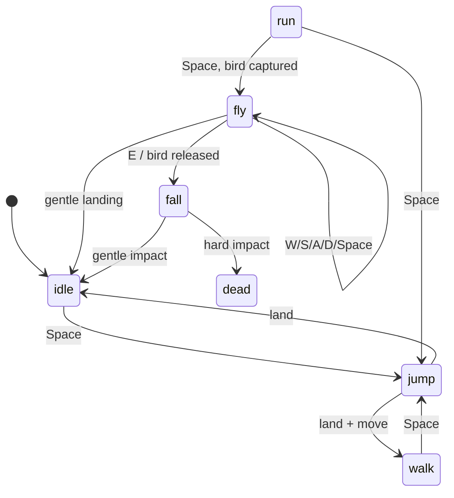

# Captured-bird flight — design proposal

**Status:** gameplay contract proposed; the shared crate's R0 has landed
(`crates/flight`, 35 unit tests plus a doctest). No client integration yet.
**Feature owner:** `mods/birds/`.
**Core work:** yes — this is not implementable in the mod alone (see §2).
**Implementation home:** the mechanics live in `crates/flight`; see
`FLIGHT-RUST.md` for the architecture and the binding seams. This document is
the gameplay contract either way.
**Targets:** the reference scene (`crates/goats/src/game/`) and the Godot port
(`godot/src/`), then the wire (`crates/proto/`, both `net` bridges).

The feature: a bird that lands on a goat can be *captured* when the goat jumps.
A goat with a captured bird can run, jump and take off, then fly under the
player's control; the bird can be released in mid-air, and the goat falls.
The herd's bots can do the same, flown by an autopilot.

This document is the whole design: the player-facing rules, the core mechanics,
the mod's changes, the new API, the tuning tree, the wire, the per-client
implementation plan and the tests. It is deliberately written before any code so
the two clients can be implemented against one contract rather than drifting
apart.

---

## 1. The player experience

### 1.1 The loop

1. A bird lands on the back of a goat that is standing still (the existing
   `ST.PERCH` landing, `pickPerch`/`stepLand`).
2. The goat jumps. The bird is **captured**: it stays on the back and the goat
   gains the **flight capability**. This is the only way to capture a bird.
3. With a captured bird, a **running jump** takes off: run forward (`Shift+W`)
   and press `Space` instead of jumping. The goat leaves the ground and the HUD
   switches to flight.
4. In the air the controls change:
   - `W` — pitch down / descend
   - `S` — pitch up / ascend
   - `A` — bank left
   - `D` — bank right
   - `Space` — flap the bird's wings (a lift and speed burst)
   - `E` — release the bird; the goat free-falls
5. A gentle ground contact ends the flight and the bird stays captured, so the
   goat can run and jump again. A hard contact does fall damage.
6. Releasing the bird (`E`) ends the capability: the bird flies off, the goat
   falls, and the landing applies fall damage based on impact speed. It must
   catch another bird to fly again.
7. A captured bird is still a bird on the goat's back: the existing perch heal
   (`blessGoat`) applies while it rides. That is the energy source that makes a
   long flight viable.

### 1.2 Capture vs. take-off

These are two separate jumps, deliberately:

| Jump | Goat state | Result |
| --- | --- | --- |
| Jump with a bird perched, on the ground, no capability | `jump` | Bird becomes captured; capability granted |
| Running jump with a captured bird | `fly` | Take-off |

The first jump is ordinary. The capture is registered on its first frame, but
the bird is only drawn in its `RIDE` pose once the goat is out of the `jump`
mode; this avoids the bird hanging in the air under a goat whose visual hop is
clip root motion rather than `py`.

A **running** jump is required for take-off, not merely a jump: the same
condition that chooses `Run` as the gait (`gait === "run"` and `move > 0`). A
standing or walking jump is still an ordinary jump and does not launch.

### 1.3 What the player sees

- A captured bird is visibly on the goat's back in the air, banking and pitching
  with it, and flapping hard.
- The goat is drawn pitched and banked as a whole, pivoting about the body centre
  rather than the hooves (the same correction `flingDraw` already makes).
- The HUD state word says `flying`, and while flying a one-line control hint is
  shown. The existing "EAT" prompt is hidden in the air (`E` is release there).
- On release, the bird takes off with a squawk and the goat falls; a hard landing
  uses the existing damage pulse, and a lethal one plays the death clip.

### 1.4 Edge cases

- **One captured bird per goat.** If several birds are perched when the jump is
  registered, the nearest to the goat is captured and the rest stay perched (they
  will leave when the goat moves).
- **A captured bird never leaves on its own.** It ignores the perch duration and
  the "moving goat" test until the goat releases it, dies, or is unloaded.
- **Death releases the bird.** The bird flies off; a corpse does not carry a
  bird. The goat's next life starts without a capability (`restart` clears it).
- **A blast overrides flight.** Being flung by a device ends the flight, knocks
  the bird off and applies the normal blast arc. The bird does not tumble with
  the goat.
- **A flying goat is airborne everywhere.** Mines and trapped tufts do not
  trigger, ground-only things (portals, eating, wading drag) do not apply, and
  two goats only collide when they are at similar heights.
- **The menu/console freezes flight** like every other world update (`dt === 0`).

---

## 2. Why this needs core work

The mod's surface today cannot express any of it:

| Need | Available today | Missing |
| --- | --- | --- |
| Capture a bird on a jump | `goats.on("mode")` (reference) or polling `player.state().mode` | — (mod can detect) |
| Make a goat fly | `player.setMode` accepts only the ground gaits and `sleep` (not `jump`/`fly`/`fall`) | no `fly` mode, no vertical position, no velocity, no pitch/roll |
| Read input in flight | none | the core owns input; a world mod gets `update(dt)` only |
| Make the goat fall | `teleport(x,z)`, `giveHealth`, `setMode` | no free-fall, no fall damage |
| Fly a bot | `zoomies`, `startle`, `teleport`, `face` | no vertical motion, no mode write, no steering |
| Put the bird on a pitched/banked back | `player.state().y` (height), bots have no `y` | `pitch`, `roll`, bot `y` |
| Sync a flying goat/bot | `Gait` is a closed enum; `py` exists | `Fly`/`Fall` gaits and pitch/roll on the wire |

So the core gains a small, generic **flight controller** for the player and the
herd. It knows nothing about birds: a mod grants the capability and the core
flies the entity. That keeps the input mapping, physics, landing and fall damage
identical on both clients, and leaves the goofy part (birds, capture, release,
wingbeats) in the mod.

---

## 3. Core mechanics

### 3.1 Modes and the capability

Two new modes join the state machine:

```
idle | walk | trot | run | jump | flung | sleep | eat | dead | fly | fall
```

and one new per-entity flag:

- **`flight`** — the *capability*: this goat may take off. It is not a mode. It
  is granted when a bird is captured and cleared when the bird is released,
  the goat dies, or the game restarts. It survives landing, sleeping and being
  flung (but a blast releases the bird, so the mod clears it).

`fly` is the powered flight; `fall` is the released free-fall. Both are airborne
for every existing airborne test (`goatAirborne`, `botAirborne`, `airborne`,
`waterActorStep`'s wetness, portal rings and so on).



### 3.2 Player state

Beside `flingY/VX/VY/VZ`, the player gains:

```js
let flightCapable = false;   // the bird is aboard
let flightY = 0;             // absolute base height (like flingY)
let flightVY = 0;            // m/s
let flightSpeed = 0;         // horizontal airspeed, m/s
let flightPitch = 0;         // radians about the model's +Z; + raises the nose
let flightRoll = 0;          // radians about the model's +X; + drops the right side
let flightFlapCool = 0;      // seconds until the next flap
let flightFlaps = 0;         // flaps since take-off (for a rider's wingbeat)
let flightTime = 0;          // seconds airborne
let fallY = 0, fallVY = 0, fallVX = 0, fallVZ = 0, fallDead = false;
```

`goat.py` remains the height above the ground, derived every frame from
`flightY - terrainHeight(px, pz)` in `fly` and `fall`, exactly as the flung arc
already derives it. This is what makes a slope crossed mid-air not drag the goat.

The bot gets the same fields (`flyY`, `flyVY`, `flySpeed`, `pitch`, `roll`,
`flapCool`, `flaps`, `flyTime`, `flightCapable`, `flightCooldown`), reusing the
existing `flyY/flyVX/flyVZ/flyVY` names where the flung arc already uses them.

### 3.3 Take-off

Take-off is triggered inside the jump path, so both clients get it for free:

```js
// startJump(move, gait), before mode = "jump"
if (flightCapable && gait === "run" && move > 0) {
    startFlight();          // returns without starting a jump
    return;
}
```

The bot's zoomies hop is the same rule:

```js
if (b.flightCapable && b.flightCooldown <= 0) startBotFlight(b);
else { /* the existing jump */ }
```

`startFlight()`:

- legal from `idle/walk/trot/run/jump`; refused from `dead/sleep/eat/flung/fall`;
- `flightY = terrainHeight(px, pz) + py` (so a take-off from a jump starts where
  the goat is);
- `flightSpeed = max(current horizontal speed, T.flight.minSpeed)` — from a jump
  that is the frozen `jumpSpeed`, from the ground the current gait speed;
- `flightVY = T.flight.takeoffLift`, `flightPitch = T.flight.takeoffPitch`,
  `flightRoll = 0`, `flightTime = 0`, `flightFlaps = 0`;
- `mode = "fly"`, costs `stats.jumpEnergyCost` (it is a jump), plays the jump
  bleat.

There is also a scripted form (new API): `player.fly()` / `bot.fly()`, which
bypasses the run check and starts a flight from any legal mode. It is what the
manifest command and the tests use; the gameplay path is always run + jump.

### 3.4 The flight model

Arcade, not aerodynamics: one model, simple enough to transcribe exactly and
tune by feel. All angles in radians; the model's local frame is +X forward,
+Y up, +Z across the body (the first two are what every existing draw assumes).
`T` below is `TUNING.flight`.

Every `fly` frame, in this order:

```js
// 1. controls. `move` is W(+1)/S(-1); `turn` is A(+1)/D(-1).
const pitchIn = -move;                 // W -> nose down
const rollIn  = -turn;                 // A -> left bank (negative roll)
const targetPitch = pitchIn * T.pitchMax;
const targetRoll  = rollIn  * T.bankMax;
flightPitch += clamp(targetPitch - flightPitch, -T.pitchRate * dt, T.pitchRate * dt);
flightRoll  += clamp(targetRoll  - flightRoll,  -T.bankRate  * dt, T.bankRate  * dt);

// 2. bank turns the goat. Positive roll is a right bank, so it lowers yaw.
const speedFrac = clamp(flightSpeed / T.speed, 0.5, 1.5);
yaw += -(flightRoll / T.bankMax) * T.turnRate * speedFrac * dt;

// 3. airspeed eases to cruise; a flap adds a burst.
flightSpeed += (T.speed - flightSpeed) * Math.min(1, dt * T.speedResponse);
flightSpeed = clamp(flightSpeed, T.minSpeed, T.maxSpeed);

// 4. the pitch decides a target vertical speed; the actual one eases to it.
const targetVy = flightSpeed * Math.sin(flightPitch) * T.climbGain - T.sink;
flightVY += (targetVy - flightVY) * Math.min(1, dt * T.vyResponse);
if (flapPressed) flap();               // adds T.flapLift to flightVY and speed

// 5. move.
flightY += flightVY * dt;
px += Math.cos(yaw) * flightSpeed * dt;
pz += -Math.sin(yaw) * flightSpeed * dt;
py = flightY - terrainHeight(px, pz);

// 6. ceiling.
const ground = terrainHeight(px, pz);
if (flightY > ground + T.ceiling) {
    flightY = ground + T.ceiling;
    if (flightVY > 0) flightVY = 0;
}
```

At level pitch the goat sinks at `T.sink`; `S` pitches up and climbs; `W` dives.
`Space` is a strong burst that also restores airspeed, so a stall is recoverable.
The model has no lift/energy coupling in v1 on purpose: it is easy to keep
identical in two languages and easy to tune. A lift model is a later tuning pass,
not a protocol change.

`flap()`:

```js
if (mode !== "fly" || flightFlapCool > 0) return false;
if (stats.energy < T.flapEnergy) return false;     // tired birds flap weakly
stats.energy -= T.flapEnergy;
flightVY += T.flapLift;
flightSpeed = Math.min(T.maxSpeed, flightSpeed + T.flapSpeed);
flightFlapCool = T.flapCooldown;
flightFlaps += 1;
return true;
}
```

Flight itself drains `TUNING.stats.energyDrain.fly`. The bird's `blessGoat`
(4 energy/s) can more than offset it; a captured bird is therefore a real
engine, and a flock of perched birds is still a heal.

The frame's `curSpeed` becomes `flightSpeed` in `fly` (the aerial speed) and the
horizontal magnitude in `fall`, so `player.state().speed`, the HUD and the wire
all report the real number.

### 3.5 Landing

Ground contact is tested at the goat's base height, using the same `rest` the
flung arc uses (`haveModel ? 0 : V_DROP`):

```js
const rest = haveModel ? 0 : V_DROP;
const ground = terrainHeight(px, pz);

// Never let a climb put the goat under the ground. On the take-off frame the
// goat sits exactly on `ground + rest` with a positive `flightVY`, so this is
// also the branch that must *not* land it.
if (flightVY > 0 && flightY < ground + rest) flightY = ground + rest;

// Descent reaching the ground is the landing.
if (flightVY <= 0 && flightY <= ground + rest) {
    landFromFlight(-flightVY);          // impact = downward speed, m/s
}
```

`landFromFlight(impact)` applies fall damage if `impact > T.safeFall`, then:

- `py = haveModel ? 0 : V_DROP` (the base sits on the ground), `pitch = roll = 0`;
- `health > 0 ? (mode = move !== 0 ? gait : "idle") : die()`;
- `flightFlaps = 0`, `flightVY = 0`.

The bird stays captured. A slope met while climbing clamps the goat to the
surface rather than letting it sink into the hill; a descent that reaches the
surface lands. That is the honest reading of "the goat met the ground".

### 3.6 Release, free fall and fall damage

`release()` is the `E` action in `fly` and the core's "the bird is gone" path:

```js
if (mode !== "fly") return false;
flightCapable = false;                   // the bird is no longer aboard
fallY = flightY;
fallVX = Math.cos(yaw) * flightSpeed;
fallVZ = -Math.sin(yaw) * flightSpeed;
fallVY = flightVY;
fallDead = health <= 0;
mode = "fall";
return true;
```

`fall` integrates true gravity (`T.gravity`, around −32 m/s², *not* the blast's
−72) with the horizontal momentum frozen. A release while still climbing starts
with a positive `fallVY`; the same rule as the flight applies -- clamp the
falling goat to the surface while it is still moving up, and only land once it is
coming down. On contact:

```js
const impact = Math.max(0, -fallVY);
const damage = Math.max(0, impact - T.safeFall) * T.fallDamage;
health = Math.max(T.fallHealthFloor, health - damage);
if (health <= 0 || fallDead) die();      // the death clip plays on the ground
else mode = move !== 0 ? gait : "idle";
py = haveModel ? 0 : V_DROP;
```

Fall damage is deliberately capable of killing (`fallHealthFloor` defaults to 0):
releasing is a choice, unlike a mine you walked onto, which keeps the blast's
floor of 1. A low release (under `safeFall`) does nothing at all, so the goofy
"hop off at a metre" is safe. `updateStats` treats `fall` as a no-drain, no-death
state until contact (`fallDead` carries a lethal fall), so the goat cannot die
halfway down.

The mod must not heal a goat at `health <= 0` while it is falling: `blessGoat`
gains that guard, or a captured bird would revive the falling goat mid-air.

### 3.7 Death, blasts and other systems

- **Death in flight** — `release()` into `fall` with `fallDead = true`; the goat
  falls, and `die()` runs on contact. No corpse hangs in the air.
- **Blast** — `startFling` takes over from `fly`/`fall`: mode becomes `flung`,
  the flight state stops mattering, and the mod sees the mode change and releases
  the bird. `blast` should also ignore goats above a `blastHeight` (around 4 m)
  so a bomb does not swat a goat out of the sky; a 3D check or a height guard is
  enough.
- **Water** — a flying goat is not wading. `waterDragFraction` and the water
  drain must return 1 while `mode === "fly" || mode === "fall"`; the wake already
  reads `py`, so a goat over a pool does not splash. Landing on the terrain under
  a pool is the existing wading rule (no swimming yet).
- **Mines/traps** — `goatAirborne`/`botAirborne` include `fly` and `fall`, so no
  ground trigger fires. A bot's own `tripHerd` is covered by the same helper.
- **Portals** — `PORTALS.step()` gains a height guard (`py <= 0.5`); a goat
  flying over a ring must not join a host.
- **Eating** — `E` is release in flight; `foodReady` is false and the HUD's eat
  prompt is hidden in `fly`/`fall`.
- **Collisions** — `collidePairs`/`resolveGoatCollisions` become height-aware:
  two goats only push apart when their heights overlap (for example
  `|py1 - py2| < 1.0`). A goat flying over the herd must not shove it.
- **Sleep/eat** — `setMode` refuses `sleep`/`eat` while flying, and a flying goat
  cannot be put to sleep by a script. The auto-sleep branch is grounded-only
  already.
- **Restart** — clears `flightCapable`, all flight/fall state, and `py = 0`.

### 3.8 Bots

Bots get the capability from the mod (a bird captured on their back). Their
take-off is the zoomies hop, intercepted by the rule in §3.3. Once in `fly`, an
autopilot flies them; a client never simulates it (`netWorldLocal()` already
gates `updateBots`).

The autopilot is a ring around the player, which keeps the herd visible and
looks like the birds' own flocking:

```js
bot.flyAngle += T.botTurn * bot.orbitDir * dt;        // orbitDir = index parity
const tx = goat.px + Math.cos(bot.flyAngle) * T.botRadius;
const tz = goat.pz - Math.sin(bot.flyAngle) * T.botRadius;
const ty = terrainHeight(tx, tz) + T.botAltitude;

// steer, bank, pitch toward the ring point and its height
const wantYaw = Math.atan2(-(tz - bot.z), tx - bot.x);
bot.yaw += clamp(angleDelta(wantYaw, bot.yaw), -T.botYawRate * dt, T.botYawRate * dt);
bot.roll = clamp(angleDelta(wantYaw, bot.yaw) * T.botBankGain, -T.bankMax, T.bankMax);
bot.pitch = clamp((ty - bot.flyY) * T.botPitchGain, -T.pitchMax, T.pitchMax);
if (bot.flyY < terrainHeight(bot.x, bot.z) + 2) bot.pitch = T.pitchMax;  // terrain guard

// flap when low, then the same vertical model as the player
if (bot.flyY < ty - 1 && bot.flapCool <= 0) flapBot(bot);
```

After `T.botTime` seconds it stops orbiting and pitches down until it lands; on
landing it gets `T.botCooldown` seconds on the ground (so a bird that stays
captured does not produce an infinite take-off loop). Its `py` is published like
any other height, and a bot killed in the air keeps its arc (the existing dead
bot's `py > 0` fall).

The mod starts the loop by granting the capability on the capturing jump. That
jump was itself one of the bot's zoomies hops, so its `zoom` clock is still
running and the next hop is the take-off; the mod must not call `zoomies()`
mid-jump, because that writes `mode = "run"` and cancels the jump.

### 3.9 Rendering and pivots

The goat is drawn with a whole-body rotation composed exactly like the birds'
`bodyQuatInto` (yaw about +Y, pitch about the model's +Z, roll about the model's
+X). Both current draw paths already have the machinery:

- **Reference** — `flingDraw` in `model.js` composes two rotations into one
  axis-angle for `rl.drawModelEx`; flight needs three. Extract the quaternion
  composition into one helper (`flightDraw`), pivot the model about the body
  centre exactly as `flingDraw` does (reuse `TUNING.explosions.fling.pivot`; it
  is already the body's centre), and use it for `drawModelGoat` and for mirrored
  peers/bots.
- **Godot** — `PlayerGoat._place` sets `position` and `rotation.y`; add a full
  `Basis` for `fly`/`fall` and the same pivot correction. `Herd` applies the
  wired pitch/roll to a mirrored goat's basis. The exact axis order is pinned by
  a shared gate test, not by prose.

Clip contract: add optional `fly` and `fall` roles. Until a `GoatFly`/`GoatFall`
action exists in the model, both fall back to the `jump` clip, held at a fixed
pose fraction (around 0.35) so it reads as a leap rather than a looping hop, with
the root rotation carrying the flight. With a real `GoatFly`, advance `phase`
with `loopDuration()` as the other looping gaits do; a real `GoatFall` is posed
from its own progress. Add `fly`/`fall` to the role lists (`CLIP`, `VARIANTS`,
`ROLES`, `netPeerShot` where the one-shot rule is decided) and to
`Herd._clip_for` with a `GoatJump` fallback.

The birds' `drawBird` already composes yaw/pitch/roll through
`bodyQuatInto`; a riding bird uses the same path with the goat's angles.

---

## 4. The Birds mod

### 4.1 New bird state

Add one state and one flag:

```js
const ST = { ..., RIDE: 7 };                 // "ride"
ST_NAME = [..., "ride"];
b.captured = false;                          // the bird is a captured rider
b.tpitch = 0; b.troll = 0;                   // mirror targets for pitch/roll
```

`RIDE` is the published state for a captured bird; `PERCH` remains "sitting on a
goat but not captured". The distinction matters to a mirroring client, which is
not told who a bird's rider is but can draw a `RIDE` bird from the wire.

### 4.2 Capture

`updateRiders()` runs at the top of `simulate(dt)`, after the core has updated
the goat and the herd. It polls rather than relying on the `"mode"` event, because
the Godot port's event surface is partial and the mod must behave the same on
both clients:

```js
const p = goats.player.state();
if (p.mode === "jump" && lastPlayerMode !== "jump") {
    const b = nearestPerchedOn(PERCH_PLAYER);
    if (b !== null) captureBird(b, PERCH_PLAYER);
}
lastPlayerMode = p.mode;

const list = goats.bots.list();
for (let i = 0; i < list.length; i++) {
    if (list[i].mode === "jump" && lastBotMode[i] !== "jump") {
        const b = nearestPerchedOn(i);
        if (b !== null) captureBird(b, i);
    }
    lastBotMode[i] = list[i].mode;
}
// The herd can be resized under the table; a shorter list leaves stale entries
// that the next bot at that index would inherit, so trim it here.
lastBotMode.length = list.length;
```

`captureBird(b, rider)`:

- `b.captured = true; b.perch = rider; b.sent = false;`
- keep `ST.PERCH` for the rest of the goat's jump and move to `ST.RIDE` when the
  rider is no longer in `jump` (avoids the clip-hop gap described in §1.2);
- `goats.player.setFlight(true)` or `goats.bots.get(rider).setFlight(true)`;
- a bot is captured on a jump it took *during* a zoomies run, so its `zoom`
  clock is still running and it will hop again; do not call `zoomies()` here --
  it sets the mode to `run` and would cancel the jump that just captured the
  bird. If a nudge is ever needed, call it once the bot has left `jump`;
- a squawk and a wing flare for the joke.

All capture state changes are gated on `goats.net.localWorld()`: the world's
owner simulates the flock. A joiner mirrors a `RIDE` bird; it does not capture one
(see §8).

### 4.3 The ride pose

A captured bird follows its rider in 3D, not just in the ground plane. The
back point is on the goat's *drawn* body, which is pivoted about the body centre
rather than the hooves (the same correction `flingDraw` makes). With `R` the
goat's yaw/pitch/roll rotation and `pivot` the body-centre offset the flung arc
already uses (`goats.tuning.get("explosions.fling.pivot")`):

```
feet = groundAt(x, z) + y          // the goat's base, the physics height
back = feet + (0, pivot, 0) + R * (0, PERCH_H - pivot, 0)
```

At zero pitch/roll this is `feet + (0, PERCH_H, 0)`, the existing perch height;
a pitched goat rotates the rider about the same point its mesh rotates about.
The mod already has the quaternion helpers (`qAxisInto`, `qMulInto`, `qRotInto`),
so this is the existing `bodyQuatInto` math with the goat's angles and a shifted
local offset.

```js
function riderTarget(b) {
    if (b.perch === PERCH_PLAYER) {
        const p = goats.player.state();
        return { x: p.x, z: p.z, baseY: groundAt(p.x, p.z) + p.y,
                 yaw: p.yaw, pitch: p.pitch, roll: p.roll,
                 flying: p.mode === "fly", speed: p.speed };
    }
    const bot = goats.bots.get(b.perch);
    if (bot === null) return null;
    return { x: bot.x, z: bot.z, baseY: groundAt(bot.x, bot.z) + bot.y,
             yaw: bot.yaw, pitch: bot.pitch, roll: bot.roll,
             flying: bot.mode === "fly", speed: 0 };
}
```

`stepRide(b)` sets `b.x/y/z` from the `back` point above, `b.yaw` from the
rider, and `b.pitch`/`b.roll` from the rider plus a small cosmetic offset. It
ignores `dur`, `speed` and `tooFar`. `stepPerch` keeps the old behaviour for a
non-captured bird, but treats `captured` as "ignore the moving-goat rule and the
perch timer".

`flapFor(ST.RIDE)` is a strong, fast wave (`flapWave(b.t, 0.9, 3.2)`). The wingbeat
is derived from the state clock on both ends, so nothing extra is published; the
goat's `Space` flap is a physics burst and the bird is already flapping hard. If
a later polish wants the exact wingbeat, publish the flap counter as an eighth
row value (§6.2).

### 4.4 Release

The core owns the release: `E` in `fly` clears `flightCapable`, enters `fall`,
and the mod sees it. The mod's release check is part of `updateRiders()`:

```js
// for each captured bird
if (rider is player and (p.mode === "fall" || p.mode === "dead" || !p.flight)) releaseBird(b);
if (rider is bot and (bot === null || bot.mode === "fall" || bot.mode === "dead" || !bot.flight)) releaseBird(b);
```

`releaseBird(b)`:

- `b.captured = false; b.perch = -1;`
- `startTakeoff(b)` so the bird flies away on its own, and a squawk;
- the core's capability is already false; on death/unload the mod calls
  `setFlight(false)` explicitly.

A normal landing keeps `captured` and the capability: the bird stays on the back,
and the next run + jump takes off again. If the rider was the player and the goat
restarts, the mod sees the mode go to `idle`/`walk` from `dead` and clears the
capture (the core also clears the capability on `restart`).

### 4.5 Perch and flock interactions

- `pickPerch`/`stepLand` still require a standing goat, so capture always starts
  from a bird that has genuinely landed.
- `blessGoat` counts `ST.RIDE` as well as `ST.PERCH`; a captured bird heals its
  goat on the ground and in the air. It skips a goat at `health <= 0`.
- `tripDevices` only runs for `IDLE`/`WALK`; a rider never trips a device.
- `separateFlock` does not include `RIDE`; two birds on one goat cannot push each
  other.
- `tooFar` is ignored for a captured bird; it goes where its goat goes.
- `placeBird`'s non-finite recovery re-attaches a captured bird to its rider
  rather than dropping it on the ground.
- `startTakeoff` clears `perch` and `captured`; use it for release.

### 4.6 Commands

`birds fly` already means "the whole flock takes off"; it keeps that meaning.
Extend the `birds` verb:

| Command | Meaning |
| --- | --- |
| `birds mount` | Put `BIRDS[0]` on the player's goat in `RIDE` and grant flight (the test/demo path). |
| `birds drop` | Release the player's captured bird and call `player.release()` if flying. |
| `birds ride [bot]` | Put a bird on bot `[bot]` in `RIDE`, grant flight and start its zoomies. |
| `birds` (no verb) | Status adds `captured: n` and the riders, beside the existing state counts. |

A feature check keeps the mod usable on an older client:

```js
const FLIGHT_API = typeof goats.player.setFlight === "function";
```

If it is absent, `mount`/`ride` answer an error and normal flock behaviour is
unchanged. On a client in a session, `mount`/`ride`/`drop` answer that the world
is the host's; the joiner can watch a `RIDE` bird but does not own the flock
(§8).

---

## 5. New API surface

Everything is additive to API v1. Shapes are documented in the same style as
`APIv1.md` §4.5 and §4.8.

### 5.1 `goats.player`

```js
const s = goats.player.state();
// adds to the existing snapshot:
//   flight  boolean  the captured-bird capability is granted
//   flying  boolean  mode is "fly"
//   pitch   number   radians about the model's +Z; + raises the nose (0 when grounded)
//   roll    number   radians about the model's +X; + drops the right side
//   flaps   number   flaps since take-off (0 when grounded)

goats.player.setFlight(on);   // true/false; the capability, not a mode
goats.player.fly();           // scripted take-off; true if it started
goats.player.release();       // the E action; true if it was flying
```

Semantics:

- `setFlight(true)` arms the goat. The next **running jump** takes off. It does
  not move the goat.
- `setFlight(false)` while flying is a release: the goat enters `fall` (with the
  fall damage on contact). On the ground it just clears the capability.
- `fly()` is the scripted form of run + jump; it requires the capability and a
  legal mode (`idle/walk/trot/run/jump`), and returns `false` otherwise.
- `release()` returns `false` unless the mode is `fly`.
- `setMode` still refuses `fly` and `fall`: `fly()` is the way into the air and
  `release()` the way out, so a script cannot skip the capability check.
- A dead, sleeping or eating goat keeps the capability but cannot take off.
- `restart()` clears the capability and all flight state.

### 5.2 `goats.bots`

`list()` and `get(i)` rows gain:

```
y       height above the ground, metres (the player's `y`)
pitch   radians, as above
roll    radians, as above
flight  the capability
flying  mode is "fly"
flaps   flaps since take-off
```

and the handle gains three verbs:

```js
const b = goats.bots.get(i);
b.setFlight(on);   // capability; ignored on a client (the host owns bots)
b.fly();           // scripted take-off
b.release();       // end a flight into a fall
```

The `mode` field already reports `"fly"`/`"fall"` once the core has them.

### 5.3 Lifetime and ownership

`setFlight` is **not** owner-tracked in v1 (unlike `explosions.armed`): the
capability is one boolean per goat, last call wins. The birds mod is its only
caller and clears it on release, death and `"shutdown"`. If a second mod ever
grants flight, promote it to an owner-keyed grant the way `armed` is; that is a
larger change and is not needed for this feature.

On a client in a session, bot writes are ignored exactly as the existing bot
verbs are; the player's own goat is local and its capability works.

---

## 6. Tuning and the wire

### 6.1 Tuning tree

Add a `flight` subtree (and one stats leaf):

```
stats.energyDrain.fly        2.5    energy/s while flying
flight.enabled               1      0 disables the mechanic (bisect)
flight.takeoffLift           5.0    m/s upward impulse at take-off
flight.takeoffPitch          0.25   rad, nose-up at take-off
flight.speed                 9.0    cruise airspeed, m/s
flight.minSpeed              5.0
flight.maxSpeed              14.0
flight.speedResponse         1.2    per second toward cruise
flight.pitchMax              0.55   rad
flight.pitchRate             1.6    rad/s
flight.bankMax               0.75   rad
flight.bankRate              2.2    rad/s
flight.turnRate              1.4    rad/s at full bank and cruise
flight.sink                  1.2    m/s at level pitch
flight.climbGain             1.0    vy share of speed * sin(pitch)
flight.vyResponse            3.0    per second toward the target vy
flight.flapLift              5.0    m/s impulse
flight.flapSpeed             1.5    m/s airspeed gain
flight.flapCooldown          0.45   s
flight.flapEnergy            1.2    energy per flap
flight.ceiling               60     metres above the ground below
flight.gravity              -32.0   m/s² for `fall` (not the blast's -72)
flight.safeFall              12.0   m/s impact that does no damage
flight.fallDamage            2.2    health per m/s over safeFall
flight.fallHealthFloor       0      a fall may kill
flight.blastHeight           4.0    metres above the ground a blast reaches
flight.botAltitude           8.0    metres a bot holds
flight.botRadius             18.0   metres of the orbit ring
flight.botTime               18.0   seconds a bot stays up
flight.botCooldown           8.0    seconds on the ground between bot flights
flight.botTurn               0.9    rad/s around the ring
flight.botYawRate            1.5    rad/s toward the ring point
flight.botPitchGain          0.12   rad per metre of altitude error
flight.botBankGain           1.5
```

Clamps: angles stay in sane ranges (`pitchMax`/`bankMax` in `[0, 1.4]`),
`gravity` negative, `safeFall`/`fallDamage` non-negative, `ceiling` at least 5,
`pivot` (reused from the flung arc) in `[0, 2]`. The exact numbers are tuning,
not contract; the *shape* (pitch/roll signs, order of operations, the fall
formula) is.

### 6.2 Wire and protocol

The wire is the one part that cannot be additive. Bump `PROTOCOL_VERSION` 11 → 12
and append to the gait enum:

```rust
pub enum Gait {
    Idle, Walk, Trot, Run, Jump, Flung, Sleep, Eat, Dead,
    Fly,   // powered flight (appended)
    Fall,  // released free-fall (appended)
}
```

`PeerState` and `BotState` gain two quantized angles:

```rust
pub pitch: i8,   // degrees, + nose up
pub roll: i8,    // degrees, + right bank
```

Both carry `#[serde(default)]` for the JSON bridge, exactly as `py` does; the
binary datagram is positional and versioned, so a missing field there is a
refusal rather than a default.

`py` already carries the height; for flight it becomes the same "height above
the ground" it is for flung. `net.js` publishes `py` for `fly`/`fall` as well as
`flung`, and adds degrees for pitch/roll (0 when grounded). The Godot bridge
does the same in `crates/godot/src/net.rs` and `main.gd`'s `_publish_pose`.

Budget: two bytes per peer and two per bot. A 100-bot world adds ~200 bytes
across its parts; the fields are fixed-width and positional, so the split-world
budget test gets a new upper bound rather than a variable-length encoding. The
gait enum grows by two variants; the version bump is what stops an old peer
misreading them.

Mirroring:

- `netPeerShot` adds `fall`; `fly` is a loop. When the model has no `GoatFly`
  or `GoatFall`, both are posed from the jump fallback at a fixed fraction
  (0.35), so a mirrored goat does not loop a gallop in mid-air; if a real clip
  exists, `fly` uses the loop phase and `fall` uses its own progress.
- `peerRole`/`botRole`/`clipRole` add `fly`/`fall` with the jump fallback.
- Reference `drawPeers` and bot drawing use `flightDraw` for `fly`/`fall`, with
  the wired pitch/roll and the pivot correction.
- Godot `Herd.apply` reads the same fields, converts degrees to radians, and
  eases pitch/roll alongside yaw (a smoothed bank lags by a frame; the trajectory
  is still the host's).
- The birds mod's `publishRows` row grows from 5 to 7 numbers:
  `[x, y, z, yaw, st, pitch, roll]`. `publishRows` already accepts up to 8 wide.
  `apply` reads the last two if present and defaults them to 0, so an old row is
  still readable (though the mod hash prevents a mixed session anyway).

The mod's version goes to **1.1.0**: its published table shape changed, so its
hash changes and the join handshake refuses a mismatched peer, which is the
intended behaviour.

---

## 7. Implementation plan — one Rust core, two bindings

The mechanics live in **`crates/flight`**, a pure, engine-free Rust crate (see
`FLIGHT-RUST.md`). It owns the controller, the transitions, fall damage, the bot
autopilot, the pose and the tuning defaults. Each client keeps only the
integration.

| `crates/flight` (Rust) | Reference integration | Godot integration |
| --- | --- | --- |
| `Config`, `State`, `Input`, `Outcome` | `crates/flight-js` installs a `__flight` global; `goat.js`/`bots.js` call it in the `fly`/`fall` branches | `crates/godot/src/flight.rs` exposes a `Flight` class; `player_goat.gd`/`bots.gd` call it |
| `can_take_off`, `start`, `step`, `release`, `fall_damage` | mode/stats/input integration around it | mode/stats/input integration around it |
| `bot_input`, `pose`, `axis_angle`, `back_point` | `model.js` draws from the returned pose | `pose.gd`/`_place` build the basis from it |
| defaults and clamps | `core.js`/`tuning.gd` map their leaves into `Config` | same |

The crate is the specification for the maths; the client code is the binding and
is judged by the gates. `FLIGHT-RUST.md` §4/§5 have the exact seams.

### R0 — the shared crate and its tests

**✅ Landed.** `crates/flight/`: `Cargo.toml` (no dependencies), `src/lib.rs` and
the modules. The public surface is `FLIGHT-RUST.md` §3: `Config` (defaults +
`validate`), `State`, `Input`, `Events`/`Outcome`, `can_take_off`, `start`,
`step`, `release`, `fall_damage`/`apply_fall_damage`, `bot_input`,
`Quat`/`AxisAngle`, `pose`, `back_point`. Unit and property-style tests live with
it.

**Gate:** `cargo test -p flight` (35 tests plus a doctest) and
`cargo clippy -p flight --all-targets -- -D warnings`.

### R1 — the reference binding and the player flight branch

**✅ Landed.** `crates/flight-js` is the Slag binding (`create_object`,
`create_function`, `set_global`) over `flight`, and it is a crate of its own
because all three hosts evaluate the same JavaScript but only the client links
raylib. It is installed before `context.eval(SCENE)` in `crates/goats/src/lib.rs`
`run()`, `crates/server/src/headless.rs` `Sim::start` and
`crates/harness/src/lib.rs` `Harness::start`.

`goat.js` has the player's `fly`/`fall` branches: the state is packed into the
binding's positional arrays, the crate steps it, and the returned numbers and
consequences (take-off cost, flap cost, drain, release, landing damage) are
written back. `model.js` draws from `pose`/`axis_angle`/`backPoint`, `core.js`
carries the `flight` tuning subtree and `stats.energyDrain.fly`, and `ctl.js`
exposes `fly`, `release` and `flight on|off`.

**Gate:** `crates/harness/tests/flight.rs` (40 cases: take-off rules, W/S/A/D,
flap/cooldown/energy, drain, release, fall damage and the lethal contact), plus
`scene_logic.rs` and `birds.rs` unchanged.

### R2 — the Godot binding and the player flight branch

**✅ Landed.** `crates/godot/src/flight.rs` is a `Flight` class (`RefCounted`) over
`flight`, with the same positional arrays the `__flight` global takes. `main.gd`
creates one after the mods' `tuning.json` merges, configures it from
`PlayerGoat.flight_config()`, hands it to the goat, and re-configures when
`Tuning.version` moves. `player_goat.gd` has the `fly`/`fall` branches: the
take-off rule in `start_jump`, the crate's step and events, the stats, the clip
role and the pose (the model rotates about `FLIGHT_PIVOT`). `tuning.gd` carries
`stats.energyDrain.fly` and the `flight` subtree, with the reference's clamps.

**Gate:** `verify_flight.gd` (the binding's arrays, ground callback, pose and
back point, then take-off/controls/flap/release/landing/restart through
`PlayerGoat`), the flight tape in `verify_goat.gd` (379 frames against the crate
itself), and `verify_pose.gd`'s flight basis and rider seat.

### R3 — the herd

**✅ Landed.** Both clients add the bot branch: the reference's `bots.js` and the port's
`bots.gd` take the grant from `flightCapable`, intercept the zoomies hop as the take-off,
and call `botInput`/`step` every frame with an unlimited-energy input. `botRole`/`bot_role`
gain the `fly`/`fall` fallback, `botAirborne`/`airborne` include them, a death in the air
keeps its height (and its momentum, as the corpse's arc), and the push-apart skips a body
with `py > 1` so a flyer does not shove the goats below it. Landing keeps the bird and
starts `flight.botCooldown`.

The wire fields (batched `pitch`/`roll`/`py`, and the mirrored herd's basis) are R4's, with
the protocol bump. The autopilot itself is the crate's `bot_input` in both clients.

**Gate:** `verify_bots.gd` (the hop rule, the ring, the landing cooldown, the airborne
guard and the death in the air) and the herd section of `crates/harness/tests/flight.rs`.

### R4 — the API, wire, mod and polish

Everything in §5, §6 and §4 that is not the physics: `setFlight`/`fly`/
`release`, the state fields, the bot row fields, the birds mod's capture/ride/
release, `Gait::Fly`/`Fall`, pitch/roll on the wire, protocol 12, the HUD/touch
polish, the optional camera follow and the `GoatFly`/`GoatFall` art.

R1 and R2 can land in either order. R4 is the same work as the original plan;
the crate changes none of it.

---

## 8. Multiplayer scope

The world mod is host-authoritative: the host simulates the flock and publishes
it, and clients mirror it. In v1 that means:

- **Host / solo:** the host's player goat and the host's bots can capture and fly.
  This is the full feature.
- **Joiner:** a joiner's own goat cannot capture a bird, because the host's flock
  does not see the joiner's goat (the mod has no peer read — there is no
  `goats.peers`). A joiner can still see the host's flying goats and bots, and
  the herd mirrors their flight correctly.

Making it work for joiners is a clean follow-up, not a redesign:

1. add `goats.peers.list()` (name, position, mode, height, pitch, roll) to the
   world-mod surface;
2. let the host's flock consider peer goats as perch/capture targets;
3. publish the rider identity in the birds' row (or a small `rider` field), so
   each client knows a bird is on *its* goat and can grant its own capability;
4. the host detects a peer's `jump` from the peer state and publishes the capture,
   exactly as it does for its own goat.

None of that changes the flight physics or the wire fields proposed here; it is
one more read and one more piece of mod state. It should be a separate slice so
the single-player/host feature is not blocked on it.

---

## 9. Testing

### Shared crate (`cargo test -p flight`)

- take-off eligibility: run jump yes, walk/standing jump and a dead/sleeping
  goat no;
- attitude and signs: `W` noses down, `S` noses up, `A` rolls left and raises
  yaw, `D` rolls right and lowers it; the clamps hold;
- the vertical model: level flight sinks, `S` climbs, the ceiling clamps;
- flap: impulse, speed gain, cooldown, energy cost, refusal at zero energy;
- release -> fall -> impact, safe/low release, the fall-damage formula and the
  health floor;
- ground contact at the rest height, a slope met while climbing, a death only on
  contact;
- bot autopilot: the ring point, the turn and pitch signs, the terrain guard,
  landing and the cooldown;
- pose and rider: the quaternion sign convention, `axis_angle`, and the back
  point at a known pitch/roll;
- a deterministic loop over many random finite states/inputs: the state stays
  finite and the clamps hold.

### Reference harness (`cargo test`)

These are now **integration** tests: the scene evaluates and calls the `__flight`
global installed by `crates/flight-js`.

- `scene_logic.rs` (or a new `flight.rs`):
  - `flight on` + run + jump enters `fly`; a walk/standing jump does not.
  - `W`/`S` change the sign of `py`'s movement; `A`/`D` change `yaw` and `roll`;
    `Space` adds height and increments `flaps`; the cooldown refuses a second
    flap.
  - `E` enters `fall`; a high release loses health by the expected amount and a
    low release loses none; a lethal fall reaches `dead` only on contact.
  - energy drains in `fly`; a flap at zero energy is refused.
  - a flying goat does not trigger a mine/trap; a hard flight landing damages;
    a gentle one lands and keeps the capability.
  - `restart` clears the capability.
- `birds.rs`:
  - `birds mount` + jump captures (`state` says `ride`); run + jump flies;
    `E` makes the bird take off and the goat fall.
  - a captured bird's position tracks the goat's back at a non-zero pitch/roll;
    `blessGoat` still heals in `ride`.
  - a bot capture (`birds ride 0`) starts the bot's flight; it lands after
    `botTime`; no capability means no flight.
  - the published row is seven numbers and a client mirrors `ride`.
  - unloading the mod clears the player's and bots' capabilities.
- `proto` round-trips `Fly`, `Fall`, `pitch`, `roll`; the world budget test gets
  its new upper bound.

### Godot gates

These are the *binding* tests: the GDScript integration of the same crate.

- `verify_flight.gd` (new): calls the `Flight` class directly for the maths and
  the pose, then walks take-off/landing/fall-damage through `PlayerGoat`.
- `verify_goat.gd`: extend the tape with a flight run (capability on, run, jump,
  pitch/bank/flap, release, fall, land), comparing position, `py`, mode, pitch,
  roll, health, energy, speed and flaps every frame. The oracle is the same
  `Flight` class, so the gate checks the GDScript integration rather than a
  second transcription of the maths. The wire phase waits for R4's
  `GoatFly`/`GoatFall` clips; without them the model holds its take-off pose.
- `verify_pose.gd`: the yaw/pitch/roll basis and the rider's back point at a
  known attitude.
- `verify_bots.gd`: bot take-off, orbit, landing and cooldown.
- `verify_peers.gd` / `verify_net.gd`: `peer` and `world` payloads with
  `fly`/`fall` and pitch/roll, and a mirrored model's basis.
- `verify_mod_surface.gd`: `player.setFlight/fly/release`, the new state fields,
  bot `setFlight/fly/release`, and the birds mod's `mount` command.
- `interop.sh` (`join`/`pair`): a host with a flying goat and a flying bot is
  mirrored by a joiner; the joiner sees the flight poses, not a goat on the grass.

### What is *not* a test

The exact tuning values. A gate asserts the signs, the order of operations and
the clamps; a play-through asserts that it feels right.

---

## 10. Risks and open questions

1. **The feel of the arcade model.** Holding `S` can climb indefinitely. The
   energy drain and flap cost are the first levers; if that is not enough, the
   first tuning pass adds a lift/airspeed coupling (a climb bleeds speed, a dive
   gains it). That is a tuning change, not a wire change.
2. **Camera in a bank.** The existing chase camera is a free orbit; it does not
   follow the goat's yaw. A gentle auto-yaw in flight is proposed in R4. Without
   it the goat can turn out of the view, which is acceptable for a goofy feature
   but worth watching in play.
3. **The capture jump's visual hop.** The first capture jump still uses the clip's
   root-motion hop, and `py` stays 0, so the bird stays at the back point while
   the goat's mesh hops for ~0.6 s. Keeping `PERCH` until the jump ends hides most
   of it. A `state().hop` (the clip's root-motion height) would fix it exactly,
   but it is not worth a new field for one jump.
4. **Two mods granting flight.** v1 is last-writer-wins. If it becomes real,
   adopt `explosions.armed`'s owner-keyed request.
5. **A joiner's goat cannot capture.** See §8; the feature is complete for the
   host/solo and the herd, and the follow-up is scoped.
6. **Fall damage and the bird's heal.** The mod must not bless a goat at 0 health
   mid-fall (it would revive). The guard is in §4.5 and should be tested.
7. **Touch release.** The Android overlay has no release button. R4 adds one
   (the stick is already pitch/bank and the jump button is already flap). Until
   then, a phone can fly but cannot bail out.
8. **A `GoatFly` clip.** The fallback jump pose held at a fixed fraction is a
   placeholder. The artist's contract is one looping `GoatFly` grounded at the
   origin with no root motion, and an optional `GoatFall`; until then the root
   rotation is what sells it.
9. **The shared crate is a new boundary.** The reference calls it through a
   `__flight` native global and the port through the GDExtension; each is one
   crossing per flyer per frame, plus the terrain callback. `FLIGHT-RUST.md` §7
   bounds it and records the two callback-free alternatives. Only flyers pay it.
10. **The reference realm sees `__flight`.** It is an internal global, named and
    documented as not part of the `goats` API; the reference already exposes `rl`,
    `android` and `web` to the realm, so this is not a new sandbox hole. The Godot
    mod realm does not see the `Flight` class at all.
11. **The specification moves for this system.** For gaits, weather, bots and the
    rest the JS scene remains the reference. For flight the crate and its tests
    are the reference, because the alternatives are two transcriptions. This is
    the price of sharing and is confined to the new system.

---

## 11. File-by-file change list

**Shared (new)**

- `crates/flight/Cargo.toml` — no dependencies; pure logic.
- `crates/flight/src/lib.rs` and its modules — `Config` (defaults + `validate`),
  `State`/`Input`/`Events`, `can_take_off`, `start`, `step`, `release`,
  `fall_damage`/`apply_fall_damage`, `bot_input`, `Quat`/`AxisAngle`, `pose`,
  `back_point`, and the unit/property tests.
- `Cargo.toml` (workspace) — add the member and the `flight = { path = ... }`
  workspace dependency.
- `crates/flight-js/` (new) — the `__flight` Slag global over `flight`: install
  it in the client, the server and the harness. Depends on `slag` (without its
  raylib feature) and `flight`.

**Reference**

- `crates/goats/Cargo.toml`, `crates/server/Cargo.toml`,
  `crates/harness/Cargo.toml` — depend on `flight-js`.
- `crates/goats/src/lib.rs`, `crates/server/src/headless.rs`,
  `crates/harness/src/lib.rs` — install the global before the scene is
  evaluated.
- `crates/goats/src/game/core.js` — tuning + clamps + energy leaf, mapped into
  the crate's `Config`.
- `crates/goats/src/game/goat.js` — mode/stats/input integration and the
  `__flight.step` call; the maths is in the crate.
- `crates/goats/src/game/bots.js` — bot flight branch, `__flight.bot_input`,
  take-off hook, role, death-in-air, trig/airborne.
- `crates/goats/src/game/model.js` — `CLIP.fly/fall`, draw from
  `__flight.pose`/`axis_angle`.
- `crates/goats/src/game/mods.js` — player state + verbs; bot row fields + verbs.
- `crates/goats/src/game/net.js` — pose/world fields, peer role, mirror draw,
  `netPeerPhase`, and the portal height guard.
- `crates/goats/src/game/ctl.js` — `fly`, `release`, `flight on/off`, `jump` in
  flight, help.
- `crates/goats/src/game/touch.js` — flight stick semantics and release button.
- `crates/goats/src/game/explosions.js` — airborne tests, blast height.
- `crates/goats/src/game/water.js` — dry while airborne.
- `crates/goats/src/net.rs` — pose parse/publish.
- `crates/session/src/bridge.rs` — `parse_gait` gains `"fly"`/`"fall"` and
  `Command::Pose` gains `pitch`/`roll` (defaulted for the JSON bridge).
- `crates/proto/src/lib.rs` — gaits, fields, version.
- `crates/harness/tests/` and `crates/session/src/lib.rs` tests — new/modified
  cases and every `PeerState`/`BotState` initializer. `crates/harness/tests/flight.rs`
  (new) is R1's gate.

**Godot**

- `crates/godot/Cargo.toml` — depend on `flight`.
- `crates/godot/src/flight.rs` (new) — the `Flight` GDExtension class.
- `crates/godot/src/lib.rs` — register the class.
- `godot/src/main.gd` — create one `Flight` and inject it into `PlayerGoat` and
  `Bots`, re-configuring it when the tuning tree moves.
- `godot/src/tuning.gd`, `player_goat.gd`, `pose.gd`, `bots.gd`, `herd.gd`,
  `commands.gd`, `hud.gd`, `explosions.gd`, `water.gd`, `portals.gd`.
- `godot/tools/verify_flight.gd` (new) — R2's binding and player gate; the
  flight tape in `verify_goat.gd` and `verify_pose.gd`'s flight basis are its
  other halves.
- `crates/godot/src/prelude.js` — player/bot facades.
- `crates/godot/src/net.rs` — pose parse/publish.
- `godot/tools/verify_goat.gd`, `verify_flight.gd` (new), `verify_pose.gd`,
  `verify_bots.gd`, `verify_peers.gd`, `verify_mod_surface.gd`.

**Mod**

- `mods/birds/mod.js` — capture/ride/release, capture polling, pose math,
  commands, publish/apply, bless.
- `mods/birds/mod.json` — version 1.1.0, description.
- `mods/birds/FLIGHT.md` — this document.

**Docs**

- `APIv1.md` §4.5, §4.8, §4.10, §4.13 and §6.4 once the slices land.
- `ROADMAP.md` M14f gets a line pointing at this design and its status.
- `mods/birds/FLIGHT-RUST.md` — the shared-crate architecture.

---

## 12. Decision summary

| Question | Decision |
| --- | --- |
| Where does flight live? | **`crates/flight`**, a pure Rust crate shared by both clients; the mod grants/clears the capability. |
| Where does the physics live? | In the crate: the controller, transitions, fall damage, bot autopilot, pose and tuning defaults. The clients own the input/mode/stats/net/draw integration. |
| How is it triggered? | A **running** jump with the capability; `fly()` is the scripted form. |
| How is a bird captured? | A jump while it is perched; one bird per goat; capability granted then. |
| What are the controls? | `W` descent, `S` ascent, `A`/`D` bank, `Space` flap, `E` release. |
| Can the goat fly forever? | Energy drains; flaps cost energy; the bird's perch heal offsets it. |
| Does landing damage? | Hard `fly`/`fall` contact does; gentle contact does not. |
| Does releasing hurt? | Above `safeFall` impact, yes; a fall can kill. |
| Do bots fly? | Yes, with a ring autopilot; the mod starts it on capture. |
| What travels on the wire? | `Gait::Fly`/`Fall`, `py`, pitch/roll, protocol 12. |
| Can clients capture? | Host/solo and the herd in v1; joiners are a scoped follow-up. |
